# AISC5020 概率与统计复习大纲（Probability & Statistics for AI）

> 依据 `lec/` 下 Week 5–8 课件整理。  
> **★ = `hints.txt` 明确点名的考点**；**【重点】 = Week 7 / Week 8 / 多元概率 / 多元条件概率的加强部分**。  
> 术语第一次出现用 **中文（English）**；关键问题用 **Q（Key question）**，关键结论用 **结论（Key takeaway）**。  
> 图片来自课件关键页，保存在 `images/`；请用支持相对路径的 Markdown 预览打开。  
> 读法（How to use）：先读中文，再看紧随其后的 **English（英文对照）**；复习时可以先遮住英文自测。

---

## 0. 先看全局：这四周到底在讲什么？

| 周 | 主题（Topic） | 一句话主线（One-line story） | hints 考点 |
|---|---|---|---|
| Week 5 | 概率基础（Probability Foundation） | 从“事件”到“随机变量”，再到“联合 / 边缘 / 条件”，最后用期望和方差概括分布（From events to random variables, then joint/marginal/conditional distributions, and finally expectation and variance） | ★ Law of Total Expectation p.50；★ Law of Total Variance p.51 |
| Week 6 | 信息论（Information Theory） | 用熵衡量不确定性，用 KL / 交叉熵衡量“模型与真实分布的差距”，用 Fano 给出预测误差下界（Entropy for uncertainty, KL/cross-entropy for distribution mismatch, Fano for the error lower bound） | ★ Fano Inequality p.38–43 |
| Week 7 | 统计推断（Statistical Inference） | 用似然找参数，用损失函数训练模型，用正则化控制过拟合（Use likelihood to estimate, losses to train, and regularization to control overfitting） | 为 Week 8 的贝叶斯与正则化打基础（Foundation for Bayesian methods and regularization） |
| Week 8 | 贝叶斯统计与贝叶斯网络（Bayesian Statistics & Bayesian Networks） | 用先验 + 似然更新 posterior；用 DAG + CPT 紧凑表示高维联合分布；用 d-separation 读条件独立（Update the posterior with prior + likelihood; represent a joint distribution with a DAG + CPTs; read conditional independence via d-separation） | ★ Conjugate Priors p.5–17；★ Fisher Information p.6–7 |

### 三条贯穿线（Three threads）

1. **条件（Conditioning）主线**  
   条件概率 → 条件分布 → 条件期望 → 条件熵 / 互信息 → 条件似然 → 贝叶斯网络的条件独立。  
   > 一句话：**“给定什么信息”决定了你算的是哪个分布。**  
   > *English: What you condition on determines which distribution you are computing.*

2. **优化（Optimization）主线**  
   MLE = 最小化 KL = 最小化交叉熵 → 线性回归的最小二乘 / 逻辑回归的交叉熵 → 正则化 / MAP。  
   > 一句话：**“训练模型”很多时候就是在做“最小化分布距离”。**  
   > *English: Training a model often means minimizing a distribution distance.*

3. **不确定性（Uncertainty）主线**  
   方差 → 全方差公式 → 偏差-方差权衡 → 熵 / Fano 下界。  
   > 一句话：**“不确定性可以分解，也可以给出下界。”**  
   > *English: Uncertainty can be decomposed and can also be lower-bounded.*

### 针对薄弱点的复习顺序（Study plan for Week 7 / Week 8 / multivariate）

1. **先补多元与多元条件（第 2 章）**  
   重点：联合 → 边缘 → 条件、条件期望、全期望 / 全方差、多元正态条件公式、条件独立。  
   配套：第 2.3、2.7、2.8 节的例子，以及自测题 1–5。  
   *English: Review joint → marginal → conditional, conditional expectation, total expectation/variance, Gaussian conditioning, and conditional independence.*
2. **再攻 Week 7（第 4 章）**  
   重点：似然 / MLE、MLE = min KL、线性回归 / 逻辑回归、偏差-方差、Ridge / Lasso。  
   配套：自测题 6–8、12。  
   *English: Master likelihood/MLE, MLE = min KL, linear/logistic regression, bias-variance, and Ridge/Lasso.*
3. **最后攻 Week 8（第 5 章）**  
   重点：共轭先验、Fisher / Jeffreys、贝叶斯网络因子分解、chain / fork / collider、d-separation。  
   配套：自测题 9–10。  
   *English: Focus on conjugate priors, Fisher/Jeffreys, Bayesian-network factorization, chain/fork/collider, and d-separation.*
4. **Week 6 作为“桥梁”复习**  
   重点：熵、交叉熵、KL、互信息、Fano。它们把 Week 5 的概率和 Week 7 的 MLE / 损失连起来。  
   *English: Use Week 6 as a bridge: entropy, cross-entropy, KL, mutual information, and Fano connect probability to MLE and losses.*

> 如果时间很少：优先看 **2.5–2.8、4.2–4.4、4.7–4.8、5.2–5.3、5.6**，这些是 hints 和薄弱点重叠最多的地方。  
> *English: If time is short, prioritize 2.5–2.8, 4.2–4.4, 4.7–4.8, 5.2–5.3, and 5.6 — where the hints overlap most with your weak areas.*

### 符号约定（Notation）

- $X,Y,Z$：随机变量（random variables）；$x,y,z$：具体取值。
- $p(x)$ / $f(x)$：离散 PMF / 连续 PDF；$p(x,y)$：联合分布；$p(x|y)$：条件分布。
- $E[\cdot]$：期望（expectation）；$Var(\cdot)$：方差（variance）；$Cov(\cdot,\cdot)$：协方差（covariance）。
- $Σ$：协方差矩阵（covariance matrix）；$I$：单位矩阵（identity matrix）。
- $\mathcal{X}$：随机变量的取值集合 / 支撑集（support）。
- $Pa(X)$：贝叶斯网络中 $X$ 的父节点（parents）。

---

# 1. Week 5：概率基础（Probability Foundation）

> **English（英文对照）：** Week 5 builds the language of probability: events, random variables, distributions, conditioning, expectation, and variance.

## 1.1 样本空间、事件、概率公理

- **样本空间（sample space）** $Ω$：所有可能结果的集合。
- **样本点（sample outcome）** $ω∈Ω$：一个结果。
- **事件（event）** $A⊆Ω$：样本空间的子集。
- **补集（complement）** $A^c$：$A$ 不发生。
- **互斥 / 不相交（disjoint / mutually exclusive）**：$A∩B=∅$。
- **划分（partition）**：$A_1,A_2,\ldots$ 两两不交，且并集为 $Ω$。

> **English（英文对照）：** A probability measure assigns numbers to events and satisfies nonnegativity, normalization, and countable additivity.

**概率测度（probability measure）** $P$ 满足三条公理：

1. $P(A)≥0$；
2. $P(Ω)=1$；
3. 若 $A_1,A_2,\ldots$ 两两不交，则 $P(∪_i A_i)=Σ_i P(A_i)$。

常用性质：

$$
P(A∪B)=P(A)+P(B)-P(A∩B)
$$

$$
P(A^c)=1-P(A),\qquad A⊆B ⇒ P(A)≤P(B)
$$

**独立（independence）**：

> **English（英文对照）：** Two events are independent when their joint probability equals the product of their marginal probabilities.

$$
A⊥B \iff P(A∩B)=P(A)P(B)
$$

> **注意： 易错：互斥 ≠ 独立（disjoint ≠ independent）。**  
> 若 $P(A)>0,P(B)>0$ 且 $A∩B=∅$，则 $P(A∩B)=0≠P(A)P(B)$，所以互斥事件反而不独立。

---

## 1.2 条件概率、全概率、贝叶斯

**条件概率（conditional probability）**：

$$
P(A|B)=\frac{P(A∩B)}{P(B)},\qquad P(B)>0
$$

**乘法公式（multiplication rule）**：

$$
P(A∩B)=P(A|B)P(B)=P(B|A)P(A)
$$

**全概率公式（Law of Total Probability）**：若 $A_1,\ldots,A_k$ 是 $Ω$ 的划分，

$$
P(B)=Σ_{j=1}^k P(B|A_j)P(A_j)
$$

**贝叶斯定理（Bayes' Theorem）**：

$$
P(A_i|B)=\frac{P(B|A_i)P(A_i)}{Σ_{j=1}^k P(B|A_j)P(A_j)}
$$

- $P(A_i)$：**先验概率（prior probability）**；
- $P(A_i|B)$：**后验概率（posterior probability）**；
- $P(B|A_i)$：**似然（likelihood）**；
- 分母 $P(B)$：**证据 / 边缘似然（evidence / marginal likelihood）**。

> **English（英文对照）：** Bayes' theorem turns a prior and a likelihood into a posterior.

> **Q（关键问题 / Key question）：检测阳性，真的患病概率高吗？**  
> **English (question):** If a medical test is positive, is the probability of disease really high?  
> 不一定。医学检测题必须同时看 **患病率（prior）**、**灵敏度（sensitivity）**、**特异度（specificity）**。  
> 课件 p.10 的例子中，$P(D|+)\approx 0.08$，虽然 $P(+|D)=0.9$。  
> **结论（Key takeaway）：$P(A|B)≠P(B|A)$。** 条件方向反了，答案可能完全不同。
>
> **English（英文对照）：** The direction of conditioning matters: $P(A|B)$ and $P(B|A)$ can be very different.

---

## 1.3 随机变量与分布函数

**随机变量（random variable）**：$X:Ω→\mathbb{R}$。

> **English（英文对照）：** A random variable maps each outcome to a real number so that uncertainty can be described by a distribution.

- **CDF（累积分布函数，cumulative distribution function）**：$F_X(x)=P(X≤x)$。
- **离散型（discrete）**：取值可数，**PMF（概率质量函数）** $f_X(x)=P(X=x)$。
- **连续型（continuous）**：存在 **PDF（概率密度函数）** $f_X(x)≥0$，且  
  $$
  P(a<X<b)=∫_a^b f_X(x)\,dx,\qquad ∫_{-∞}^{∞}f_X(x)\,dx=1
  $$
- 连续型有 $P(X=x)=0$。PDF 可以大于 1，也可以无界。
- **分位数（quantile）**：$F^{-1}(q)=\inf\{x:F(x)>q\}$。

---

## 1.4 期望、方差、协方差

**期望（expectation / mean）**：

> **English（英文对照）：** Expectation is a one-number summary of a distribution; variance measures spread around the mean.

$$
E[X]=Σ_x x\,p(x)\quad\text{(discrete)},\qquad
E[X]=∫_{-∞}^{∞}x f(x)\,dx\quad\text{(continuous)}
$$

**期望的线性性（linearity of expectation）**：

$$
E\Big[Σ_{i=1}^n a_iX_i\Big]=Σ_{i=1}^n a_iE[X_i]
$$

注意：线性性 **不需要独立**。

**方差（variance）**：

$$
Var(X)=E[(X-E[X])^2]=E[X^2]-(E[X])^2
$$

$$
Var(aX+b)=a^2Var(X)
$$

若 $X_1,\ldots,X_n$ 独立：

$$
Var\Big(Σ_{i=1}^n a_iX_i\Big)=Σ_{i=1}^n a_i^2Var(X_i)
$$

**协方差（covariance）与相关系数（correlation）**：

$$
Cov(X,Y)=E[(X-E[X])(Y-E[Y])]=E[XY]-E[X]E[Y]
$$

$$
ρ_{X,Y}=\frac{Cov(X,Y)}{σ_Xσ_Y},\qquad -1≤ρ≤1
$$

- 独立 ⇒ $Cov(X,Y)=0$；
- 反之不成立：**不相关 ≠ 独立（uncorrelated ≠ independent）**。
- $Var(X±Y)=Var(X)+Var(Y)±2Cov(X,Y)$。

---

## 1.5 常见分布速查

| 分布（Distribution） | 记号 | PMF / PDF | 均值 | 方差 |
|---|---|---|---|---|
| Bernoulli | $Bern(p)$ | $p^x(1-p)^{1-x}$ | $p$ | $p(1-p)$ |
| Binomial | $Bin(n,p)$ | $\binom{n}{x}p^x(1-p)^{n-x}$ | $np$ | $np(1-p)$ |
| Geometric | $Geo(p)$ | $p(1-p)^{k-1}$ | $1/p$ | $(1-p)/p^2$ |
| Poisson | $Poi(λ)$ | $e^{-λ}λ^k/k!$ | $λ$ | $λ$ |
| Uniform | $U(a,b)$ | $1/(b-a)$ | $(a+b)/2$ | $(b-a)^2/12$ |
| Normal | $N(μ,σ^2)$ | $\frac{1}{\sqrt{2πσ^2}}e^{-(x-μ)^2/(2σ^2)}$ | $μ$ | $σ^2$ |
| Exponential | $Exp(β)$ | $βe^{-βx}$ | $1/β$ | $1/β^2$ |
| Gamma | $Gamma(α,β)$ | $\frac{β^α}{Γ(α)}x^{α-1}e^{-βx}$ | $α/β$ | $α/β^2$ |
| Beta | $Beta(α,β)$ | $\frac{Γ(α+β)}{Γ(α)Γ(β)}x^{α-1}(1-x)^{β-1}$ | $\frac{α}{α+β}$ | $\frac{αβ}{(α+β)^2(α+β+1)}$ |
| $χ^2_p$ | $Gamma(p/2,1/2)$ | — | $p$ | $2p$ |

**可加性（additivity）**：

- $X_1∼Bin(n_1,p),X_2∼Bin(n_2,p)$ 独立 ⇒ $X_1+X_2∼Bin(n_1+n_2,p)$。
- $X_1∼Poi(λ_1),X_2∼Poi(λ_2)$ 独立 ⇒ $X_1+X_2∼Poi(λ_1+λ_2)$。
- $X_i∼N(μ_i,σ_i^2)$ 独立 ⇒ $ΣX_i∼N(Σμ_i,Σσ_i^2)$。
- $Z_1,\ldots,Z_p$ 独立标准正态 ⇒ $ΣZ_j^2∼χ^2_p$。

---

# 2. 【重点】 多元分布与多元条件分布（Multivariate & Conditional Distributions）

> 这一节是 Week 5 的难点，也是 Week 8 贝叶斯网络的语言基础。  
> 核心只有一句话：**联合分布是“全部信息”，边缘分布是“丢掉一些变量”，条件分布是“固定一些变量后重新归一化”。**
>
> **English（英文对照）：** The joint distribution contains all information; marginals discard variables; conditionals fix variables and renormalize.

## 2.1 联合、边缘、条件：三个动作

### 离散情形

- **联合 PMF（joint PMF）**：
  $$
  p_{X,Y}(x,y)=P(X=x,Y=y)
  $$
- **边缘 PMF（marginal PMF）**：把另一个变量“加掉”
  $$
  p_X(x)=Σ_y p_{X,Y}(x,y),\qquad p_Y(y)=Σ_x p_{X,Y}(x,y)
  $$
- **条件 PMF（conditional PMF）**：固定 $Y=y$ 后，用 $p_Y(y)$ 归一化
  $$
  p_{X|Y}(x|y)=\frac{p_{X,Y}(x,y)}{p_Y(y)},\qquad p_Y(y)>0
  $$

### 连续情形

- **联合 PDF**：$f_{X,Y}(x,y)≥0$，$∬ f_{X,Y}(x,y)\,dx\,dy=1$。
- **边缘 PDF**：
  $$
  f_X(x)=∫_{-∞}^{∞}f_{X,Y}(x,y)\,dy,\qquad
  f_Y(y)=∫_{-∞}^{∞}f_{X,Y}(x,y)\,dx
  $$
- **条件 PDF**：
  $$
  f_{X|Y}(x|y)=\frac{f_{X,Y}(x,y)}{f_Y(y)},\qquad f_Y(y)>0
  $$
- 条件概率：
  $$
  P(X∈A|Y=y)=∫_A f_{X|Y}(x|y)\,dx
  $$

> **结论（Key takeaway）：条件分布仍然是分布。**  
> 对固定的 $y$，$f_{X|Y}(x|y)$ 关于 $x$ 的积分为 1。  
> 但它是 $x$ 的函数，不是 $y$ 的函数；$y$ 只是“参数”。
>
> **English（英文对照）：** A conditional distribution is still a distribution: for fixed $y$, it integrates (or sums) to 1 over $x$.

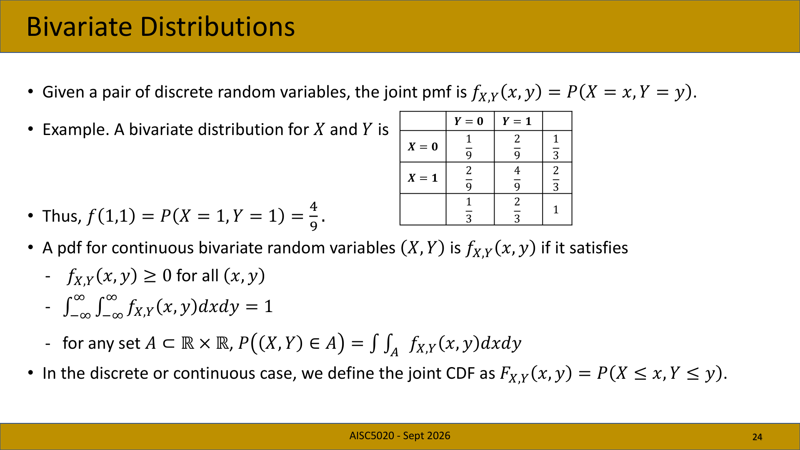

---

## 2.2 解题三步法（Multivariate recipe）

> **English（英文对照）：** Recipe for multivariate problems: draw the support → normalize the joint density → compute the required marginal, conditional, or probability.

做多元题，尤其是连续型，建议固定按下面三步：

1. **画支撑集（support）**：先写清楚 $f_{X,Y}(x,y)>0$ 的区域。  
   例如 $x^2≤y≤1$ 表示 $y$ 在抛物线上面、直线 $y=1$ 下面。
2. **归一化求常数**：令 $∬_S f_{X,Y}(x,y)\,dx\,dy=1$，解出常数 $c$。
3. **要什么算什么**：
   - 边缘：对另一个变量积分 / 求和；
   - 条件：联合 ÷ 边缘，**并保留原来的支撑限制**；
   - 概率：在指定区域上积分条件密度或联合密度。

> **注意： 易错：积分上下限写错。**  
> 连续型多元题 80% 的错误不是积分不会算，而是 **support 没画对**。  
> 记住：先画图，再写限；先写限，再积分。

---

## 2.3 例 1：连续联合密度完整流程（课件 p.25–29）

设

$$
f_{X,Y}(x,y)=
\begin{cases}
c x^2 y, & x^2≤y≤1,\\
0, & \text{otherwise}.
\end{cases}
$$

### (1) 求 $c$

支撑集要求 $x^2≤y≤1$，所以 $x^2≤1$，即 $-1≤x≤1$。于是

$$
1=∫_{-1}^{1}∫_{x^2}^{1}c x^2 y\,dy\,dx
=∫_{-1}^{1}c x^2\frac{1-x^4}{2}\,dx
=\frac{c}{2}∫_{-1}^{1}(x^2-x^6)\,dx
=\frac{4c}{21}
$$

所以

$$
c=\frac{21}{4}.
$$

### (2) 求边缘 $f_X(x)$

$$
f_X(x)=∫_{x^2}^{1}\frac{21}{4}x^2y\,dy
=\frac{21}{8}x^2(1-x^4),\qquad -1<x<1.
$$

### (3) 求条件密度 $f_{Y|X}(y|x)$

在 $x^2≤y≤1$ 上，

$$
f_{Y|X}(y|x)=\frac{f_{X,Y}(x,y)}{f_X(x)}
=\frac{\frac{21}{4}x^2y}{\frac{21}{8}x^2(1-x^4)}
=\frac{2y}{1-x^4}.
$$

注意：这个条件密度只在 $x^2≤y≤1$ 上非零。

### (4) 求条件概率 $P(Y≥3/4|X=1/2)$

$$
P\Big(Y≥\frac34\mid X=\frac12\Big)
=∫_{3/4}^{1}f_{Y|X}\Big(y\mid \frac12\Big)\,dy
=∫_{3/4}^{1}\frac{2y}{1-(1/2)^4}\,dy
$$

$$
=∫_{3/4}^{1}\frac{32}{15}y\,dy
=\frac{32}{15}\cdot\frac{1-(3/4)^2}{2}
=\frac{7}{15}.
$$

### (5) 顺便求条件期望 $E[Y|X=x]$

$$
E[Y|X=x]=∫_{x^2}^{1}y\cdot\frac{2y}{1-x^4}\,dy
=\frac{2}{1-x^4}\cdot\frac{1-x^6}{3}
=\frac{2(1+x^2+x^4)}{3(1+x^2)}.
$$

并且可以用全期望公式验证：

$$
E[Y]=E[E[Y|X]]=\frac79.
$$

> **结论（Key takeaway）：条件密度 = 联合密度 ÷ 边缘密度；条件期望 = 用条件密度算的期望。**  
> 这两个公式是后面全期望、全方差、回归函数、贝叶斯网络的共同基础。
>
> **English（英文对照）：** Conditional density = joint density divided by marginal density; conditional expectation is computed with the conditional density.

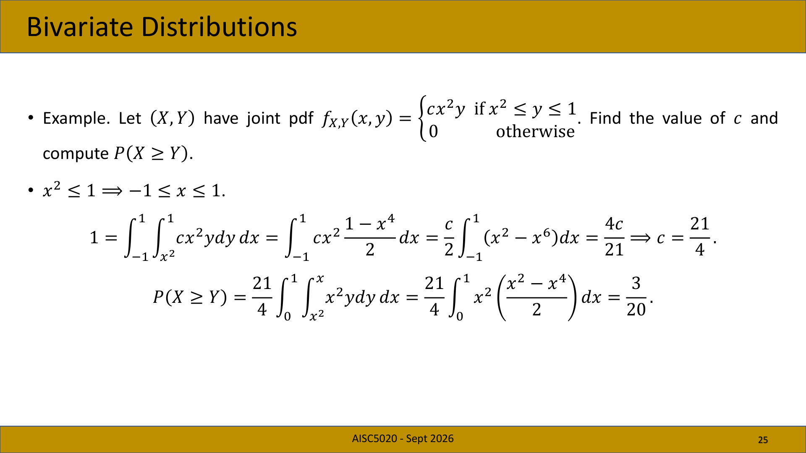

---

## 2.4 条件期望（Conditional Expectation）

**定义**：

$$
E[X|Y=y]=
\begin{cases}
Σ_x x\,p_{X|Y}(x|y), & \text{discrete},\\
∫_{-∞}^{∞}x f_{X|Y}(x|y)\,dx, & \text{continuous}.
\end{cases}
$$

更一般地，对函数 $r(x,y)$：

$$
E[r(X,Y)|Y=y]=
\begin{cases}
Σ_x r(x,y)p_{X|Y}(x|y),\\
∫ r(x,y)f_{X|Y}(x|y)\,dx.
\end{cases}
$$

> **注意： 区分两个对象：**
> - $E[Y|X=x]$ 是一个 **数**（给定 $x$ 后算出来的）；
> - $E[Y|X]$ 是一个 **随机变量**（因为 $X$ 还没观测，它是 $X$ 的函数）。

---

## 2.5 ★ 全期望公式（Law of Total Expectation）Week 5 p.50

$$
\boxed{E[Y]=E\big[E[Y|X]\big]}
$$

更一般地，对任意函数 $r(x,y)$：

$$
E[r(X,Y)]=E\big[E[r(X,Y)|X]\big].
$$

**直觉**：

1. 先按 $X$ 分组，在每组内求平均 $E[Y|X=x]$；
2. 再按 $X$ 的分布对这些组平均加权。

也就是 **“先条件平均，再对条件变量平均”**。

**证明（连续情形）**：

$$
E[E[Y|X]]
=∫ E[Y|X=x]f_X(x)\,dx
=∫∫ y f_{Y|X}(y|x)f_X(x)\,dy\,dx
=∫∫ y f_{X,Y}(x,y)\,dy\,dx
=∫ y f_Y(y)\,dy
=E[Y].
$$

**例（课件 p.50）**：设

$$
X∼U(0,1),\qquad Y|X=x∼U(x,1).
$$

则

$$
E[Y|X=x]=\frac{1+x}{2}
\quad⇒\quad
E[Y|X]=\frac{1+X}{2}.
$$

所以

$$
E[Y]=E\Big[\frac{1+X}{2}\Big]
=\frac{1+E[X]}{2}
=\frac{1+1/2}{2}
=\frac34.
$$

> **结论（Key takeaway）：全期望公式是“分步平均”的数学化。**  
> 它经常把难算的 $E[Y]$ 拆成“先算简单的条件期望，再对条件变量平均”。
>
> **English（英文对照）：** The law of total expectation is the mathematical form of averaging in two steps.

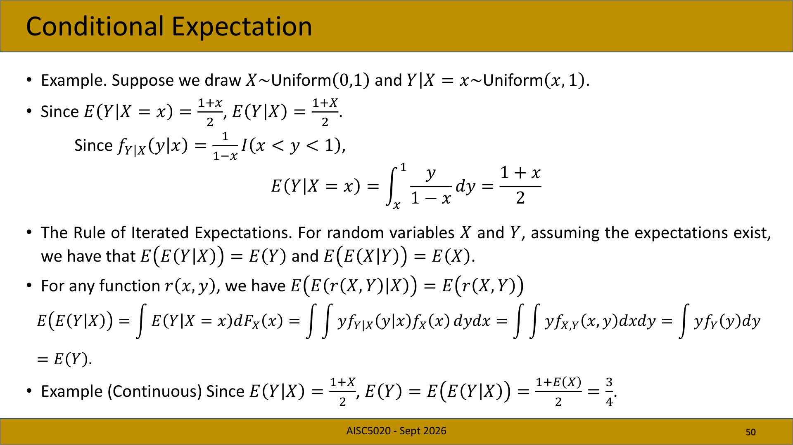

---

## 2.6 ★ 全方差公式（Law of Total Variance）Week 5 p.51

$$
\boxed{Var(Y)=E\big[Var(Y|X)\big]+Var\big(E[Y|X]\big)}
$$

**记忆**：

$$
\text{Total variance}=\text{within-group variance}+\text{between-group variance}
$$

- $E[Var(Y|X)]$：给定 $X$ 后，$Y$ 还剩多少随机波动；
- $Var(E[Y|X])$：不同的 $X$ 会让条件均值 $E[Y|X]$ 变化多少。

**证明**：

$$
Var(Y|X)=E[Y^2|X]-(E[Y|X])^2
$$

两边取期望：

$$
E[Var(Y|X)]=E[Y^2]-E[(E[Y|X])^2].
$$

又因为

$$
Var(E[Y|X])=E[(E[Y|X])^2]-(E[Y])^2,
$$

两式相加：

$$
E[Var(Y|X)]+Var(E[Y|X])
=E[Y^2]-(E[Y])^2
=Var(Y).
$$

**例（离散表格，建议自己手算一遍）**：

| $X\backslash Y$ | 0 | 1 | 边缘 $p_X$ |
|---|---:|---:|---:|
| 0 | 0.1 | 0.3 | 0.4 |
| 1 | 0.4 | 0.2 | 0.6 |
| 边缘 $p_Y$ | 0.5 | 0.5 | 1 |

条件分布：

$$
P(Y=1|X=0)=\frac{0.3}{0.4}=0.75,\qquad
P(Y=1|X=1)=\frac{0.2}{0.6}=\frac13.
$$

条件期望：

$$
E[Y|X=0]=0.75,\qquad E[Y|X=1]=\frac13.
$$

全期望：

$$
E[Y]=0.4(0.75)+0.6(1/3)=0.3+0.2=0.5.
$$

条件方差：

$$
Var(Y|X=0)=0.75(0.25)=0.1875,\qquad
Var(Y|X=1)=\frac23\cdot\frac13=\frac29.
$$

组内方差：

$$
E[Var(Y|X)]=0.4(0.1875)+0.6(2/9)
=0.075+0.1333=0.2083=\frac{5}{24}.
$$

组间方差：

$$
Var(E[Y|X])=0.4(0.75-0.5)^2+0.6(1/3-0.5)^2
=0.4(0.25)^2+0.6(-1/6)^2
=\frac{1}{24}.
$$

所以

$$
Var(Y)=\frac{5}{24}+\frac{1}{24}=\frac{6}{24}=0.25.
$$

> **结论（Key takeaway）：全方差公式把“总波动”拆成“条件内的波动”和“条件均值之间的波动”。**  
> 这也是 Week 7 偏差-方差分解（bias-variance trade-off）的概率版本。
>
> **English（英文对照）：** The law of total variance splits total variation into within-group variation and between-group variation.

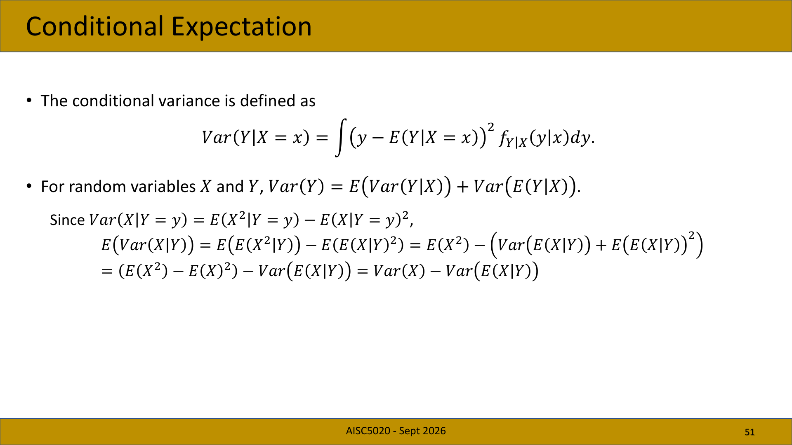

---

## 2.7 例 2：混合模型（Mixture）——全期望 + 全方差一起用

设

$$
Q∼U(0,1),\qquad X|Q=q∼Bin(n,q).
$$

则

$$
E[X|Q]=nQ,\qquad Var(X|Q)=nQ(1-Q).
$$

### 全期望

$$
E[X]=E[E[X|Q]]=E[nQ]=nE[Q]=\frac n2.
$$

### 全方差

$$
Var(X)=E[Var(X|Q)]+Var(E[X|Q]).
$$

第一项：

$$
E[Var(X|Q)]=E[nQ(1-Q)]
=n(E[Q]-E[Q^2])
=n\Big(\frac12-\frac13\Big)
=\frac n6.
$$

第二项：

$$
Var(E[X|Q])=Var(nQ)=n^2Var(Q)
=n^2\cdot\frac{1}{12}
=\frac{n^2}{12}.
$$

所以

$$
\boxed{Var(X)=\frac n6+\frac{n^2}{12}}
$$

当 $n=10$ 时：

$$
Var(X)=\frac{10}{6}+\frac{100}{12}
=\frac{10}{6}+\frac{50}{6}
=10.
$$

> **结论（Key takeaway）：混合模型里，总方差 = 各组内部方差 + 组均值之间的方差。**  
> 这正是“全方差公式”的典型应用；考试很喜欢用 “$X|Q∼Bin(n,Q)$” 这种结构。
>
> **English（英文对照）：** For a mixture model, total variance = average within-group variance + variance of the group means.

---

## 2.8 【重点】 多元正态分布（Multivariate Normal）

> **English（英文对照）：** Gaussian conditioning is linear in the observed value and usually reduces the covariance.

### 定义与记号

若 $X$ 是 $k$ 维随机向量，$X∼N(μ,Σ)$，其 PDF 为

$$
f_X(x)=(2π)^{-k/2}|Σ|^{-1/2}
\exp\Big(-\frac12(x-μ)'Σ^{-1}(x-μ)\Big),
$$

其中 $μ$ 是均值向量，$Σ$ 是 $k×k$ 对称正定协方差矩阵（symmetric positive definite）。

- 标准多元正态：$Z∼N(0,I_k)$。
- 若 $Z∼N(0,I_k)$，$X=μ+Σ^{1/2}Z$，则 $X∼N(μ,Σ)$。
- 若 $X∼N(μ,Σ)$，则 $Σ^{-1/2}(X-μ)∼N(0,I_k)$。
- 二次型：
  $$
  (X-μ)'Σ^{-1}(X-μ)∼χ^2_k.
  $$

### 线性变换（linear transformation）

若 $X∼N(μ,Σ)$，$A$ 是 $m×k$ 常数矩阵，则

$$
AX∼N(Aμ,AΣA').
$$

### 分块（partition）与边缘 / 条件

把 $X$ 分成两块：

$$
X=\begin{bmatrix}X_a\\X_b\end{bmatrix},\qquad
μ=\begin{bmatrix}μ_a\\μ_b\end{bmatrix},\qquad
Σ=\begin{bmatrix}Σ_{aa}&Σ_{ab}\\Σ_{ba}&Σ_{bb}\end{bmatrix}.
$$

则：

1. **边缘分布（marginal）**：
   $$
   X_a∼N(μ_a,Σ_{aa}).
   $$
2. **条件分布（conditional）**：
   $$
   \boxed{
   X_b|X_a=x_a∼N\Big(μ_b+Σ_{ba}Σ_{aa}^{-1}(x_a-μ_a),\;
   Σ_{bb}-Σ_{ba}Σ_{aa}^{-1}Σ_{ab}\Big)
   }
   $$

**直觉**：

- 条件均值 = 原来的均值 $μ_b$ **加上** 一个“由 $X_a$ 偏离均值带来的修正项”；
- 条件协方差 = 原来的 $Σ_{bb}$ **减去** 一个“因为知道了 $X_a$ 而减少的不确定性”；
- 所以条件方差通常 **变小**：知道得越多，越确定。

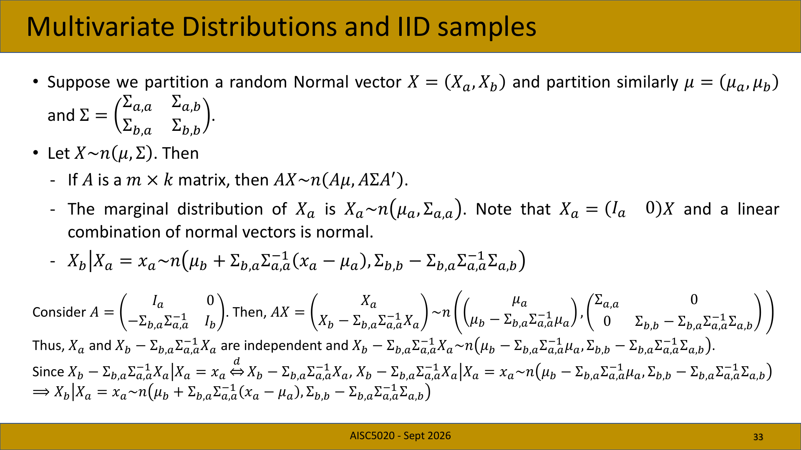

### 二元正态的具体公式（非常常用）

若

$$
\begin{bmatrix}X_1\\X_2\end{bmatrix}
∼N\left(
\begin{bmatrix}μ_1\\μ_2\end{bmatrix},
\begin{bmatrix}σ_1^2&ρσ_1σ_2\\ρσ_1σ_2&σ_2^2\end{bmatrix}
\right),
$$

则

$$
E[X_2|X_1=x]=μ_2+ρ\frac{σ_2}{σ_1}(x-μ_1),
$$

$$
Var(X_2|X_1=x)=σ_2^2(1-ρ^2).
$$

> **结论（Key takeaway）：**  
> - $ρ=0$ 时，$E[X_2|X_1=x]=μ_2$，条件方差 $=σ_2^2$，条件分布不随 $x$ 变；  
> - $|ρ|$ 越大，条件方差越小，说明 $X_1$ 提供的信息越多。

>
> **English（英文对照）：** For a bivariate normal, zero correlation makes the conditional distribution equal to the marginal; stronger correlation reduces conditional variance.

### 数值例子

设

$$
\begin{bmatrix}X_1\\X_2\end{bmatrix}
∼N\left(
\begin{bmatrix}0\\0\end{bmatrix},
\begin{bmatrix}4&2\\2&9\end{bmatrix}
\right).
$$

则 $σ_1=2,σ_2=3,ρ=2/(2\cdot3)=1/3$。

条件分布：

$$
E[X_2|X_1=x]=0+\frac{2}{4}(x-0)=\frac x2,
$$

$$
Var(X_2|X_1=x)=9-\frac{2\cdot2}{4}=9-1=8.
$$

所以

$$
X_2|X_1=x∼N(x/2,8).
$$

例如 $x=1$ 时，

$$
P(X_2>3|X_1=1)
=1-Φ\Big(\frac{3-0.5}{\sqrt8}\Big)
=1-Φ(0.8839)
≈0.188.
$$

> **结论（Key takeaway）：条件化把方差从 9 降到 8。**  
> 降多少取决于协方差；若 $Σ_{ab}=0$，则条件分布 = 边缘分布。
>
> **English（英文对照）：** Conditioning reduced the variance from 9 to 8; the reduction depends on the covariance.

---

## 2.9 协方差矩阵与线性变换

随机向量 $X=(X_1,\ldots,X_k)'$ 的协方差矩阵：

$$
Var(X)=Σ=
\begin{bmatrix}
Var(X_1)&Cov(X_1,X_2)&\cdots&Cov(X_1,X_k)\\
Cov(X_2,X_1)&Var(X_2)&\cdots&Cov(X_2,X_k)\\
\vdots&\vdots&\ddots&\vdots\\
Cov(X_k,X_1)&Cov(X_k,X_2)&\cdots&Var(X_k)
\end{bmatrix}.
$$

性质：

- $Σ$ 对称（symmetric）且半正定（positive semi-definite）。
- $E[AX]=Aμ$。
- $Var(AX)=AΣA'$。

**Multinomial 例子**：若 $X∼Multinomial(n,p)$，则

$$
E[X]=n(p_1,\ldots,p_k),
$$

$$
Var(X)=
\begin{bmatrix}
np_1(1-p_1)&-np_1p_2&\cdots&-np_1p_k\\
-np_2p_1&np_2(1-p_2)&\cdots&-np_2p_k\\
\vdots&\vdots&\ddots&\vdots\\
-np_kp_1&-np_kp_2&\cdots&np_k(1-p_k)
\end{bmatrix}.
$$

并且 $X_i∼Bin(n,p_i)$，$X_i+X_j∼Bin(n,p_i+p_j)$，所以

$$
Cov(X_i,X_j)=-np_ip_j.
$$

---

## 2.10 【重点】 多个条件变量：$P(X|Y,Z)$ 怎么算？

> **English（英文对照）：** To condition on several variables, divide the joint distribution by the joint distribution of all conditioning variables.

前面讲的是“给定一个变量”的条件分布。实际题目经常是“给定多个变量”，例如

$$
f_{X|Y,Z}(x|y,z)
$$

### 定义

$$
\boxed{
f_{X|Y,Z}(x|y,z)=\frac{f_{X,Y,Z}(x,y,z)}{f_{Y,Z}(y,z)}
}
$$

也可以写成

$$
f_{X|Y,Z}(x|y,z)=\frac{f_{X,Y|Z}(x,y|z)}{f_{Y|Z}(y|z)}.
$$

> **记忆：分子是“三个变量的联合”，分母是“所有条件变量的联合”（把 $X$ 积掉 / 加掉）。**

### 链式法则（chain rule）

$$
f(x,y,z)=f(x|y,z)f(y|z)f(z)
$$

更一般地：

$$
f(x_1,\ldots,x_n)
=f(x_1)f(x_2|x_1)f(x_3|x_1,x_2)\cdots f(x_n|x_1,\ldots,x_{n-1})
$$

### 条件独立带来的简化

若 $X⊥Y|Z$，则

$$
f_{X|Y,Z}(x|y,z)=f_{X|Z}(x|z).
$$

也就是说：**一旦知道了 $Z$，$Y$ 对 $X$ 没有额外信息**，分母里的 $Y$ 可以“忽略”。

> **结论（Key takeaway）：**  
> 多个条件变量的计算，难点不在公式，而在 **能不能利用条件独立把联合分布拆小**。  
> Week 8 的贝叶斯网络就是把这套“链式法则 + 条件独立”画成图。
>
> **English（英文对照）：** With multiple conditioning variables, the hard part is using conditional independence to factorize the joint distribution.

### 例：三个症状一起出现，流感概率多大？

设

- $F$：Flu（流感），$P(F=1)=0.10$；
- $V$：Fever（发烧）；
- $C$：Cough（咳嗽）；
- $T$：Positive test（检测阳性）。

假设给定 $F$ 后，$V,C,T$ **相互条件独立（mutually conditionally independent）**：

$$
V⊥C\,|\,F,\qquad V⊥T\,|\,F,\qquad C⊥T\,|\,F
$$

联合分布因子分解：

$$
P(F,V,C,T)=P(F)P(V|F)P(C|F)P(T|F)
$$

已知：

$$
P(V=1|F=1)=0.8,\quad P(V=1|F=0)=0.05
$$

$$
P(C=1|F=1)=0.7,\quad P(C=1|F=0)=0.1
$$

$$
P(T=1|F=1)=0.9,\quad P(T=1|F=0)=0.05
$$

求

$$
P(F=1|V=1,C=1,T=1)
$$

用贝叶斯公式：

$$
P(F=1|V=1,C=1,T=1)
=\frac{
P(F=1)P(V=1|F=1)P(C=1|F=1)P(T=1|F=1)
}{
Σ_{f∈\{0,1\}}P(F=f)P(V=1|F=f)P(C=1|F=f)P(T=1|F=f)
}
$$

分子：

$$
0.1×0.8×0.7×0.9=0.0504
$$

$F=0$ 的项：

$$
0.9×0.05×0.1×0.05=0.000225
$$

所以

$$
P(F=1|V=1,C=1,T=1)
=\frac{0.0504}{0.0504+0.000225}
≈0.9956
$$

> **结论（Key takeaway）：**  
> 单个症状可能证据不强，但 **多个条件变量联合起来** 可以把后验概率推得很高。  
> 这就是“多个证据（multiple evidence）”的贝叶斯更新，也是 Week 8 贝叶斯网络推断的雏形。
>
> **English（英文对照）：** Multiple pieces of evidence can push the posterior probability very high; this is the prototype of Bayesian-network inference.

---

## 2.11 【重点】 条件独立（Conditional Independence）

> **English（英文对照）：** Given $Z$, $Y$ provides no extra information about $X$; this is conditional independence.

**定义**：给定 $Z$，若

$$
f_{X,Y|Z}(x,y|z)=f_{X|Z}(x|z)f_{Y|Z}(y|z)
$$

对所有 $x,y,z$ 成立，则称 $X$ 与 $Y$ **在给定 $Z$ 下条件独立（conditionally independent given $Z$）**，记作

$$
X⊥Y\,|\,Z.
$$

等价说法：

$$
X⊥Y|Z
\iff f_{X|Y,Z}(x|y,z)=f_{X|Z}(x|z)
$$

> **直觉：一旦知道了 $Z$，$Y$ 就不再提供关于 $X$ 的额外信息。**

基本性质：

- 对称性：$X⊥Y|Z ⇒ Y⊥X|Z$。
- 若 $U=h(X)$，则 $X⊥Y|Z ⇒ U⊥Y|Z$。
- 若 $U=h(X)$，则 $X⊥Y|Z ⇒ X⊥Y|(Z,U)$。
- $X⊥Y|Z$ 且 $X⊥W|(Y,Z)$ ⇒ $X⊥(W,Y)|Z$。
- $X⊥Y|Z$ 且 $X⊥Z|Y$ ⇒ $X⊥(Y,Z)$。

### 例：共同原因（common cause）——边缘相关，条件独立

设

$$
Z∼N(0,1),\qquad e_1,e_2∼N(0,1),
$$

且 $Z,e_1,e_2$ 相互独立。令

$$
X=Z+e_1,\qquad Y=Z+e_2.
$$

**边缘上**：

$$
Cov(X,Y)=Cov(Z+e_1,Z+e_2)=Var(Z)=1.
$$

所以 $X,Y$ 边缘相关，$Corr(X,Y)=1/2$。

**给定 $Z$ 后**：

$$
Cov(X,Y|Z)=Cov(e_1,e_2)=0,
$$

并且实际上 $X⊥Y|Z$。

> **结论（Key takeaway）：边缘相关不代表条件相关；条件独立也不代表边缘独立。**  
> 这个例子就是 Week 8 贝叶斯网络里的 **fork（共同原因）**：$X←Z→Y$。
>
> **English（英文对照）：** Marginal correlation does not imply conditional correlation, and conditional independence does not imply marginal independence.

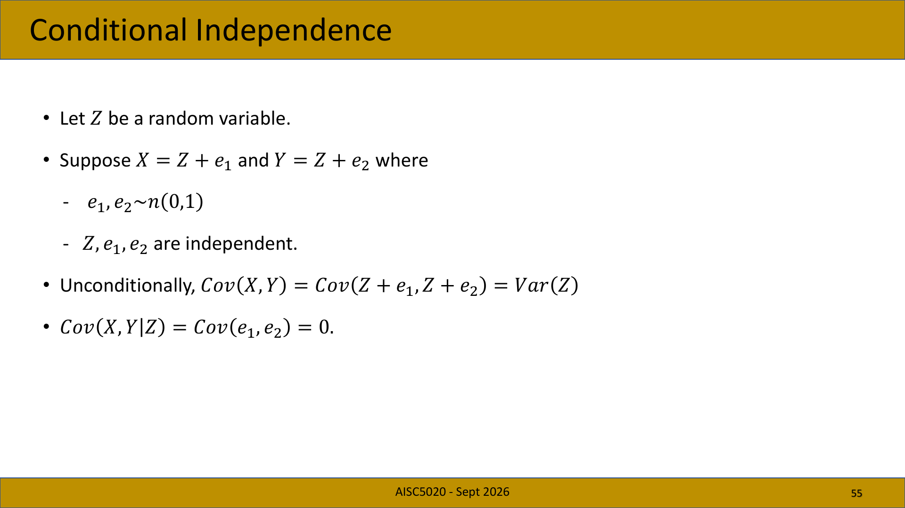

### 反例：对撞（collider）——边缘独立，条件相关

设 $X,Y$ 独立，均为 $Bern(1/2)$，令

$$
Z=I(X=Y).
$$

- 不看 $Z$ 时，$X⊥Y$。
- 给定 $Z=1$ 时，$X=Y$，所以知道 $X$ 就知道 $Y$，二者不独立。
- 给定 $Z=0$ 时，$X≠Y$，同样不独立。

> **结论（Key takeaway）：**  
> 条件化有时会 **制造** 依赖，而不是消除依赖。  
> 这类结构叫 **collider（对撞）**：$X→Z←Y$。Week 8 的 d-separation 会系统处理它。
>
> **English（英文对照）：** Conditioning can create dependence rather than remove it; this is a collider effect.

---

## 2.12 【重点】 多元条件分布常见误区清单

1. **把 $f(x|y)$ 当成 $f(y|x)$**。  
   条件方向必须看题目问的是“给定谁”。
2. **忘记条件密度的支撑集**。  
   $f_{Y|X}(y|x)$ 的 $y$ 范围通常依赖 $x$，例如 $x^2≤y≤1$。
3. **把条件期望当成常数**。  
   $E[Y|X]$ 是随机变量；$E[Y|X=x]$ 才是数。
4. **把 $E[Y|X]$ 和 $E[Y]$ 搞混**。  
   全期望公式是桥：$E[Y]=E[E[Y|X]]$。
5. **认为 $Cov=0$ 就独立**。  
   不相关只说明“线性关系”为零，可能有非线性依赖。
6. **认为边缘独立就一定条件独立**。  
   共同原因、对撞都是反例。
7. **多元正态条件方差写成 $Σ_{bb}$**。  
   正确是 $Σ_{bb}-Σ_{ba}Σ_{aa}^{-1}Σ_{ab}$，通常会变小。
8. **连续型不做归一化**。  
   联合密度积分必须为 1，条件密度对 $x$ 积分也必须为 1。

---

# 3. Week 6：信息论（Information Theory）

> **English（英文对照）：** Week 6 quantifies uncertainty and distribution mismatch: entropy, cross-entropy, KL, mutual information, and Fano.

## 3.1 熵（Entropy）

> **English（英文对照）：** Entropy is the average surprisal, or the optimal average code length in bits.

**熵**衡量一个随机变量的平均不确定性 / 最优平均编码长度：

$$
H(X)=H(p)=-Σ_x p(x)\log_2 p(x)
=E[-\log_2 p(X)]\quad\text{（bits）}
$$

约定 $0\log_2 0=0$。

- $H(X)≥0$。
- 均匀分布熵最大：若 $X$ 在 32 个结果上均匀，$H(X)=\log_2 32=5$ bits。
- 确定性分布熵为 0。
- 熵只依赖分布，不依赖具体取值。

**编码直觉**：出现概率越大的符号，用越短的码；最优平均码长约等于熵。  
$H(p)≤A<H(p)+1$（当码长必须为整数时）。

---

## 3.2 交叉熵（Cross-Entropy）与 KL 散度

> **English（英文对照）：** KL divergence measures the extra cost of using model $q$ when the truth is $p$.

设 $p$ 是真实分布，$q$ 是模型分布。

**交叉熵**：

$$
H(p,q)=-Σ_x p(x)\log_2 q(x)
=E_p[-\log_2 q(X)]
$$

**KL 散度（Kullback–Leibler divergence）**：

$$
D_{KL}(p||q)=Σ_x p(x)\log_2\frac{p(x)}{q(x)}
=H(p,q)-H(p)
$$

> 注意：不同教材符号可能相反（有的写 $D(q||p)$）。**统一用“真实 $p$ 在前，模型 $q$ 在后”最不容易错。**  
> 课件写法是 $H_p(q)=Σ_x q(x)\log_2\frac{1}{p(x)}$，其中 $q$ 是真实分布、$p$ 是编码 / 模型分布；它对应本文的 $H(q,p)$。

性质：

- $D_{KL}(p||q)≥0$（Gibbs 不等式）；
- $D_{KL}(p||q)=0 \iff p=q$；
- **不对称**：$D_{KL}(p||q)≠D_{KL}(q||p)$；
- 不是距离（不满足三角不等式）。

**为什么分类用交叉熵？**

$$
H(p,q)=H(p)+D_{KL}(p||q)
$$

真实分布 $p$ 的熵 $H(p)$ 与模型无关，所以

$$
\min_q H(p,q) \iff \min_q D_{KL}(p||q).
$$

> **结论（Key takeaway）：最小化交叉熵 = 最小化 KL = 让模型分布尽量接近真实分布。**  
> 这就是 Week 7 中 “MLE = 最小化 KL” 和 “逻辑回归 = 交叉熵损失” 的来源。
>
> **English（英文对照）：** Minimizing cross-entropy = minimizing KL = making the model distribution close to the true distribution.

**例（课件 p.12）**：真实硬币 $p=0.9$，模型 $\hat p=0.5$。

$$
H(p)= -0.9\log_2 0.9-0.1\log_2 0.1≈0.469
$$

$$
H(p,\hat p)= -0.9\log_2 0.5-0.1\log_2 0.5=1
$$

$$
D_{KL}(p||\hat p)=1-0.469=0.531\text{ bits}
$$

这 0.531 bits 就是“用错模型”多付出的平均编码成本。

---

## 3.3 联合熵、条件熵、链式法则

**联合熵（joint entropy）**：

$$
H(X,Y)=-Σ_{x,y}p(x,y)\log_2 p(x,y)
$$

**条件熵（conditional entropy）**：

$$
H(X|Y)=Σ_y p(y)H(X|Y=y)
=-Σ_{x,y}p(x,y)\log_2 p(x|y)
$$

**链式法则（chain rule）**：

$$
H(X,Y)=H(Y)+H(X|Y)=H(X)+H(Y|X)
$$

$$
H(X_1,\ldots,X_n)=Σ_{i=1}^n H(X_i|X_{i-1},\ldots,X_1)
$$

**大小关系**：

$$
H(X,Y)≥H(X)≥H(X|Y)
$$

> 直观：**加变量增加不确定性；条件化减少不确定性。**

> **结论（Key takeaway）：** $H(X|Y)=0$ 当且仅当给定 $Y$ 后 $X$ 是确定的，即 $X$ 是 $Y$ 的函数（在 $Y$ 的支撑集上）。  
> 这是 Fano 中“零错误 ⇒ 零条件熵”的基础。
>
> **English（英文对照）：** $H(X\mid Y)=0$ if and only if $X$ is determined by $Y$ (that is, $X$ is a function of $Y$ on the support of $Y$).

$$
H(X|Y)≠H(Y|X)
$$

但

$$
H(X)-H(X|Y)=H(Y)-H(Y|X)
$$

这个共同的差就是互信息。

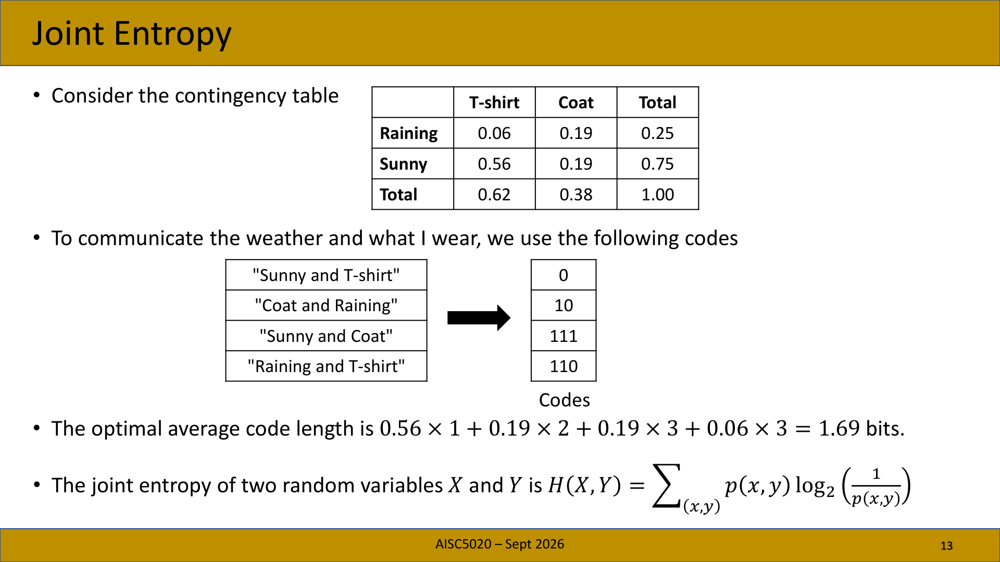

---

## 3.4 互信息（Mutual Information）

$$
I(X;Y)=H(X)+H(Y)-H(X,Y)
$$

等价形式：

$$
I(X;Y)=H(X)-H(X|Y)=H(Y)-H(Y|X)
$$

$$
I(X;Y)=Σ_{x,y}p(x,y)\log_2\frac{p(x,y)}{p(x)p(y)}
=D_{KL}\big(p(x,y)||p(x)p(y)\big)
$$

性质：

- $I(X;Y)≥0$；
- $I(X;Y)=0 \iff X⊥Y$；
- 对称：$I(X;Y)=I(Y;X)$；
- **条件互信息（conditional mutual information）**：
  $$
  I(X;Y|Z)=H(X|Z)-H(X|Y,Z)
  $$
  $I(X;Y|Z)=0 \iff X⊥Y|Z$。

**变差信息（variation of information）**：

$$
V(X,Y)=H(X,Y)-I(X;Y)≥0
$$

它更像“距离”：完全依赖时 $V=0$，独立时最大。

---

## 3.5 马尔可夫链与数据处理不等式

**马尔可夫链（Markov chain）** $X→Y→Z$：

$$
p(x,y,z)=p(x)p(y|x)p(z|y)
$$

等价于

$$
X⊥Z\,|\,Y
$$

即：给定 $Y$，$Z$ 与 $X$ 条件独立。

**数据处理不等式（Data Processing Inequality）**：

$$
X→Y→Z \quad⇒\quad I(X;Y)≥I(X;Z)
$$

直觉：信息经过“处理”不会增加，只会减少。

**重要反例**：若 $X,Y$ 独立，令 $Z=X+Y$，则 $X$ 与 $Y$ 不构成马尔可夫链，且

$$
I(X;Y)=0,\qquad I(X;Y|Z)>0.
$$

> **结论（Key takeaway）：条件化可能增加互信息。**  
> 这就是“对撞”结构：知道结果 $Z$ 后，两个原因 $X,Y$ 反而相关。
>
> **English（英文对照）：** Conditioning can increase mutual information; this is the collider effect.

---

## 3.6 ★ Fano 不等式（Fano Inequality）Week 6 p.38–43

> **English（英文对照）：** Fano links conditional entropy to the minimum possible prediction error.

### 设定

- $X$ 是真实标签，取值集合 $\mathcal{X}$ 有限；
- $Y$ 是观测特征；
- $\hat X=g(Y)$ 是估计 / 预测；
- 错误率 $P_e=P(\hat X≠X)$。

### 不等式

$$
\boxed{
H(P_e)+P_e\log_2|\mathcal{X}|
≥H(X|\hat X)
≥H(X|Y)
}
$$

其中

$$
H(P_e)=-P_e\log_2 P_e-(1-P_e)\log_2(1-P_e)
$$

是二元熵。

**弱化形式**（考试更常用）：

$$
\boxed{
1+P_e\log_2|\mathcal{X}|≥H(X|Y)
}
$$

从而

$$
\boxed{
P_e≥\frac{H(X|Y)-1}{\log_2|\mathcal{X}|}
}
$$

### 直觉与证明思路

- 若 $P_e=0$，则 $X=\hat X$，所以 $H(X|\hat X)=0$，进而 $H(X|Y)=0$：  
  **没有错误 ⇒ 观测 $Y$ 已经包含 $X$ 的全部信息。**
- 若有错误，错误本身带来不确定性 $H(P_e)$；错误时 $X$ 还有最多 $\log_2|\mathcal{X}|$ 的不确定性。
- 证明用链式法则：
  $$
  H(X|\hat X)≤H(E,X|\hat X)=H(E|\hat X)+H(X|E,\hat X)
  $$
  其中 $E=I(X≠\hat X)$，且
  $$
  H(E|\hat X)≤H(P_e),
  $$
  $$
  H(X|E,\hat X)≤P_e\log_2|\mathcal{X}|.
  $$

### 例子

设 $|\mathcal{X}|=8$，$H(X|Y)=3$ bits。则

$$
P_e≥\frac{3-1}{\log_2 8}=\frac23.
$$

也就是说，**任何分类器的错误率都不可能低于约 66.67%**。

> **结论（Key takeaway）：Fano 给出了“特征信息量”决定的最低错误率。**  
> 如果 $H(X\mid Y)$ 很大，说明 $Y$ 对 $X$ 的信息不足，再聪明的模型也无法把错误率压得很低。  
> 在机器学习里：**特征不够，模型再复杂也没用。**
>
> **English（英文对照）：** Fano gives a lower bound on error determined by how much information $Y$ carries about $X$.

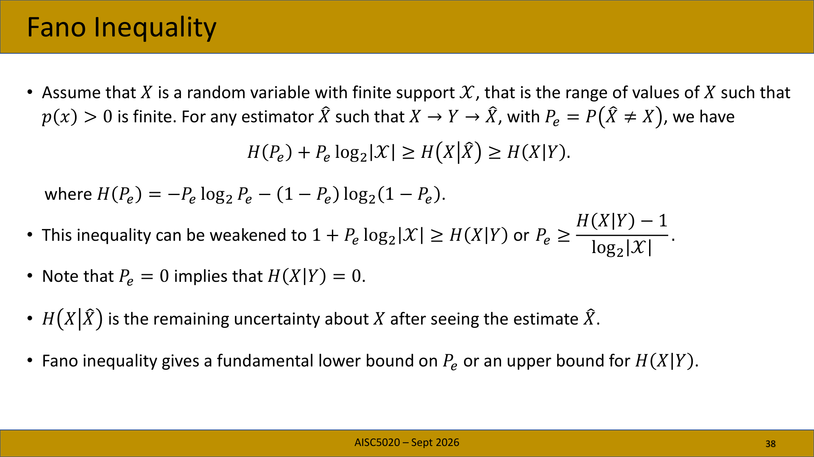

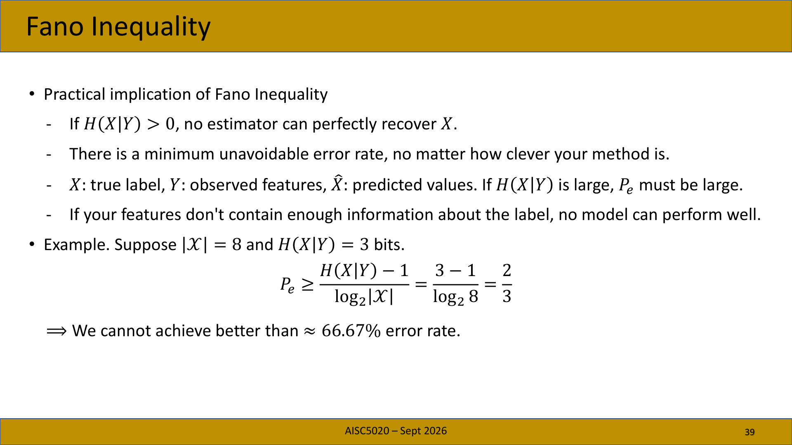

---

## 3.7 Week 6 与前后章节的联系

- **熵 → 交叉熵 → KL**：Week 6 定义“分布差距”；Week 7 用它解释 MLE。
- **条件熵 / 互信息 → 条件独立**：Week 5 的条件独立在 Week 6 有信息论版本 $I(X;Y|Z)=0$；Week 8 的 d-separation 是它的图论版本。
- **Fano → 分类下界**：Week 7 的 0-1 损失、Bayes 分类器，都可以用 Fano 给出理论下界。

---

# 4. 【重点】 Week 7：统计推断（Statistical Inference）

> Week 7 的主线：**“看到数据后，哪个参数最可信？”**  
> 答案：让观测数据出现概率最大的参数（MLE）；等价地，让模型分布最接近真实分布（最小 KL）。
>
> **English（英文对照）：** Given the data, which parameter is most plausible, and how should we estimate it?

## 4.1 似然与对数似然（Likelihood & Log-likelihood）

> **English（英文对照）：** The likelihood views the joint probability as a function of the parameter after the data are observed.

设 $X_1,\ldots,X_n$ 是 IID 样本，$f_θ$ 是 PDF / PMF，$θ$ 是未知参数。

**联合分布**：

$$
f_θ(x_1,\ldots,x_n)=∏_{j=1}^n f_θ(x_j)
$$

观测到样本 $x_1,\ldots,x_n$ 后，把它看成 $θ$ 的函数：

$$
L(θ)=∏_{j=1}^n f_θ(x_j)
$$

$$
ℓ(θ)=\ln L(θ)=Σ_{j=1}^n \ln f_θ(x_j)
$$

- $L(θ)$：**似然函数（likelihood function）**；
- $ℓ(θ)$：**对数似然（log-likelihood）**；
- 取对数把乘积变成求和，数值更稳定，也更容易求导。

> **Q（关键问题 / Key question）：似然和概率有什么区别？**  
> **English (question):** What is the difference between probability and likelihood?  
> 概率 $f_θ(x)$ 是“固定 $θ$，看数据 $x$ 有多可能”；  
> 似然 $L(θ)$ 是“固定数据 $x$，看哪个 $θ$ 更能解释数据”。  
> 数学形式相同，**视角相反**。

---

## 4.2 最大似然估计（MLE）

> **English（英文对照）：** MLE chooses the parameter that maximizes the likelihood (or log-likelihood).

$$
\boxed{
\hat θ=\arg\max_{θ∈Ω}L(θ)=\arg\max_{θ∈Ω}ℓ(θ)
}
$$

**步骤（Recipe）**：

1. 写出 $L(θ)$ 或 $ℓ(θ)$；
2. 求导 $\partial ℓ/\partial θ$，令其为 0；
3. 解方程；
4. 检查边界 / 二阶条件 / 参数范围；
5. 如果参数是向量，分别对每个分量求偏导。

### 例 1：Bernoulli

$X_i∈\{0,1\}$，$P(X_i=1)=p$。

$$
L(p)=p^{Σx_i}(1-p)^{n-Σx_i}
$$

$$
ℓ(p)=(Σx_i)\ln p+(n-Σx_i)\ln(1-p)
$$

$$
\frac{dℓ}{dp}=\frac{Σx_i}{p}-\frac{n-Σx_i}{1-p}=0
$$

解得

$$
\hat p=\frac{1}{n}Σ_{i=1}^n x_i=\bar x.
$$

### 例 2：Normal

$X_i∼N(μ,σ^2)$。

$$
ℓ(μ,σ^2)=-\frac n2\ln(2πσ^2)-\frac{1}{2σ^2}Σ_{i=1}^n(x_i-μ)^2
$$

令偏导为 0：

$$
\hat μ=\bar x_n,
$$

$$
\hat σ^2=\frac1nΣ_{i=1}^n(x_i-\bar x_n)^2.
$$

> **注意：** MLE 的 $\hat σ^2$ 分母是 $n$，是 **有偏（biased）** 的；无偏样本方差分母是 $n-1$。

### 例 3：Uniform(0,β)

$$
f(x;β)=\frac1β I(0≤x≤β)
$$

$$
L(β)=\frac{1}{β^n}∏_{i=1}^n I(0≤x_i≤β)
=\frac{1}{β^n}I\big(\max_i x_i≤β\big)
$$

似然在 $β≥\max_i x_i$ 时随 $β$ 增大而减小，所以

$$
\boxed{\hat β=\max_{1≤i≤n}x_i=x_{(n)}}
$$

> **结论（Key takeaway）：MLE 不一定通过求导得到。**  
> 遇到指示函数 / 边界约束，先看“参数必须满足什么”，再找最大值点。
>
> **English（英文对照）：** MLE does not always require differentiation; check the support and boundary constraints first.

---

## 4.3 MLE = 最小化 KL（Week 6 与 Week 7 的桥梁）

设真实数据生成分布为 $f$，模型族为 $\{f_θ\}$。

$$
\arg\min_θ D_{KL}(f||f_θ)
=\arg\min_θ E_f\Big[\log_2\frac{f(X)}{f_θ(X)}\Big]
$$

$$
=\arg\max_θ E_f[\log_2 f_θ(X)]
$$

用经验分布代替真实分布 $f$，就得到

$$
\arg\max_θ \frac1nΣ_{i=1}^n \log_2 f_θ(x_i)
=\arg\max_θ ℓ(θ).
$$

（这里 $\log_2$ 与 $\ln$ 只差常数因子 $1/\ln 2$，不影响 argmax。）

> **结论（Key takeaway）：MLE 就是在最小化“真实分布与模型分布”的 KL 散度。**  
> 所以 Week 6 的 KL / 交叉熵不是“另一套东西”，而是 Week 7 MLE 的目标函数。
>
> **English（英文对照）：** MLE minimizes the KL divergence between the true distribution and the model distribution.

---

## 4.4 条件似然（Conditional Likelihood）与机器学习损失

给定数据 $(x_1,y_1),\ldots,(x_n,y_n)$，要预测 $y|x$，估计 $P_θ(y|x)$：

$$
\hat θ=\arg\max_θ ∏_{i=1}^n P_θ(y_i|x_i)
=\arg\max_θ Σ_{i=1}^n \ln P_θ(y_i|x_i)
$$

### 线性回归 = 最小二乘（Least Squares）

模型：

$$
y=x'β+ε,\qquad ε∼N(0,σ^2)
$$

对数似然：

$$
ℓ(β,σ^2)=-\frac n2\ln σ^2-\frac{1}{2σ^2}Σ_{j=1}^n(y_j-x_j'β)^2+\text{constant}
$$

最大化 $ℓ$ 等价于最小化

$$
Σ_{j=1}^n(y_j-x_j'β)^2
$$

这就是 **残差平方和（sum of squared errors, SSE）**，所以

$$
\boxed{\hat β=(X'X)^{-1}X'Y}
$$

（当 $X'X$ 可逆时）。

### 逻辑回归 = 交叉熵（Cross-Entropy）

模型：

$$
p_j=P(y_j=1|x_j)=\frac{e^{x_j'β}}{1+e^{x_j'β}}
$$

对数似然：

$$
ℓ(β)=Σ_{j=1}^n\big[y_j\ln p_j+(1-y_j)\ln(1-p_j)\big]
$$

最大化 $ℓ$ 等价于最小化

$$
\boxed{
-\sum_{j=1}^n\big[y_j\ln p_j+(1-y_j)\ln(1-p_j)\big]
}
$$

这正是 **二元交叉熵 / 负对数似然（NLL）**。

> **结论（Key takeaway）：**  
> - 高斯噪声 + 线性模型 ⇒ 最小二乘；  
> - Bernoulli 输出 + logistic 模型 ⇒ 交叉熵。  
> **损失函数不是随便选的，它来自似然。**
>
> **English（英文对照）：** Gaussian noise + linear model ⇒ least squares; Bernoulli output + logistic model ⇒ cross-entropy. Loss functions come from likelihoods.

---

## 4.5 无偏性、MSE 与效率

> **English（英文对照）：** MSE decomposes into variance plus squared bias; unbiasedness alone is not enough.

**无偏估计（unbiased estimator）**：

$$
E[\hat θ]=θ
$$

**偏差（bias）**：

$$
Bias(\hat θ)=E[\hat θ]-θ
$$

**均方误差（MSE）**：

$$
MSE(\hat θ)=E[(\hat θ-θ)^2]
$$

**分解**：

$$
\boxed{
MSE(\hat θ)=Var(\hat θ)+[Bias(\hat θ)]^2
}
$$

**渐近无偏（asymptotically unbiased）**：

$$
\lim_{n→∞}Bias(\hat θ)=0
$$

**效率（efficiency）**：两个无偏估计 $\hat θ_1,\hat θ_2$，比较

$$
\frac{Var(\hat θ_2)}{Var(\hat θ_1)}
$$

比值 $>1$ 说明 $\hat θ_1$ 更有效。

### 例：Uniform(0,β) 的三个估计

1. **MLE**：$\hat β=X_{(n)}$。
   $$
   E[X_{(n)}]=\frac{nβ}{n+1}
   $$
   所以 MLE 有偏，但渐近无偏。
2. **无偏修正**：
   $$
   \tilde β=\frac{n+1}{n}X_{(n)}
   $$
   是无偏的，且
   $$
   Var(\tilde β)=\frac{β^2}{n(n+2)}.
   $$
3. **矩估计**：$2\bar X$ 也是无偏的，因为 $E[X]=β/2$。
   $$
   Var(2\bar X)=\frac{β^2}{3n}.
   $$

效率比较：

$$
\frac{Var(2\bar X)}{Var(\tilde β)}
=\frac{β^2/(3n)}{β^2/[n(n+2)]}
=\frac{n+2}{3}>1
$$

所以 $\tilde β=(n+1)X_{(n)}/n$ 比 $2\bar X$ 更有效。

> **结论（Key takeaway）：无偏不是唯一标准，还要看方差。**  
> MSE 同时惩罚偏差和方差；有时“稍微有偏但方差更小”反而更好（这就是正则化的思想）。
>
> **English（英文对照）：** Unbiasedness is not the only criterion; variance matters too. A slightly biased estimator with much smaller variance can have lower MSE.

---

## 4.6 回归函数与损失函数

### MSE → 条件均值

$$
E[(Y-f(X))^2]
=E_X\Big[E_{Y|X}[(Y-f(X))^2|X]\Big]
$$

对固定的 $x$，最小化 $E[(Y-c)^2|X=x]$ 得到

$$
\boxed{f(x)=E[Y|X=x]}
$$

这就是 **回归函数（regression function）**。

- 线性回归：假设 $f(x)=x'β$；
- k-NN：用邻域平均近似 $E[Y|X=x]$。

### MSE 的梯度（gradient）

对线性预测 $f(x)=x'\beta$，MSE 为

$$
L(\beta)=\frac1nΣ_{i=1}^n(y_i-x_i'\beta)^2
$$

梯度：

$$
\nabla_\beta L
=-\frac2nΣ_{i=1}^n x_i(y_i-x_i'\beta)
=-\frac2n X'(Y-X\beta)
$$

令梯度为 0：

$$
X'X\beta=X'Y
\quad⇒\quad
\hat\beta=(X'X)^{-1}X'Y
$$

这就是 **正规方程（normal equations）**。若 $X'X$ 不可逆，可以用伪逆或正则化。

梯度下降更新：

$$
\beta←\beta-\eta\nabla_\beta L
$$

> **结论（Key takeaway）：MSE 是凸函数，局部最优 = 全局最优；梯度形式简单，所以线性回归容易优化。**  
> 但 MSE 对异常值敏感（平方会放大极端误差）。
>
> **English（英文对照）：** MSE is convex, so a local minimum is global; its gradient is simple, which makes linear regression easy to optimize.

### MAE → 条件中位数

$$
E[|Y-f(X)|]
$$

对固定的 $x$，最小化 $E[|Y-c||X=x]$ 得到

$$
\boxed{f(x)=\text{median}(Y|X=x)}
$$

> **结论（Key takeaway）：损失函数决定你估计的是“均值”还是“中位数”。**  
> MSE 对异常值敏感；MAE 更稳健，但在 0 点不可导。
>
> **English（英文对照）：** The loss function determines whether you estimate the conditional mean or the conditional median.

### 常见损失函数对比

| 损失（Loss） | 公式 | 特点 | 典型用途 |
|---|---|---|---|
| MSE / L2 | $(y-f(x))^2$ | 光滑、凸、对异常值敏感 | 回归 |
| MAE / L1 | $\vert y-f(x)\vert$ | 稳健、凸、0 点不可导、梯度恒定 | 稳健回归 |
| Huber | $\frac12 e^2$ if $\vert e\vert≤δ$；$δ(\vert e\vert-δ/2)$ if $\vert e\vert>δ$ | 小误差像 L2，大误差像 L1 | 稳健回归 |
| log-cosh | $\ln\cosh(y-f(x))$ | 光滑、近似 L2 小误差 / L1 大误差 | 稳健回归 |
| 0-1 | $I(y≠g(x))$ | 直接数错误，不可导 | 分类理论 |
| Hinge | $\max(0,1-yf(x))$ | 最大化间隔，SVM | 二分类 |
| Perceptron | $\max(0,-yf(x))$ | 只罚错误，不罚“太靠近边界” | 感知机 |
| Smoothed Hinge | 分段二次 | 光滑版 Hinge | 需要可导时 |
| 交叉熵 / NLL | $-[y\ln p+(1-y)\ln(1-p)]$ | 概率输出、强罚“自信地错” | 逻辑回归 / 神经网络 |

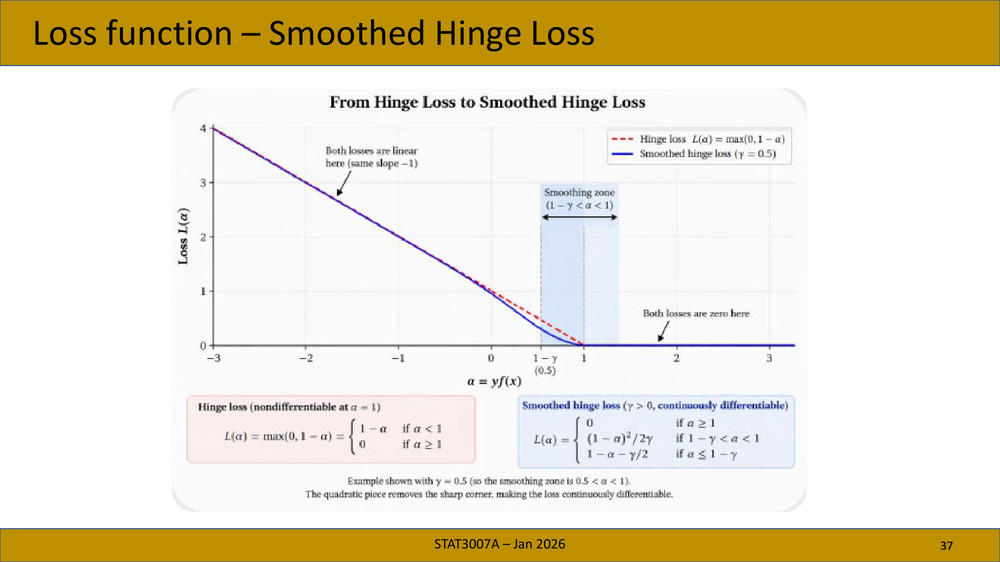

### 分类：0-1 损失与 Bayes 分类器

$$
G(x)=\arg\min_{g∈\{1,\ldots,K\}}Σ_{k=1}^K L(k,g)P(Y=k|X=x)
$$

若 $L(k,g)=I(k≠g)$，则

$$
Σ_{k≠g}P(Y=k|X=x)=1-P(Y=g|X=x)
$$

所以

$$
\boxed{
G(x)=\arg\max_{k}P(Y=k|X=x)
}
$$

这就是 **Bayes 分类器（Bayes classifier）**。

> **结论（Key takeaway）：0-1 损失下的最优分类器，就是后验概率最大的类。**  
> 但实际中 $P(Y=k|X=x)$ 未知，所以要用模型估计（逻辑回归、k-NN、神经网络等）。
>
> **English（英文对照）：** Under 0-1 loss, the optimal classifier is the one with the largest posterior probability (the Bayes classifier).

---

## 4.7 偏差-方差权衡（Bias–Variance Trade-off）

对一个新的测试点 $x_0$：

$$
\boxed{
E[(y_0-\hat f(x_0))^2]
=σ^2+\big(Bias(\hat f(x_0))\big)^2+Var(\hat f(x_0))
}
$$

- $σ^2$：不可约噪声（irreducible noise）；
- $Bias^2$：模型太简单带来的系统性误差；
- $Var$：模型对训练数据太敏感带来的波动。

**OLS 的特例**（课件 p.44）：

$$
MSE(\hat β)=σ^2\,tr\big((X'X)^{-1}\big)
$$

对新点 $x_0$：

$$
E[Err(x_0)]=σ^2+σ^2x_0'(X'X)^{-1}x_0.
$$

**问题**：

- 若 $X$ 的列高度相关（**multicollinearity，多重共线性**），$(X'X)^{-1}$ 不稳定，$\hat β$ 方差很大；
- 若特征数 $p>n$，$X'X$ 甚至不可逆。

**解决**：正则化（regularization），用一点偏差换大幅方差下降，从而降低总 MSE。

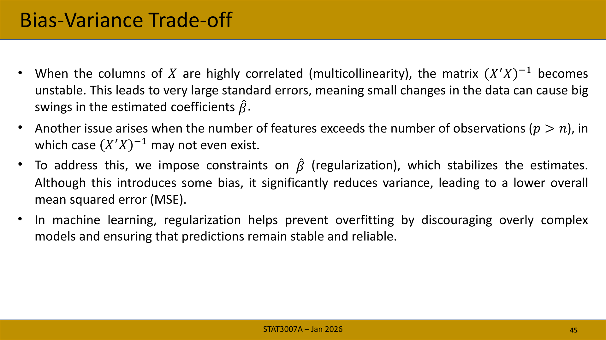

---

## 4.8 正则化（Regularization）

> **English（英文对照）：** Regularization adds a penalty to control model complexity and reduce variance.

### Ridge / L2

$$
\hat β_{ridge}
=\arg\min_β \|Y-Xβ\|^2+λ\|β\|_2^2
$$

闭式解：

$$
\boxed{
\hat β_{ridge}=(X'X+λI)^{-1}X'Y
}
$$

- $X'X+λI$ 总是可逆（$λ>0$）。
- 把系数“压小”，但通常不会恰好为 0。
- 对应 **高斯先验（Gaussian prior）** $β_j∼N(0,τ^2)$。

### Lasso / L1

$$
\hat β_{lasso}
=\arg\min_β \|Y-Xβ\|^2+λ\|β\|_1
$$

- 约束区域是菱形（polytope），有尖角，容易把某些系数压到 **恰好 0**；
- 自动做 **特征选择（feature selection）**；
- 对应 **Laplace 先验（Laplace prior）** $p(β_j)∝\exp(-|β_j|/b)$；
- 一般没有闭式解；当 $X'X=I$ 时，解是 **软阈值（soft-thresholding）**：
  $$
  \hat β_{λ,j}=\text{sign}(\hat β_j^{OLS})(|\hat β_j^{OLS}|-λ)_+.
  $$

### 贝叶斯视角：MAP = 损失 + 正则

$$
p(β|Data)∝p(Data|β)p(β)
$$

$$
-\ln p(β|Data)
\propto \underbrace{\|Y-Xβ\|^2}_{\text{loss}}
+\underbrace{λ\|β\|_1\text{ or }λ\|β\|_2^2}_{\text{penalty}}
$$

> **结论（Key takeaway）：**  
> - Ridge 的 L2 惩罚 = 高斯先验；  
> - Lasso 的 L1 惩罚 = Laplace 先验；  
> - **正则化 = 最大后验估计（MAP）**。  
> 这把 Week 7 和 Week 8 直接连起来了。
>
> **English（英文对照）：** Ridge L2 penalty = Gaussian prior; Lasso L1 penalty = Laplace prior; regularization = MAP estimation.

### 平滑函数上的正则化（Spline penalty）

$$
Pen(f;λ)=\frac1nΣ_{i=1}^n(y_i-f(x_i))^2+λ∫[f''(x)]^2dx
$$

- $λ=0$：无正则，容易过拟合；
- $λ→∞$：迫使 $f''=0$，只剩线性函数；
- 用基函数 $f(x)=Σ_j α_jh_j(x)$ 展开：
  $$
  ∫[f''(x)]^2dx=α'Ωα,\qquad
  Ω_{jk}=∫h_j''(x)h_k''(x)dx
  $$
  $$
  \hat α=(H'H+λΩ)^{-1}H'Y.
  $$

---

## 4.9 Week 7 易错点与检查清单

- [ ] 似然是 $θ$ 的函数，不是 $x$ 的函数。
- [ ] 取对数不改变 argmax。
- [ ] MLE 可能落在边界（Uniform 的 $\hat β=\max x_i$）。
- [ ] $\hat σ^2_{MLE}$ 分母是 $n$，无偏版本分母是 $n-1$。
- [ ] MSE 分解是 $Var+Bias^2$，不是 $Var+Bias$。
- [ ] 线性回归的 MLE 需要高斯噪声假设；逻辑回归的 MLE 等价于交叉熵。
- [ ] Lasso 产生稀疏解，Ridge 只缩小不置零。
- [ ] 正则化不是“让训练误差更小”，而是“用偏差换方差”。
- [ ] 分类用 0-1 损失时最优是后验最大；但 0-1 不可导，所以用 hinge / cross-entropy 等代理损失。

---

# 5. 【重点】 Week 8：贝叶斯统计与贝叶斯网络（Bayesian Statistics & Bayesian Networks）

> Week 8 有两大块：  
> 1. **贝叶斯推断**：先验 + 似然 → 后验；共轭先验让后验有闭式解。  
> 2. **贝叶斯网络**：DAG + CPT 紧凑表示联合分布；d-separation 读条件独立。
>
> **English（英文对照）：** Week 8 combines Bayesian updating with graphical models: priors and posteriors, conjugate families, Fisher information, and Bayesian networks.

## 5.1 贝叶斯规则（Bayes' Rule）

> **English（英文对照）：** Bayes' rule updates prior beliefs with the likelihood of the observed data.

观测数据 $y=(y_1,\ldots,y_n)$，参数 $θ$。

$$
\boxed{
p(θ|y)=\frac{p(y|θ)p(θ)}{p(y)}
∝p(y|θ)p(θ)
}
$$

- $p(θ)$：**先验（prior）**；
- $p(y|θ)$：**似然（likelihood）**；
- $p(θ|y)$：**后验（posterior）**；
- $p(y)=∫p(y|θ)p(θ)dθ$：**边缘似然 / 证据（marginal likelihood / evidence）**。

**后验预测（posterior predictive）**：新数据 $y^*$，假设给定 $θ$ 时 $y^*$ 与 $y$ 条件独立：

$$
\boxed{
p(y^*|y)=∫p(y^*|θ)p(θ|y)dθ
}
$$

**后验几率（posterior odds）**：

$$
\frac{p(θ_1|y)}{p(θ_2|y)}
=\frac{p(y|θ_1)}{p(y|θ_2)}
\cdot
\frac{p(θ_1)}{p(θ_2)}
$$

> **结论（Key takeaway）：后验 ∝ 似然 × 先验。**  
> 数据越多，似然越“尖”，先验影响越小；数据少时，先验影响大。
>
> **English（英文对照）：** Posterior ∝ likelihood × prior. With more data, the likelihood dominates; with little data, the prior matters more.

---

## 5.2 ★ 共轭先验（Conjugate Priors）Week 8 p.5–17

> **English（英文对照）：** A conjugate prior keeps the posterior in the same distribution family, giving closed-form updates.

**定义**：若先验分布族 $\mathcal{P}$ 满足“后验仍然属于 $\mathcal{P}$”，则称该先验为 **共轭先验（conjugate prior）**。

**优点（Advantages）**：

- 后验有闭式解（closed-form）；
- 计算简单、可解释；
- 是复杂模型的基础积木。

**指数族（exponential family）** 的自然共轭先验：

若

$$
p(y|θ)=f(y)g(θ)\exp\{\phi(θ)'u(y)\},
$$

则自然共轭先验形如

$$
p(θ)∝g(θ)^η\exp\{\phi(θ)'ν\}.
$$

后验：

$$
p(θ|y)∝g(θ)^{η+n}\exp\Big\{\phi(θ)'\big(ν+Σ_{j=1}^n u(y_j)\big)\Big\}.
$$

### 共轭先验总表（考试速查）

| 似然（Likelihood） | 先验（Prior） | 后验（Posterior） | 后验预测（Predictive） |
|---|---|---|---|
| Bernoulli / Binomial | $Beta(α,β)$ | $Beta(α+Σy_i,\;β+n-Σy_i)$ | $P(y^*=1\mid y)=\frac{α+Σy_i}{α+β+n}$ |
| Multinomial | $Dirichlet(α_1,\ldots,α_K)$ | $Dirichlet(α_k+n_k)$ | $P(y^*=k\mid y)=\frac{α_k+n_k}{Σα_j+n}$ |
| Normal（已知 $σ^2$） | $N(μ_0,τ_0^2)$ | $N(μ_1,τ_1^2)$ | $N(μ_1,σ^2+τ_1^2)$ |
| Normal（已知 $μ$） | $InverseGamma(α,β)$ | $IG(α+n/2,\;β+\frac12Σ(y_i-μ)^2)$ | Student's $t$ |
| Poisson | $Gamma(α,β)$ | $Gamma(α+Σy_i,\;β+n)$ | Negative Binomial |

### (1) Beta–Bernoulli / Beta–Binomial（课件 p.4）

先验：

$$
θ∼Beta(α,β),\qquad
p(θ)∝θ^{α-1}(1-θ)^{β-1}
$$

似然（$n$ 次，$\bar y$ 是 1 的比例）：

$$
p(y|θ)=θ^{n\bar y}(1-θ)^{n(1-\bar y)}
$$

后验：

$$
θ|y∼Beta(α+n\bar y,\;β+n(1-\bar y))
$$

后验均值：

$$
E[θ|y]=\frac{α+n\bar y}{α+β+n}
$$

后验预测：

$$
P(y^*=1|y)=\frac{α+n\bar y}{α+β+n}
$$

若先验是 Uniform，即 $α=β=1$：

$$
P(y^*=1|y)=\frac{1+n\bar y}{n+2}
$$

> **结论（Key takeaway）：Beta 先验 + Bernoulli 似然 ⇒ Beta 后验。**  
> 先验的 $α,β$ 可以理解为“伪计数（pseudo-counts）”：$α$ 个虚拟的 1，$β$ 个虚拟的 0。
>
> **English（英文对照）：** Beta prior + Bernoulli likelihood ⇒ Beta posterior. The prior parameters act as pseudo-counts.

### (2) Dirichlet–Multinomial（课件 p.10–11）

先验：

$$
θ∼Dirichlet(α_1,\ldots,α_K),\qquad
p(θ)∝∏_{j=1}^K θ_j^{α_j-1}
$$

似然（多项分布，$n_j$ 是第 $j$ 类计数）：

$$
p(y|θ)∝∏_{j=1}^K θ_j^{n_j}
$$

后验：

$$
θ|y∼Dirichlet(α_1+n_1,\ldots,α_K+n_K)
$$

后验预测：

$$
P(y^*=k|y)=\frac{α_k+n_k}{Σ_{j=1}^Kα_j+n}
$$

> **结论（Key takeaway）：Dirichlet 是 Beta 的多类别推广。**  
> 先验的 $α_k$ 也是“伪计数”。
>
> **English（英文对照）：** Dirichlet is the multivariate generalization of Beta; its parameters are also pseudo-counts.

### (3) Normal–Normal（已知方差，课件 p.12–13）

先验：

$$
θ∼N(μ_0,τ_0^2)
$$

似然：

$$
y_i|θ∼N(θ,σ^2)
$$

后验：

$$
θ|y∼N(μ_1,τ_1^2)
$$

其中

$$
\boxed{
\frac{1}{τ_1^2}=\frac{1}{τ_0^2}+\frac{n}{σ^2}
}
$$

$$
\boxed{
μ_1=\frac{\frac{μ_0}{τ_0^2}+\frac{n\bar y}{σ^2}}{\frac{1}{τ_0^2}+\frac{n}{σ^2}}
}
$$

> **精度的直觉：** 先验精度 $1/τ_0^2$ 加上数据精度 $n/σ^2$，得到后验精度 $1/τ_1^2$。  
> 后验均值是先验均值与样本均值的 **精度加权平均（precision-weighted average）**。

后验预测：

$$
y^*|y∼N(μ_1,\;σ^2+τ_1^2)
$$

> **注意：** 预测方差 = **观测噪声 $σ^2$** + **参数不确定性 $τ_1^2$**。

### (4) Inverse-Gamma–Normal（已知均值，课件 p.14–16）

先验：

$$
σ^2∼InverseGamma(α,β)
$$

后验：

$$
σ^2|y∼IG\Big(\alpha+\frac n2,\;\beta+\frac12Σ_{i=1}^n(y_i-θ)^2\Big)
$$

后验预测是 **Student's $t$ 分布**：

$$
y^*|y∼t_{\nu}(θ,s),
\qquad \nu=2a,\quad s^2=\frac b a,
$$

其中

$$
a=\frac n2+α,\qquad b=β+\frac12Σ(y_i-θ)^2.
$$

### (5) Gamma–Poisson（课件 p.17）

先验：

$$
θ∼Gamma(α,β)
$$

似然：

$$
y_i|θ∼Poisson(θ)
$$

后验：

$$
θ|y∼Gamma(α+Σy_i,\;β+n)
$$

后验预测：

$$
y^*|y∼NegativeBinomial(α+Σy_i,\;β+n)
$$

> **结论（Key takeaway）：共轭先验的核心是“先验和似然形式匹配，后验保持同一族”。**  
> 考试若给出先验和似然，先认出族，再套更新公式，通常不需要硬算积分。
>
> **English（英文对照）：** A conjugate prior matches the likelihood so that the posterior stays in the same family.

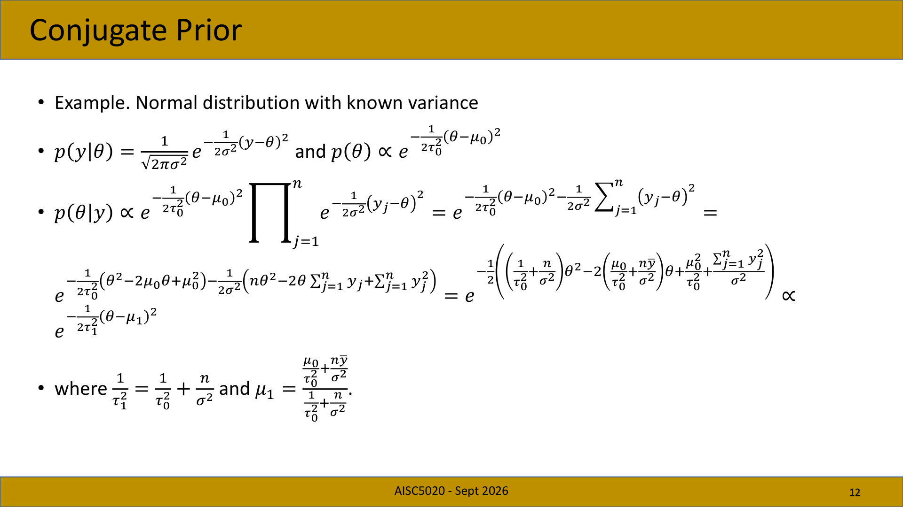

---

## 5.3 ★ Fisher 信息与 Jeffreys 先验（Week 8 p.6–7）

### Fisher 信息（Fisher Information）

对单个观测 $Y$：

$$
\boxed{
I(θ)=E\Big[\Big(\frac{\partial\ln p(Y|θ)}{\partial θ}\Big)^2\Big]
=-E\Big[\frac{\partial^2\ln p(Y|θ)}{\partial θ^2}\Big]
}
$$

- 第一式：**得分函数（score）的平方的期望**；
- 第二式：**对数似然曲率的期望**（更常用）。
- $I(θ)$ 越大，说明似然对 $θ$ 越敏感，数据对 $θ$ 的信息越多。

对 $n$ 个 IID 观测：

$$
I_n(θ)=nI(θ)
$$

### Jeffreys 先验（Jeffreys Prior）

$$
\boxed{
p(θ)∝\sqrt{I(θ)}
}
$$

**不变性（invariance）**：在重参数化 $φ=g(θ)$ 下，Jeffreys 先验保持形式一致：

$$
p(φ)=p(θ)\Big|\frac{dθ}{dφ}\Big|.
$$

普通 Uniform 先验不具备这个性质（课件 p.5 的例子：$θ∼U(0,1)$ 与 $φ=θ^2∼U(0,1)$ 会矛盾）。

### Bernoulli 例子（课件 p.7–8）

$$
\ln p(y|θ)=y\ln θ+(1-y)\ln(1-θ)
$$

$$
\frac{\partial\ln p}{\partial θ}=\frac yθ-\frac{1-y}{1-θ}
$$

$$
\frac{\partial^2\ln p}{\partial θ^2}=-\frac{y}{θ^2}-\frac{1-y}{(1-θ)^2}
$$

$$
I(θ)=E\Big[-\frac{\partial^2\ln p}{\partial θ^2}\Big]
=\frac{1}{θ}+\frac{1}{1-θ}
=\frac{1}{θ(1-θ)}
$$

所以 Jeffreys 先验：

$$
p(θ)∝θ^{-1/2}(1-θ)^{-1/2}
=Beta(1/2,1/2)
$$

后验：

$$
θ|y∼Beta\Big(n\bar y+\frac12,\;n(1-\bar y)+\frac12\Big)
$$

后验预测：

$$
P(y^*=1|y)=\frac{n\bar y+1/2}{n+1}
$$

> **结论（Key takeaway）：Fisher 信息衡量“数据对参数的信息量”；Jeffreys 先验用 $\sqrt{I(θ)}$ 保证重参数化不变。**  
> 这是 Week 8 的一个小考点，常考 Bernoulli / Binomial 的 Fisher 信息和 Jeffreys 先验。
>
> **English（英文对照）：** Fisher information measures how much information the data carry about the parameter; the Jeffreys prior uses $\sqrt{I(\theta)}$ to be reparameterization-invariant.

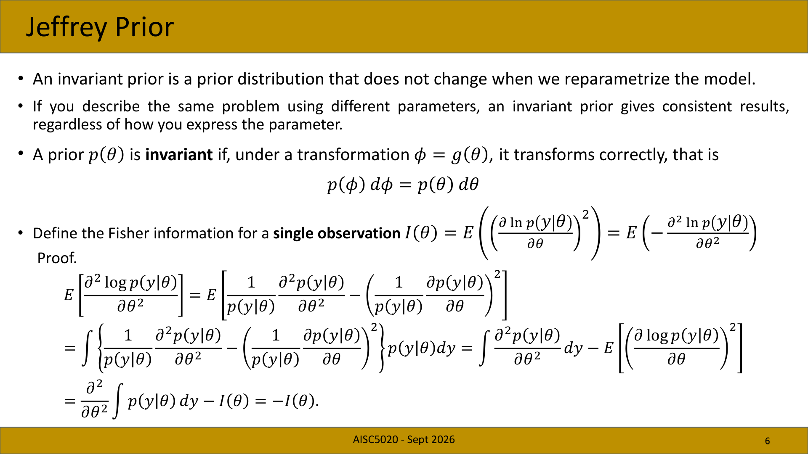

---

## 5.4 贝叶斯网络（Bayesian Networks）

> **English（英文对照）：** A Bayesian network compactly represents a joint distribution with a DAG and local conditional probability tables.

### 为什么需要贝叶斯网络？

若有 $n$ 个离散变量，每个有 $d$ 个取值，完整联合分布需要存 $d^n$ 个数：

- $n=4,d=2$：$16$ 个；
- $n=30,d=2$：$>10^9$ 个，完全不现实。

**贝叶斯网络**用 **DAG（有向无环图，directed acyclic graph）** + **CPT（条件概率表，conditional probability table）** 紧凑表示：

$$
\boxed{
P(X_1,\ldots,X_n)=∏_{j=1}^n P\big(X_j|Pa(X_j)\big)
}
$$

这就是 **因子分解（factorization theorem）**。

### 例子：Alarm 网络（课件 p.22）

变量：

- $B$：Burglary（入室盗窃）；
- $E$：Earthquake（地震）；
- $A$：Alarm（警报）；
- $J$：John calls（John 打电话）；
- $M$：Mary calls（Mary 打电话）。

DAG：$B→A←E$，$A→J$，$A→M$。

联合分布：

$$
P(B,E,A,J,M)=P(B)P(E)P(A|B,E)P(J|A)P(M|A)
$$

需要存：$P(B),P(E),P(A|B,E),P(J|A),P(M|A)$ 这些小表，而不是 $2^5=32$ 个联合概率。

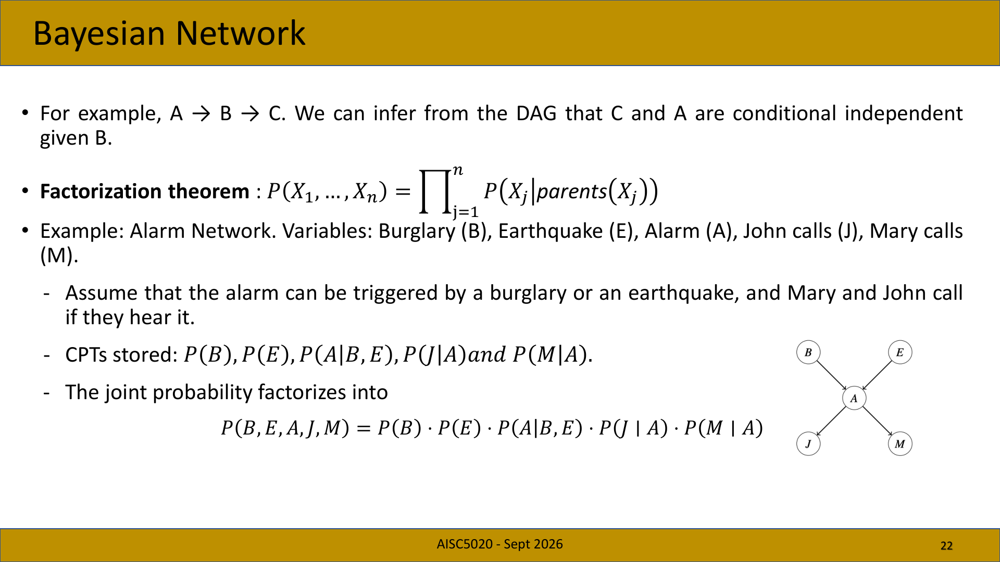

### 局部马尔可夫性质（Local Markov Property）

**每个变量在给定其父节点后，条件独立于它的非后代节点（non-descendants）。**

$$
X_j⊥\text{NonDescendants}(X_j)\;|\;Pa(X_j)
$$

例如 $A→B→C→D$：

$$
D⊥\{A,B\}\;|\;C
$$

因为一旦知道 $C$，$A,B$ 就不能再提供关于 $D$ 的额外信息。

### 马尔可夫毯（Markov Blanket）

一个节点的 **马尔可夫毯** = 父节点 + 子节点 + 子节点的其他父节点（co-parents）。

给定马尔可夫毯，该节点条件独立于网络中所有其他节点。

Alarm 网络中：

- $A$ 的马尔可夫毯：$\{B,E,J,M\}$；
- $J$ 的马尔可夫毯：$\{A\}$；
- $B$ 的马尔可夫毯：$\{A,E\}$（$A$ 是子节点，$E$ 是 co-parent）。

> **结论（Key takeaway）：**  
> 局部马尔可夫性质告诉你“看父节点就够了”；  
> 马尔可夫毯告诉你“要完全隔离一个节点，需要看哪些节点”。
>
> **English（英文对照）：** The local Markov property says “look at the parents”; the Markov blanket tells you which nodes isolate a node from the rest of the network.

---

## 5.5 【重点】 三种基本结构：Chain、Fork、Collider

> **English（英文对照）：** Chain/fork: observing the middle node blocks the path; collider: observing the middle node or its descendant opens the path.

### (1) 链（Chain）：$X→Y→Z$

- 不观测 $Y$：$X$ 与 $Z$ 可能相关（信息沿着链流动）。
- 观测 $Y$：$X⊥Z|Y$，路径被 **阻断（blocked）**。

$$
p(x,y,z)=p(x)p(y|x)p(z|y)
$$

### (2) 共同原因（Fork）：$X←Y→Z$

- 不观测 $Y$：$X$ 与 $Z$ 可能相关。
- 观测 $Y$：$X⊥Z|Y$，路径被阻断。

$$
p(x,y,z)=p(y)p(x|y)p(z|y)
$$

> 这就是 Week 5 的 $X=Z+e_1,Y=Z+e_2$ 例子。

### (3) 对撞（Collider）：$X→Y←Z$

- 不观测 $Y$：$X⊥Z$（路径本来就不通）。
- 观测 $Y$ **或 $Y$ 的任一后代**：$X$ 与 $Z$ 反而相关，路径被 **打开（active）**。

$$
p(x,y,z)=p(x)p(z)p(y|x,z)
$$

> ** 口诀：**  
> **Chain / Fork：观测中间节点 → 阻断；**  
> **Collider：观测中间节点（或后代）→ 打开。**  
> 这就是“**explaining away（解释掉）**”：知道结果后，原因之间会互相解释。

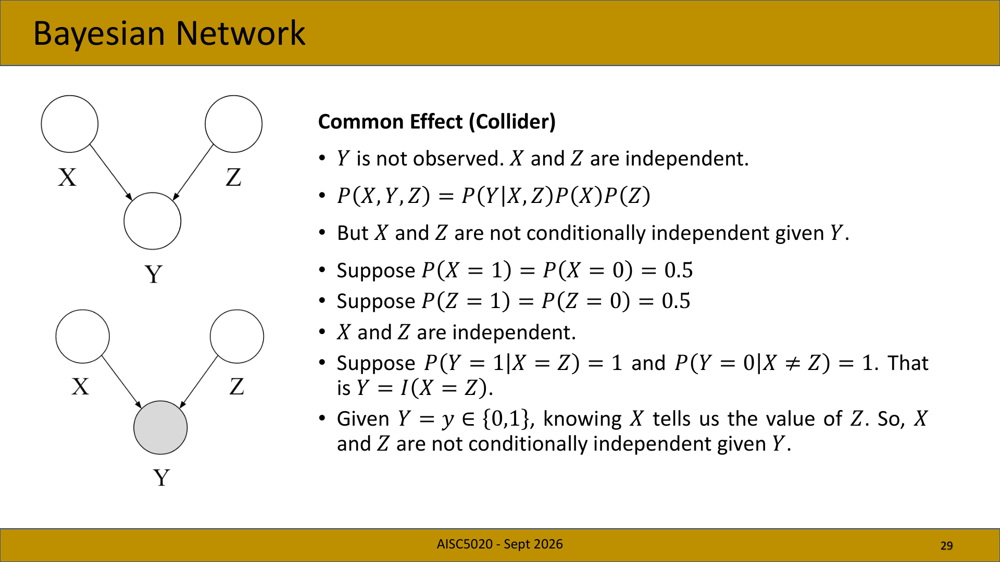

---

## 5.6 【重点】 d-separation（有向分离）

> **English（英文对照）：** d-separation is a graphical test for conditional independence in a DAG.

给定 DAG、两个节点 $X,Y$ 和观测集合 $Z=\{Z_1,\ldots,Z_k\}$。

**定义**：若 $Z$ 把 $X$ 与 $Y$ 之间的所有路径都阻断，则称 $X,Y$ 被 $Z$ **d-分离（d-separated）**，记作

$$
X⊥Y\,|\,Z
$$

并且这个条件独立在 **所有** 与 DAG 一致的分布中都成立。

### 算法（d-separation algorithm）

1. 把观测节点 $Z$ **涂黑（shade）**。
2. 把有向边看成无向边，枚举 $X$ 到 $Y$ 的所有路径。
3. 对每条路径，拆成重叠的三元组（triples）$A-B-C$。
4. 判断每个三元组是 **active** 还是 **blocked**：
   - **Chain** $A→B→C$：若 $B$ **未观测**，active；若 $B$ **观测**，blocked。
   - **Fork** $A←B→C$：若 $B$ **未观测**，active；若 $B$ **观测**，blocked。
   - **Collider** $A→B←C$：若 $B$ **及其所有后代都未观测**，blocked；若 $B$ **或任一后代观测**，active。
5. **一条路径 active ⇔ 路径上每个三元组都 active。**
6. **若所有路径都 blocked ⇒ d-separated ⇒ 条件独立。**  
   **若至少一条路径 active ⇒ d-connected ⇒ 条件独立不保证。**

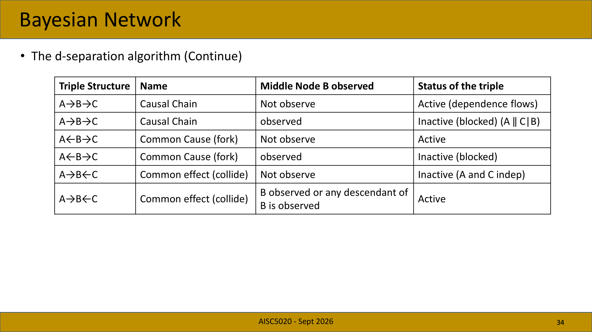

### 例（课件 p.35）

DAG：$L→R→T←B$，$R→D$，$T→T'$。

问：$L$ 与 $B$ 在给定 $Z=\{R,T\}$ 下是否 d-separated？

路径：$L-R-T-B$。

- Triple 1：$L→R→T$。$R$ 被观测 ⇒ chain 被 **blocked**。
- Triple 2：$R→T←B$。$T$ 被观测 ⇒ collider **active**。

因为路径要求 **每个 triple 都 active**，而 Triple 1 已经 blocked，所以整条路径 **blocked**。

所以

$$
L⊥B\,|\,\{R,T\}
$$

### 例（课件 p.36）

问：$L$ 与 $B$ 在给定 $Z=\{T'\}$ 下是否 d-separated？

- Triple 1：$L→R→T$。$R$ 未观测 ⇒ active。
- Triple 2：$R→T←B$。$T'$ 是 $T$ 的后代且被观测 ⇒ collider **active**。

整条路径 active ⇒ $L$ 与 $B$ **d-connected** ⇒ 条件独立 **不保证**。

### 例（课件 p.37）

问：$Z=∅$。

- Triple 1：$L→R→T$，$R$ 未观测 ⇒ active。
- Triple 2：$R→T←B$，$T,T'$ 都未观测 ⇒ collider **blocked**。

路径 blocked ⇒ $L⊥B$（边缘独立）。

> **结论（Key takeaway）：**  
> - 观测 **chain / fork 的中间节点** 会阻断路径；  
> - 观测 **collider 或其后代** 会打开路径；  
> - 所以“控制变量”不一定让变量独立，控制 collider 反而制造相关。
>
> **English（英文对照）：** Observing the middle node of a chain or fork blocks the path; observing a collider or its descendant opens the path. Controlling for a collider can create dependence.

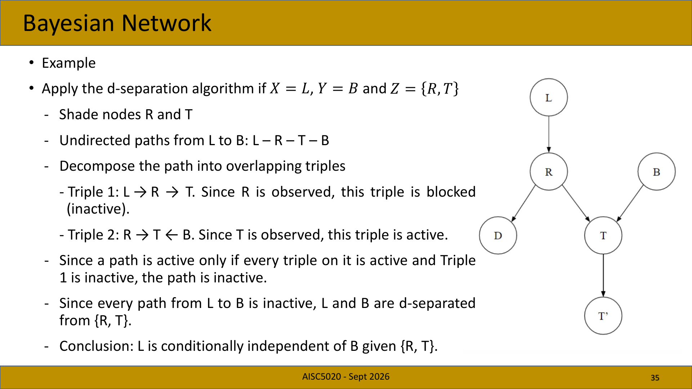

---

## 5.7 【重点】 贝叶斯网络推断（Inference）

> **English（英文对照）：** Inference simplifies the network by removing irrelevant nodes and conditioning on the evidence.

给定网络 $P(X_1=x_1,\ldots,X_n=x_n)$ 和证据 $E=e$，求查询

$$
P(Q=q|E=e)
$$

其中 $Q⊆X$。

### 四步策略（课件 p.39–40）

1. **删掉与 $Q∪E$ 无关的节点**：  
   只保留 $Q$ 和 $E$ 的祖先（ancestors）；非祖先不可能影响查询或证据。
2. **条件化证据 $E=e$**：  
   固定证据节点的值；把其子节点的 CPT 用观测值缩减；然后可以删掉证据节点。
3. **删掉与 $Q$ 断开的节点**：  
   步骤 1–2 后，有些节点与 $Q$ 不再连通，给定证据后与 $Q$ 独立，可以删。
4. **在缩减后的网络上计算条件概率**：  
   通常用
   $$
   P(Q|E=e)=\frac{P(Q,E=e)}{P(E=e)}
   ∝P(Q,E=e)
   $$
   并对剩余变量求和 / 积分。

### Asia 网络例子（课件 p.41–45）

变量：

- $A$：Visit to Asia（去过亚洲）；
- $S$：Smoking（吸烟）；
- $T$：Tuberculosis（肺结核）；
- $L$：Lung cancer（肺癌）；
- $E$：Either tuberculosis or lung cancer（肺结核或肺癌）；
- $B$：Bronchitis（支气管炎）；
- $X$：Positive X-ray（X 光阳性）；
- $D$：Dyspnoea（呼吸困难）。

DAG：

$$
A→T→E→X,\qquad
S→L→E,\qquad
S→B→D,\qquad
E→D
$$

标准因子分解：

$$
P(A,S,T,L,B,E,X,D)
=P(A)P(S)P(T|A)P(L|S)P(E|T,L)P(B|S)P(X|E)P(D|E,B)
$$

> **课件 p.23 写成 $P(D|E,S,B)$，但按图中箭头，$D$ 的父节点是 $E$ 和 $B$。**  
> 以 DAG 箭头为准；若考试严格按课件公式，则按课件写。这里提醒你注意这个细节。

给定 $X=1$，求 $P(L=1|X=1)$。

**步骤（Recipe）**：

1. 保留 $L,X$ 的祖先：$A,S,T,L,E$；删掉 $B,D$。
2. 固定 $X=1$：$P(X=1|E=1)=0.98$，$P(X=1|E=0)=0.05$；删掉 $X$。
3. 剩余 $A,S,T,L,E$ 都与 $L$ 连通。
4. 计算：

$$
P(L=1,X=1)
=Σ_{A,S,T,E}P(X=1|E)P(E|T,L=1)P(L=1|S)P(T|A)P(A)P(S)
$$

课件算得

$$
P(L=1,X=1)≈0.05390
$$

$$
P(L=0,X=1)≈0.02833
$$

所以

$$
P(L=1|X=1)
=\frac{0.05390}{0.05390+0.02833}
≈0.655
$$

**解释**：先验肺癌概率约 5.5%；观测到 X 光阳性后，后验跳到约 65.5%。  
因为 $X$ 强烈指示 $E$，而 $E$ 又由 $L$ 或 $T$ 导致，所以 $X$ 为 $L$ 提供了强证据。

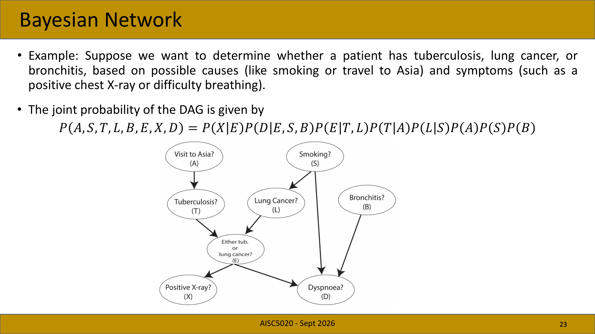

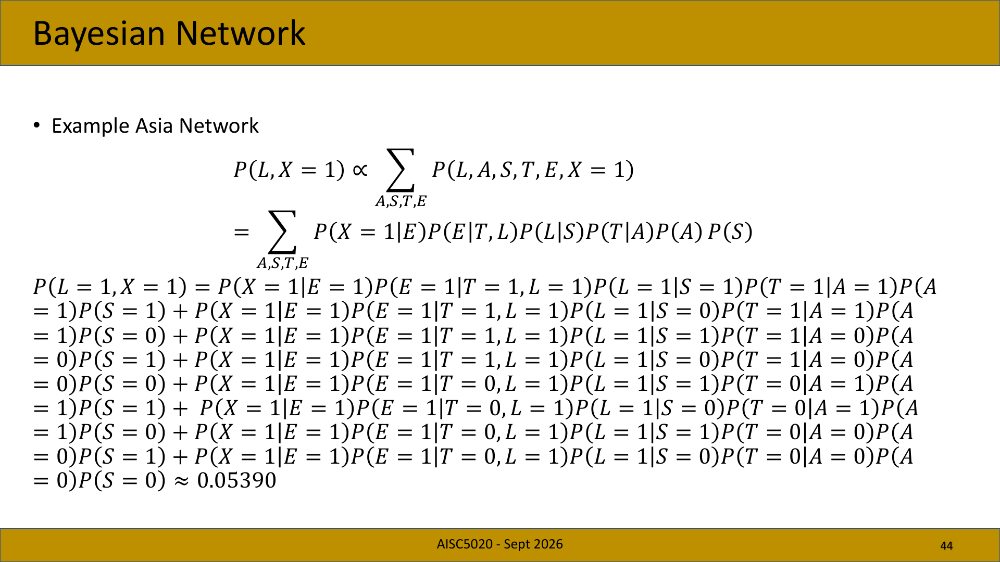

---

## 5.8 Week 8 易错点与检查清单

- [ ] 后验 ∝ 似然 × 先验，分母是归一化常数，通常不用算。
- [ ] 共轭先验要“先认族，再套公式”；Beta–Bernoulli、Dirichlet–Multinomial、Normal–Normal、Gamma–Poisson 必须熟。
- [ ] Fisher 信息有两种等价写法：得分平方的期望 = 负二阶导的期望。
- [ ] Jeffreys 先验是 $\sqrt{I(θ)}$，不是 $I(θ)$。
- [ ] 贝叶斯网络因子分解的分母只写父节点，不写所有祖先。
- [ ] d-separation 中，**collider 被观测会打开路径**，不是阻断。
- [ ] 观测 collider 的 **后代** 也会打开路径。
- [ ] “d-connected”只说明“可能相关”，不保证（Only “possibly dependent”; no guarantee）一定相关；“d-separated”才保证条件独立。
- [ ] 推断时先删非祖先、再条件化证据、再删断开的节点，能大幅简化计算。

---

# 6. 知识点之间的联系（How everything connects）

## 6.1 一张文字版“知识地图”

```text
                         ┌──────────────────────────┐
                         │ Week 5 概率基础           │
                         │ 事件 → 随机变量 → 分布    │
                         └────────────┬─────────────┘
                                      │
              ┌───────────────────────┼────────────────────────┐
              ▼                       ▼                        ▼
   条件概率 / 贝叶斯          联合 / 边缘 / 条件分布      期望 / 方差 / 协方差
              │                       │                        │
              ▼                       ▼                        ▼
   Week 8 先验/后验          条件期望 E[Y|X]            全期望 / 全方差
              │                       │                        │
              ▼                       ▼                        ▼
   共轭先验 / Fisher           Week 7 回归函数           Week 7 偏差-方差
              │                       │                        │
              └───────────────┬───────┴────────────┬───────────┘
                              ▼                    ▼
                    Week 6 熵 / KL / 互信息    Week 7 MLE / 损失 / 正则
                              │                    │
                              ▼                    ▼
                    Fano 下界 / 条件独立     交叉熵 / 逻辑回归 / MAP
                              │                    │
                              └─────────┬──────────┘
                                        ▼
                              Week 8 贝叶斯网络
                              DAG + CPT + d-separation
```

## 6.2 关键“桥接”表

| 前面的概念 | 在哪里出现 | 后面怎么用 |
|---|---|---|
| 条件概率 $P(A\mid B)$ | Week 5 | Week 8 的 posterior $p(θ\mid y)$；贝叶斯网络 CPT |
| 条件分布 $f(x\mid y)$ | Week 5 | Week 7 条件似然 $P_θ(y\mid x)$；Week 8 网络因子 |
| 条件期望 $E[Y\mid X]$ | Week 5 p.49–50 | Week 7 回归函数 $f(x)=E[Y\mid X=x]$ |
| 全方差公式 | Week 5 p.51 | Week 7 偏差-方差分解 |
| 条件独立 $X⊥Y\mid Z$ | Week 5 p.53–55 | Week 8 d-separation 的语义基础 |
| 熵 / 交叉熵 / KL | Week 6 | Week 7 MLE = min KL；逻辑回归 = 交叉熵 |
| 互信息 $I(X;Y)$ | Week 6 | 特征信息量；Fano 下界 |
| 马尔可夫链 $X→Y→Z$ | Week 6 | Week 8 chain 结构；数据处理不等式 |
| Fano 不等式 | Week 6 p.38–43 | Week 7 分类错误率下界 |
| MLE | Week 7 | Week 7 线性/逻辑回归；Week 8 MAP 的特例（Uniform prior） |
| 正则化 | Week 7 | Week 8 贝叶斯先验（Ridge↔Gaussian，Lasso↔Laplace） |
| 共轭先验 | Week 8 | 闭式后验、后验预测；简单贝叶斯模型 |
| Fisher 信息 | Week 8 | Jeffreys 先验；参数估计效率 |
| 贝叶斯网络 | Week 8 | 高维联合分布的紧凑表示；条件独立查询 |

## 6.3 三个“统一视角”

1. **条件化视角**  
   条件概率 → 条件分布 → 条件期望 → 条件熵 / 互信息 → 条件似然 → 贝叶斯网络。  
   **所有“给定某些信息”的问题，都是条件化。**

2. **优化视角**  
   MLE = 最小化 KL = 最小化交叉熵；  
   线性回归 = 高斯似然 + 最小二乘；  
   逻辑回归 = Bernoulli 似然 + 交叉熵；  
   正则化 = 先验 + MAP。  
   **所有“训练模型”的问题，都可以写成“损失 + 正则”。**

3. **不确定性视角**  
   方差 → 全方差 → 偏差-方差 → 熵 → Fano。  
   **不确定性可以分解（全方差、偏差-方差），也可以给出下界（Fano）。**

---

## 6.4 关键结论中英对照（Bilingual key takeaways）

| 中文结论 | English takeaway |
|---|---|
| 条件分布 = 联合分布 ÷ 边缘分布。 | Conditional = joint divided by marginal. |
| 全期望公式：先条件平均，再对条件变量平均。 | Law of total expectation: average conditional means over the conditioner. |
| 全方差 = 组内方差 + 组间方差。 | Total variance = within-group variance + between-group variance. |
| 多元正态条件化后，均值线性修正，方差通常变小。 | Conditioning a Gaussian shifts the mean linearly and usually reduces the covariance. |
| 条件独立：知道 $Z$ 后，$Y$ 不再提供关于 $X$ 的额外信息。 | Conditional independence: given $Z$, $Y$ gives no extra information about $X$. |
| 熵衡量平均不确定性 / 最优平均编码长度。 | Entropy measures average uncertainty / optimal average code length. |
| 交叉熵 = 熵 + KL。 | Cross-entropy = entropy + KL divergence. |
| Fano 给出由 $H(X\mid Y)$ 决定的错误率下界。 | Fano gives a lower bound on error determined by $H(X\mid Y)$. |
| MLE 是让观测数据最可能出现的参数。 | MLE is the parameter that makes the observed data most likely. |
| MLE 等价于最小化真实分布与模型分布的 KL。 | MLE is equivalent to minimizing KL between the true and model distributions. |
| 高斯噪声 + 线性模型 ⇒ 最小二乘。 | Gaussian noise + linear model ⇒ least squares. |
| Bernoulli 输出 + logistic 模型 ⇒ 交叉熵。 | Bernoulli output + logistic model ⇒ cross-entropy. |
| MSE = 方差 + 偏差平方。 | MSE = variance + squared bias. |
| Ridge 用 L2 惩罚，Lasso 用 L1 惩罚。 | Ridge uses an L2 penalty; Lasso uses an L1 penalty. |
| 正则化 = 用偏差换方差。 | Regularization trades bias for variance. |
| 后验 ∝ 似然 × 先验。 | Posterior ∝ likelihood × prior. |
| 共轭先验让后验保持同一分布族。 | A conjugate prior keeps the posterior in the same family. |
| Fisher 信息衡量数据对参数的信息量。 | Fisher information measures how much information the data carry about the parameter. |
| 贝叶斯网络用 DAG + CPT 因子分解联合分布。 | A Bayesian network factorizes the joint distribution with a DAG and CPTs. |
| d-separated ⇒ 条件独立；d-connected 只说明可能相关。 | d-separated ⇒ conditional independence; d-connected only means possible dependence. |

### 关键问题中英对照（Bilingual key questions）

| 中文问题 | English question |
|---|---|
| 给定联合分布，如何求边缘和条件分布？ | Given a joint distribution, how do we obtain marginals and conditionals? |
| 条件化会让方差变大还是变小？ | Does conditioning increase or decrease variance? |
| 如何判断两个变量条件独立？ | How can we tell whether two variables are conditionally independent? |
| 为什么分类用交叉熵而不是 MSE？ | Why use cross-entropy instead of MSE for classification? |
| MLE、KL、交叉熵之间是什么关系？ | How are MLE, KL divergence, and cross-entropy related? |
| 为什么要正则化？Ridge 和 Lasso 有什么区别？ | Why regularize? What is the difference between Ridge and Lasso? |
| 共轭先验为什么有用？ | Why are conjugate priors useful? |
| 一个 DAG 蕴含哪些条件独立？ | Which conditional independencies does a DAG imply? |
| 观测 collider 会发生什么？ | What happens when we condition on a collider? |
| d-separated 和 d-connected 有什么区别？ | What is the difference between d-separated and d-connected? |

---

## 6.5 核心术语表（Glossary）

| 中文 | English | 一句话解释 |
|---|---|---|
| 样本空间 | sample space | 所有可能结果的集合 $Ω$。 |
| 事件 | event | 样本空间的子集。 |
| 条件概率 | conditional probability | 已知 $B$ 发生后 $A$ 的概率。 |
| 联合分布 | joint distribution | 多个变量一起的分布 $p(x,y)$。 |
| 边缘分布 | marginal distribution | 把其他变量积掉 / 加掉后剩下的分布。 |
| 条件分布 | conditional distribution | 固定某些变量后，其余变量的分布。 |
| 全期望公式 | law of total expectation | $E[Y]=E[E[Y\mid X]]$。 |
| 全方差公式 | law of total variance | $Var(Y)=E[Var(Y\mid X)]+Var(E[Y\mid X])$。 |
| 条件独立 | conditional independence | 给定 $Z$ 后 $X$ 与 $Y$ 独立。 |
| 熵 | entropy | 平均不确定性 / 最优平均编码长度。 |
| 交叉熵 | cross-entropy | 用模型 $q$ 编码真实 $p$ 的平均成本。 |
| KL 散度 | KL divergence | 交叉熵与熵的差，衡量分布差异。 |
| 互信息 | mutual information | 知道 $Y$ 能减少多少关于 $X$ 的不确定性。 |
| 似然 | likelihood | 固定数据，把联合概率看成参数的函数。 |
| 最大似然估计 | MLE | 让观测数据最可能出现的参数。 |
| 先验 | prior | 看数据前对参数的信念。 |
| 后验 | posterior | 看数据后更新的参数分布。 |
| 共轭先验 | conjugate prior | 后验与先验属于同一分布族的先验。 |
| Fisher 信息 | Fisher information | 数据对参数的信息量 / 对数似然曲率。 |
| 杰弗里斯先验 | Jeffreys prior | 与参数化无关的先验 $p(θ)∝\sqrt{I(θ)}$。 |
| 有向无环图 | DAG | 贝叶斯网络的结构，边有方向且无环。 |
| 条件概率表 | CPT | 每个节点给定父节点后的局部概率表。 |
| 马尔可夫毯 | Markov blanket | 父节点 + 子节点 + co-parents。 |
| 链 | chain | $X→Y→Z$，观测 $Y$ 阻断路径。 |
| 共同原因 | fork | $X←Y→Z$，观测 $Y$ 阻断路径。 |
| 对撞 | collider | $X→Y←Z$，观测 $Y$ 或其后代打开路径。 |
| 有向分离 | d-separation | 用图判断条件独立的规则。 |
| 偏差-方差权衡 | bias-variance trade-off | 模型复杂度与泛化误差的权衡。 |
| 正则化 | regularization | 加惩罚项，用偏差换方差。 |

---

## 6.6 常用数学句式与读法中英对照（Common phrases & how to read formulas）

| 中文句式 | English phrase |
|---|---|
| 当且仅当 | if and only if (iff) |
| 对任意 / 对所有 | for all / for any |
| 存在 | there exists |
| 相互独立 | mutually independent |
| 条件独立于 | conditionally independent of |
| 以概率 1 | with probability 1 |
| 几乎必然 | almost surely |
| 无偏估计 | unbiased estimator |
| 渐近无偏 | asymptotically unbiased |
| 充分统计量 | sufficient statistic |
| 后验预测分布 | posterior predictive distribution |
| 边缘分布 | marginal distribution |
| 联合分布 | joint distribution |
| 因子分解 | factorization |
| 有向无环图 | directed acyclic graph (DAG) |
| 条件概率表 | conditional probability table (CPT) |
| 马尔可夫毯 | Markov blanket |
| 有向分离 | d-separation |
| 解释掉 | explaining away |
| 特征选择 | feature selection |
| 多重共线性 | multicollinearity |
| 过拟合 | overfitting |

| 公式 | 英文读法（How to read it） |
|---|---|
| $P(A\mid B)$ | the probability of $A$ given $B$ |
| $E[Y\mid X]$ | the conditional expectation of $Y$ given $X$ |
| $Var(Y\mid X)$ | the conditional variance of $Y$ given $X$ |
| $X⊥Y\mid Z$ | $X$ and $Y$ are conditionally independent given $Z$ |
| $X∼N(μ,Σ)$ | $X$ follows a multivariate normal distribution with mean $μ$ and covariance $Σ$ |
| $p(θ\mid y)∝p(y\mid θ)p(θ)$ | the posterior is proportional to the likelihood times the prior |
| $D_{KL}(p\vert\vert q)$ | the KL divergence from $p$ to $q$ |
| $H(X\mid Y)$ | the conditional entropy of $X$ given $Y$ |
| $\hat θ$ | an estimator or estimate of $θ$ |
| $\arg\max_θℓ(θ)$ | the value of $θ$ that maximizes $ℓ(θ)$ |
| iid | independent and identically distributed |
| $X\perp Y$ | $X$ and $Y$ are independent |

---

# 7. 公式速查（One-page formula sheet）

## 7.1 概率与条件

$$
P(A|B)=\frac{P(A∩B)}{P(B)}
$$

$$
P(B)=Σ_jP(B|A_j)P(A_j)
$$

$$
P(A_i|B)=\frac{P(B|A_i)P(A_i)}{Σ_jP(B|A_j)P(A_j)}
$$

$$
p(x,y)=p(x|y)p(y)=p(y|x)p(x)
$$

$$
p(x_1,\ldots,x_n)=p(x_1)p(x_2|x_1)\cdots p(x_n|x_1,\ldots,x_{n-1})
$$

## 7.2 期望、方差、协方差

$$
E[aX+bY]=aE[X]+bE[Y]
$$

$$
Var(aX+b)=a^2Var(X)
$$

$$
Var(X)=E[X^2]-(E[X])^2
$$

$$
Cov(X,Y)=E[XY]-E[X]E[Y]
$$

$$
Var(X±Y)=Var(X)+Var(Y)±2Cov(X,Y)
$$

$$
\boxed{E[Y]=E[E[Y|X]]}
$$

$$
\boxed{Var(Y)=E[Var(Y|X)]+Var(E[Y|X])}
$$

## 7.3 多元分布

$$
f_X(x)=∫f_{X,Y}(x,y)dy
$$

$$
f_{X|Y}(x|y)=\frac{f_{X,Y}(x,y)}{f_Y(y)}
$$

$$
X⊥Y \iff f_{X,Y}(x,y)=f_X(x)f_Y(y)
$$

$$
X⊥Y|Z \iff f_{X,Y|Z}(x,y|z)=f_{X|Z}(x|z)f_{Y|Z}(y|z)
$$

$$
X∼N(μ,Σ)\quad⇒\quad AX∼N(Aμ,AΣA')
$$

$$
X_b|X_a=x_a∼N\big(μ_b+Σ_{ba}Σ_{aa}^{-1}(x_a-μ_a),\;Σ_{bb}-Σ_{ba}Σ_{aa}^{-1}Σ_{ab}\big)
$$

## 7.4 信息论

$$
H(X)=-Σ_xp(x)\log_2p(x)
$$

$$
H(X,Y)=H(X)+H(Y|X)
$$

$$
H(X|Y)≤H(X)≤H(X,Y)
$$

$$
H(p,q)=-Σ_xp(x)\log_2q(x)
$$

$$
D_{KL}(p||q)=H(p,q)-H(p)≥0
$$

$$
I(X;Y)=H(X)+H(Y)-H(X,Y)=H(X)-H(X|Y)
$$

$$
I(X;Y|Z)=H(X|Z)-H(X|Y,Z)
$$

$$
X→Y→Z\quad⇒\quad I(X;Y)≥I(X;Z)
$$

$$
H(P_e)+P_e\log_2|\mathcal{X}|≥H(X|Y)
$$

$$
P_e≥\frac{H(X|Y)-1}{\log_2|\mathcal{X}|}
$$

## 7.5 统计推断

$$
L(θ)=∏_{i=1}^nf_θ(x_i),\qquad
ℓ(θ)=Σ_{i=1}^n\ln f_θ(x_i)
$$

$$
\hat θ=\arg\max_θℓ(θ)
$$

$$
MSE(\hat θ)=Var(\hat θ)+[Bias(\hat θ)]^2
$$

$$
\hat β_{OLS}=(X'X)^{-1}X'Y
$$

$$
\hat β_{ridge}=(X'X+λI)^{-1}X'Y
$$

$$
\hat β_{lasso}=\arg\min_β\|Y-Xβ\|^2+λ\|β\|_1
$$

$$
\text{soft-threshold: }\hat β_{λ,j}=\text{sign}(\hat β_j^{OLS})(|\hat β_j^{OLS}|-λ)_+
$$

## 7.6 贝叶斯

$$
p(θ|y)∝p(y|θ)p(θ)
$$

$$
p(y^*|y)=∫p(y^*|θ)p(θ|y)dθ
$$

$$
Beta(α,β)+Bin(n,\bar y)⇒Beta(α+n\bar y,\;β+n(1-\bar y))
$$

$$
Dirichlet(α)+Multinomial(n)⇒Dirichlet(α_k+n_k)
$$

$$
N(μ_0,τ_0^2)+N(θ,σ^2)⇒N(μ_1,τ_1^2)
$$

$$
\frac1{τ_1^2}=\frac1{τ_0^2}+\frac n{σ^2}
$$

$$
μ_1=\frac{μ_0/τ_0^2+n\bar y/σ^2}{1/τ_0^2+n/σ^2}
$$

$$
Gamma(α,β)+Poisson(θ)⇒Gamma(α+Σy_i,\;β+n)
$$

$$
I(θ)=E[(\partial_θ\ln p(Y|θ))^2]=-E[\partial_θ^2\ln p(Y|θ)]
$$

$$
p(θ)∝\sqrt{I(θ)}
$$

## 7.7 贝叶斯网络

$$
P(X_1,\ldots,X_n)=∏_{j=1}^nP(X_j|Pa(X_j))
$$

$$
X_j⊥\text{NonDescendants}(X_j)\;|\;Pa(X_j)
$$

$$
\text{Markov blanket}(X)=Pa(X)∪Children(X)∪CoParents(X)
$$

d-separation 口诀：

- Chain / Fork：观测中间节点 ⇒ blocked；
- Collider：观测中间节点或其后代 ⇒ active；
- 所有路径 blocked ⇒ d-separated ⇒ 条件独立。

---

# 8. 自测题（重点：Week 7 / Week 8 / 多元条件）

> 先自己做，再对照后面的“答案要点”。

1. 设 $(X,Y)$ 的联合分布为  
   $P(0,0)=0.1,P(0,1)=0.3,P(1,0)=0.4,P(1,1)=0.2$。  
   求 $E[Y|X=0],E[Y|X=1],E[Y],Var(Y)$，并用全方差公式验证。  
   *English: Given the joint table, find the conditional expectations, $E[Y]$, and $Var(Y)$, then verify the law of total variance.*

2. 设 $f_{X,Y}(x,y)=cxy$，$0<x<1$，$0<y<2$。  
   求 $c$、$f_X(x)$、$f_{Y|X}(y|x)$、$P(Y>1|X=0.5)$。  
   *English: Find the normalizing constant, the marginal $f_X$, the conditional $f_{Y|X}$, and $P(Y>1|X=0.5)$.*

3. 设 $(X_1,X_2)∼N(0,Σ)$，$Σ=\begin{bmatrix}4&2\\2&9\end{bmatrix}$。  
   求 $X_2|X_1=1$ 的分布，并计算 $P(X_2>3|X_1=1)$。  
   *English: Find the conditional distribution of $X_2$ given $X_1=1$, and compute $P(X_2>3|X_1=1)$.*

4. 证明全方差公式 $Var(Y)=E[Var(Y|X)]+Var(E[Y|X])$。  
   *English: Prove the law of total variance.*

5. 举例说明“边缘独立”与“条件独立”不是一回事，并解释 collider。  
   *English: Give an example showing that marginal independence and conditional independence are different, and explain a collider.*

6. 设 $X_1,\ldots,X_n∼U(0,β)$。求 MLE $\hat β$，证明它有偏，并给出无偏修正。  
   *English: Find the MLE of $\beta$, show that it is biased, and give an unbiased correction.*

7. 证明 MLE 等价于最小化 KL 散度（写出关键步骤）。  
   *English: Prove that MLE is equivalent to minimizing KL divergence; show the key steps.*

8. 写出逻辑回归的负对数似然，并说明它为什么等于交叉熵。  
   *English: Write the negative log-likelihood for logistic regression and explain why it equals cross-entropy.*

9. 设 $θ∼Beta(2,3)$，观测 $n=10$ 次，$\sum y_i=7$。  
   求后验分布、后验均值、后验预测 $P(y^*=1|y)$。  
   *English: Find the posterior, posterior mean, and posterior predictive $P(y^*=1|y)$.*

10. 在 DAG $L→R→T←B$，$T→T'$ 中，判断：
    (a) $L⊥B|\{R,T\}$；(b) $L⊥B|T'$；(c) $L⊥B$。  
    分别用 d-separation 解释。  
    *English: For the DAG, decide (a) $L⊥B|\{R,T\}$, (b) $L⊥B|T'$, and (c) $L⊥B$; justify each with d-separation.*

11. 设 $|\mathcal{X}|=4$，$H(X|Y)=1.5$ bits。用 Fano 弱形式给出 $P_e$ 的下界。  
    *English: Use the weak Fano inequality to lower-bound $P_e$.*

12. Ridge 和 Lasso 的区别是什么？分别对应什么先验？  
    *English: What is the difference between Ridge and Lasso? Which priors do they correspond to?*

---

## 答案要点（Answer hints）

1. $P(Y=1|X=0)=0.75$，$P(Y=1|X=1)=1/3$；$E[Y]=0.5$；  
   $E[Var(Y|X)]=5/24$，$Var(E[Y|X])=1/24$，总和 $=1/4=Var(Y)$。

2. $c=1$（因为 $∫_0^1∫_0^2cxy\,dy\,dx=c$）；  
   $f_X(x)=2x$；$f_{Y|X}(y|x)=y/2$，$0<y<2$；  
   $P(Y>1|X=0.5)=∫_1^2 y/2\,dy=3/4$。

3. $E[X_2|X_1=1]=1/2$，$Var=8$；  
   $P(X_2>3|X_1=1)=1-Φ((3-0.5)/√8)≈0.188$。

4. 从 $Var(Y|X)=E[Y^2|X]-(E[Y|X])^2$ 两边取期望，再用 $Var(E[Y|X])=E[(E[Y|X])^2]-(E[Y])^2$。

5. 共同原因：$X=Z+e_1,Y=Z+e_2$，边缘相关、给定 $Z$ 独立；  
   对撞：$X,Y$ 独立，给定 $Z=X+Y$ 后相关。

6. $\hat β=X_{(n)}$；$E[\hat β]=nβ/(n+1)$；无偏修正 $\tilde β=(n+1)X_{(n)}/n$。

7. $D_{KL}(f||f_θ)=E_f[\log f]-E_f[\log f_θ]$，第一项与 $θ$ 无关，所以最小化 KL 等价于最大化 $E_f[\log f_θ]$；用经验分布替换 $f$ 得 MLE。

8. $NLL=-Σ[y_i\ln p_i+(1-y_i)\ln(1-p_i)]$，正是真实标签分布与模型 Bernoulli 分布的交叉熵。

9. 后验 $Beta(9,6)$；后验均值 $9/15=0.6$；  
   预测 $P(y^*=1|y)=9/15=0.6$。

10. (a) d-separated：$L→R→T$ 中 $R$ 观测，chain blocked；  
    (b) d-connected：$T'$ 是 collider $T$ 的后代且观测，路径打开；  
    (c) independent：collider $T$ 未观测，路径 blocked。

11. $P_e≥(1.5-1)/\log_2 4=0.5/2=0.25$。

12. Ridge：L2，系数缩小但不为 0，高斯先验；  
    Lasso：L1，可产生稀疏解（特征选择），Laplace 先验。

---

# 9. 常见错误清单（中英对照）

| 中文（Chinese） | English | 正确做法（Correct approach） |
|---|---|---|
| 把 $P(A\mid B)$ 和 $P(B\mid A)$ 搞混 | reversing the conditioning | 先问“给定谁”，再套公式（Ask “given what?” first） |
| 认为互斥就是独立 | disjoint = independent | 互斥且非零概率 ⇒ 不独立（Disjoint with positive probability ⇒ not independent） |
| 认为不相关就是独立 | uncorrelated = independent | 独立 ⇒ 不相关；反之不一定（Independent ⇒ uncorrelated; the converse is false） |
| 忘记条件密度的支撑集 | ignoring the support | 先画 support，再写积分限（Draw the support first, then set the limits） |
| 把 $E[Y\mid X]$ 当常数 | treating conditional expectation as a number | 它是随机变量；$E[Y\mid X=x]$ 才是数（It is a random variable; $E[Y\mid X=x]$ is a number） |
| 认为边缘独立 ⇒ 条件独立 | marginal independence ⇒ conditional independence | 共同原因 / 对撞都是反例（Common cause / collider are counterexamples） |
| 观测 collider 以为阻断路径 | conditioning on a collider blocks the path | collider 观测会打开路径（Observing a collider opens the path） |
| 把 MLE 的 $\hat σ^2$ 分母写成 $n-1$ | wrong denominator in MLE variance | MLE 用 $n$；无偏估计用 $n-1$（MLE uses $n$; unbiased estimation uses $n-1$） |
| 认为正则化总是降低训练误差 | regularization always lowers training error | 它用偏差换方差，训练误差可能变大（It trades bias for variance; training error may increase） |
| 认为 Lasso 和 Ridge 都能稀疏 | Lasso and Ridge both sparse | 只有 Lasso 容易产生精确 0（Only Lasso tends to produce exact zeros） |
| 认为 KL 是对称距离 | KL is a symmetric distance | KL 不对称，不是距离（KL is asymmetric and not a distance） |
| 认为 d-connected 就一定相关 | d-connected ⇒ dependence | 只说明“可能相关”，不保证 |

---

# 10. 考前最后 10 分钟看什么？

1. **全期望 / 全方差**（Week 5 p.50–51）  
   $$
   E[Y]=E[E[Y|X]],\qquad Var(Y)=E[Var(Y|X)]+Var(E[Y|X])
   $$  
   *English: Law of total expectation and law of total variance.*

2. **条件密度公式 + 支撑集**  
   $$
   f_{X|Y}(x|y)=f_{X,Y}(x,y)/f_Y(y)
   $$  
   *English: Conditional density formula plus the support restriction.*

3. **多元正态条件公式**  
   $$
   X_b|X_a=x_a∼N(μ_b+Σ_{ba}Σ_{aa}^{-1}(x_a-μ_a),\;Σ_{bb}-Σ_{ba}Σ_{aa}^{-1}Σ_{ab})
   $$  
   *English: Gaussian conditioning formula.*

4. **MLE = min KL = min 交叉熵**  
   线性回归 ↔ 最小二乘；逻辑回归 ↔ 交叉熵。  
   *English: MLE = min KL = min cross-entropy; linear regression ↔ least squares, logistic regression ↔ cross-entropy.*

5. **偏差-方差**  
   $$
   MSE=Var+Bias^2
   $$  
   *English: Bias-variance decomposition: MSE = variance + squared bias.*

6. **Ridge / Lasso**  
   Ridge 闭式解、Lasso 稀疏、分别对应 Gaussian / Laplace 先验。  
   *English: Ridge has a closed form and shrinks; Lasso is sparse; Gaussian vs Laplace priors.*

7. **共轭先验四件套**  
   Beta–Bernoulli、Dirichlet–Multinomial、Normal–Normal、Gamma–Poisson。  
   *English: The four conjugate-prior families: Beta–Bernoulli, Dirichlet–Multinomial, Normal–Normal, and Gamma–Poisson.*

8. **Fisher 信息 / Jeffreys 先验**  
   $$
   I(θ)=E[(\partial_θ\ln p)^2]=-E[\partial_θ^2\ln p],\qquad p(θ)∝\sqrt{I(θ)}
   $$  
   *English: Fisher information and the Jeffreys prior.*

9. **Fano 弱形式**  
   $$
   P_e≥\frac{H(X|Y)-1}{\log_2|\mathcal{X}|}
   $$  
   *English: Weak Fano lower bound on the error probability.*

10. **d-separation 口诀**  
    Chain / Fork：观测中间 ⇒ blocked；  
    Collider：观测中间或后代 ⇒ active；  
    所有路径 blocked ⇒ 条件独立。  
    *English: Chain/fork: observing the middle blocks; collider: observing the middle or descendant opens; all paths blocked ⇒ conditional independence.*

---

> **最后提醒（Final reminder）：**  
> Week 7 和 Week 8 的题目往往不是“套一个公式”就完，而是 **先判断结构（identify the structure first）**：  
> - 这是条件分布还是边缘分布？（Is it a conditional or a marginal distribution?）  
> - 这是 MLE 还是 MAP？（Is it MLE or MAP?）  
> - 这是 chain、fork 还是 collider？（Is it a chain, fork, or collider?）  
> 结构判断对了，公式自然就出来了。（Once the structure is right, the formula follows.）
