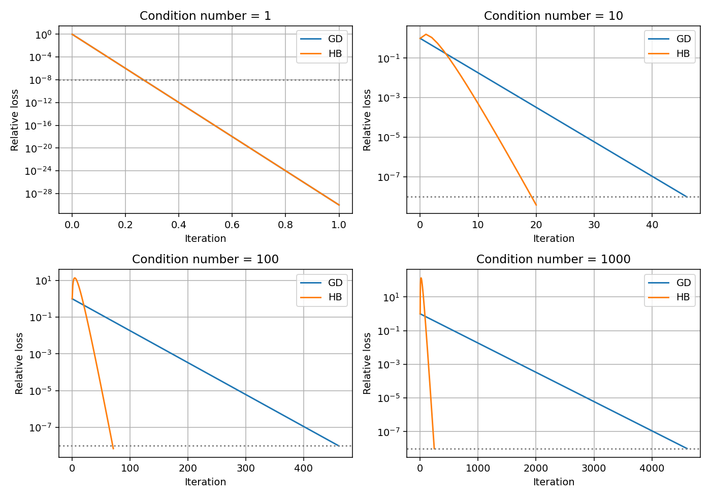
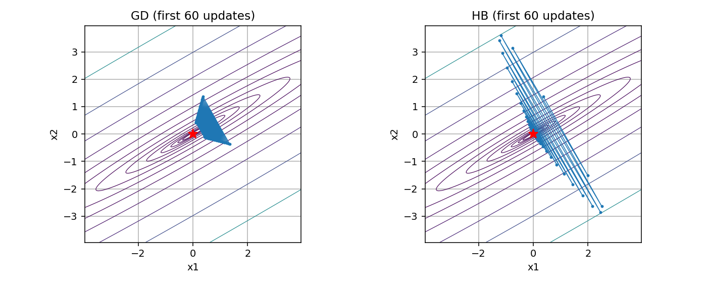
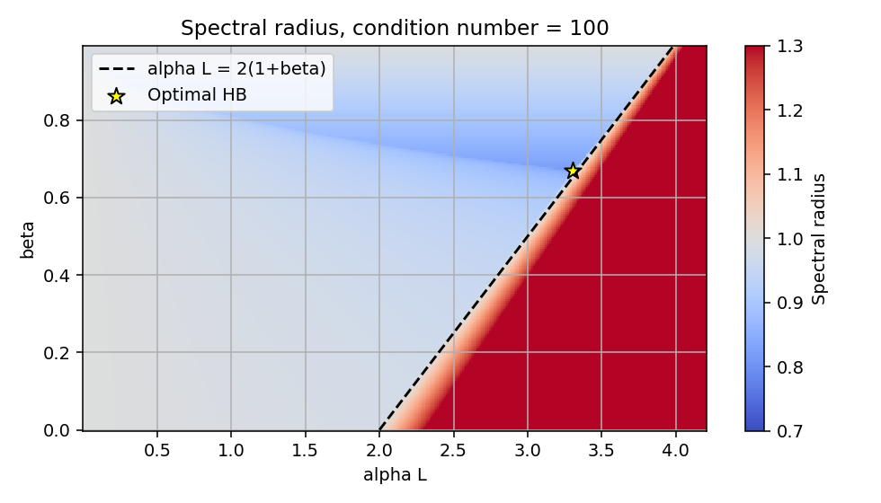
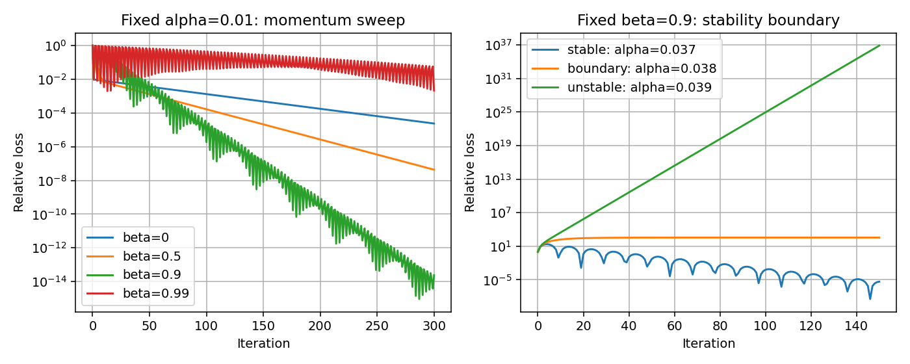
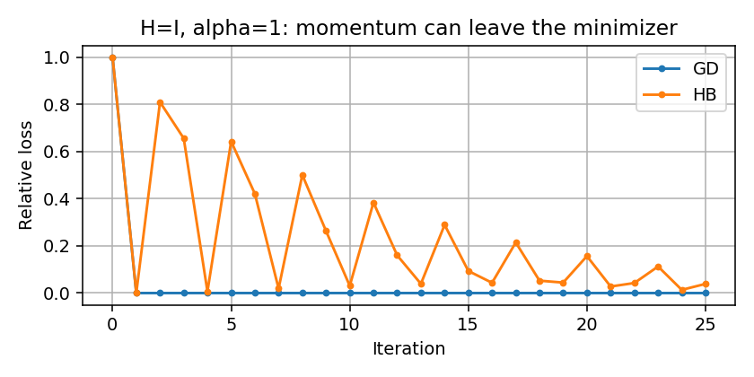

# Project 2 — 5020 Maths for AI
# A Comparison of Gradient Descent and Momentum

**研究范围：二维正定二次函数上的收敛、路径、稳定性与参数影响**  
**方法：数学推导与本地 Python/NumPy 可复现实验**  
**报告版本：实验报告初稿；Markdown 不具有固定页数，排版为 PDF 后应按课程要求控制在 6–10 页。**

## 1. Introduction & Objective

梯度下降（Gradient Descent，GD）利用当前梯度更新变量，Heavy-ball Momentum（HB）还保留上一步的位移。两种方法每次更新均计算一次梯度，但 HB 的历史项改变了迭代的动力学。对于狭长椭圆形等高线，GD 的步长受到高曲率方向限制，而低曲率方向可能下降缓慢；HB 能否缓解这种困难，需要同时考察速度、轨迹和稳定性。

本项目研究二维严格凸二次函数，不涉及神经网络训练。我们提出三个问题：（1）Hessian 条件数如何影响 GD 与 HB？（2）学习率与动量系数如何决定收敛、振荡及发散？（3）更好的渐近速率是否意味着 Loss 每步下降或有限步表现始终更好？

本文将“收敛”定义为迭代点趋于唯一最优解，将“渐近速率”与“达到误差阈值的迭代次数”分别衡量。振荡指特征方向坐标反复变号，不自动意味着发散。稳定性主要指无噪声、固定参数下对任意初始状态的渐近稳定，不等同于噪声鲁棒性。

研究采用先推导、后验证的方式：利用 Hessian 特征分解推导精确稳定条件，再用确定性实验检验条件数、路径和参数的影响。文献 [1] 提供优化算法与动态系统之间的分析背景；文献 [2–3] 用于界定延伸问题，不替代本项目的数学证明和实验。

## 2. Mathematical Background

### 2.1 正定性与唯一最优解

考虑一般二次函数

$$
f(x)=\frac12x^\top Hx-b^\top x+c,\qquad H=H^\top\succ0.
$$

梯度和 Hessian 分别为

$$
\nabla f(x)=Hx-b,\qquad \nabla^2f(x)=H.
$$

由于正定矩阵可逆，唯一驻点为 $x^\star=H^{-1}b$。令 $e=x-x^\star$，展开并利用 $Hx^\star=b$，交叉项消去，得到

$$
f(x)-f(x^\star)=\frac12e^\top He.
$$

当 $e\ne0$ 时该式严格为正，因此 $x^\star$ 是唯一全局最小点。设 $\mu=\lambda_{\min}(H)>0$、$L=\lambda_{\max}(H)$，则

$$
\frac\mu2\|e\|_2^2\le f(x)-f(x^\star)\le\frac L2\|e\|_2^2.
$$

所以本问题上变量收敛与目标误差趋零等价。平移到误差坐标不改变 GD/HB 的递推结构，实验因此使用 $b=0,c=0$，即 $x^\star=0$。

### 2.2 条件数与特征方向

由谱定理，$H=Q\Lambda Q^\top$，其中 $Q$ 正交，$\Lambda=\operatorname{diag}(\lambda_1,\lambda_2)$。定义 $z_k=Q^\top(x_k-x^\star)$，则

$$
f(x_k)-f^\star=\frac12\sum_{i=1}^2\lambda_i z_{k,i}^2,
\qquad \kappa=\frac L\mu.
$$

等高线的长短半轴之比为 $\sqrt\kappa$。当 $\kappa$ 很大时，不同方向曲率差异大，称为病态条件。这里的困难来自曲率不均衡，而非局部极小点。HB 不改变 $H$ 或其条件数；它缓解的是病态条件对迭代速度的影响。

### 2.3 GD 的收敛与单调性证明

本节采用二次函数的经典谱分析方法；GD 与 HB 的动态系统分析背景参见文献 [1](#ref-1)。以下等式与收敛条件在本报告中逐步推导，不直接引用一般非二次函数的收敛结论。

GD 的更新式为

$$
x_{k+1}=x_k-\alpha\nabla f(x_k).
$$

误差满足 $e_{k+1}=(I-\alpha H)e_k$，在特征坐标中为

$$
z_{k+1,i}=(1-\alpha\lambda_i)z_{k,i},\qquad
z_{k,i}=(1-\alpha\lambda_i)^kz_{0,i}.
$$

对任意初值收敛，当且仅当每个方向的乘子绝对值小于 1。因此

$$
|1-\alpha\lambda_i|<1\ \text{对所有 }i
\quad\Longleftrightarrow\quad 0<\alpha<\frac2L.
$$

定义 $\rho_{\mathrm{GD}}=\max_i|1-\alpha\lambda_i|$，可得

$$
\|e_k\|_2\le\rho_{\mathrm{GD}}^k\|e_0\|_2,\qquad
f(x_k)-f^\star\le\rho_{\mathrm{GD}}^{2k}(f(x_0)-f^\star).
$$

此外，

$$
f(x_{k+1})-f(x_k)
=\frac12\sum_i\lambda_i\left[(1-\alpha\lambda_i)^2-1\right]z_{k,i}^2\le0.
$$

故稳定范围内 GD 的 Loss 单调不增，即使某些方向坐标交替变号。$0<\alpha\lambda_i<1$ 时该方向不变号，$1<\alpha\lambda_i<2$ 时衰减振荡。

最优固定步长最小化端点乘子的最大绝对值。令两端幅度相等：$1-\alpha\mu=-(1-\alpha L)$，得到

$$
\alpha_{\mathrm{GD}}^\star=\frac2{L+\mu},\qquad
\rho_{\mathrm{GD}}^\star=\frac{\kappa-1}{\kappa+1}.
$$

### 2.4 Heavy-ball 的精确稳定条件

HB 作为二阶动态系统的表示与稳定性研究参见文献 [1](#ref-1)。以下使用二阶多项式的 Jury 判据，直接推导本项目固定正定 Hessian 下的条件；该条件不应当作为一般强凸函数的全局稳定保证。

HB 定义为

$$
x_{k+1}=x_k-\alpha\nabla f(x_k)+\beta(x_k-x_{k-1}),\qquad 0\le\beta<1.
$$

在每个特征方向上，令 $a_i=1+\beta-\alpha\lambda_i$，则

$$
z_{k+1,i}=a_i z_{k,i}-\beta z_{k-1,i},\qquad
\begin{pmatrix}z_{k+1,i}\\z_{k,i}\end{pmatrix}
=\begin{pmatrix}a_i&-\beta\\1&0\end{pmatrix}
\begin{pmatrix}z_{k,i}\\z_{k-1,i}\end{pmatrix}.
$$

状态矩阵的特征方程为

$$
p_i(r)=r^2-a_i r+\beta=0.
$$

对实系数二次多项式 $r^2+c_1r+c_0$，Jury 判据要求 $|c_0|<1$、$1+c_1+c_0>0$、$1-c_1+c_0>0$，才能使两根严格位于单位圆内。代入得

$$
\beta<1,\qquad \alpha\lambda_i>0,\qquad 2(1+\beta)-\alpha\lambda_i>0.
$$

因此本研究参数范围内的充要条件是

$$
\boxed{0\le\beta<1,\qquad 0<\alpha<\frac{2(1+\beta)}L.}
$$

在上边界 $\alpha L=2(1+\beta)$，高曲率方向多项式为 $(r+1)(r+\beta)$，出现根 $-1$，一般不能渐近收敛。超出边界后存在模长大于 1 的根，具有相应分量的初始状态会增长。这里“对任意初始状态”的限定排除了恰好未激发不稳定方向的特殊初值。

### 2.5 振荡与最优渐近速率

二次模型上的 HB 加速属于经典结果，相关 GD/HB 比较背景见文献 [1](#ref-1)。本节给出本项目所需的根分析和最优参数推导；实验中的有限步结果则由第 4 节的本地计算提供。

根为

$$
r_{i,\pm}=\frac{a_i\pm\sqrt{a_i^2-4\beta}}2.
$$

当 $\beta>0$ 且判别式小于零时，两根共轭，乘积为 $\beta$，所以模长为 $\sqrt\beta$。条件等价于

$$
(1-\sqrt\beta)^2<\alpha\lambda_i<(1+\sqrt\beta)^2.
$$

此时

$$
z_{k,i}=(\sqrt\beta)^k[C_i\cos(k\theta_i)+D_i\sin(k\theta_i)],
\qquad \cos\theta_i=\frac{1+\beta-\alpha\lambda_i}{2\sqrt\beta}.
$$

因此动量系数与衰减包络相关，学习率和曲率共同影响频率。$\beta$ 接近 1 时，包络衰减缓慢，说明动量并非越大越好。

下面给出最优参数的推导。若所有端点方向的根模长不超过 $q<1$，由根的乘积可知 $\beta\le q^2$；将多项式缩放到半径 $q$ 的圆，必要条件为

$$
|1+\beta-\alpha\lambda|\le q+\frac\beta q.
$$

在 $\lambda=\mu,L$ 处分别使用该不等式，得到

$$
\alpha\mu\ge1+\beta-q-\frac\beta q,\qquad
\alpha L\le1+\beta+q+\frac\beta q.
$$

由于右侧下界为正，二式相除可得

$$
\kappa\le\frac{1+\beta+q+\beta/q}{1+\beta-q-\beta/q}
\le\left(\frac{1+q}{1-q}\right)^2.
$$

最后一步利用 $0\le\beta\le q^2$，该比值随 $\beta$ 增大而增大。因此 $q\ge(\sqrt\kappa-1)/(\sqrt\kappa+1)$。令 $\beta=q^2$ 并令端点约束同时取等号，便达到此下界：

$$
q=\rho_{\mathrm{HB}}^\star=\frac{\sqrt\kappa-1}{\sqrt\kappa+1},\quad
\beta^\star=q^2,\quad
\alpha^\star=\frac4{(\sqrt L+\sqrt\mu)^2}.
$$

$\kappa=1$ 单独处理：$\beta^\star=0,\alpha^\star=1/L$，两种方法均一步收敛。对于大条件数，GD 的谱半径为 $1-\Theta(\kappa^{-1})$，HB 为 $1-\Theta(\kappa^{-1/2})$。这是固定参数、最坏方向意义下的渐近改善。

但在最优 HB 参数下，两端方向出现重根 $q$ 与 $-q$。重根解具有 $(C+Dk)r^k$ 的形式，所以不能直接宣称 $\|e_k\|\le q^k\|e_0\|$。本文使用谱半径预测长期趋势，并实际测量有限步迭代次数。

## 3. Experimental Setup

### 3.1 函数族、初值与评价指标

实验取

$$
H=Q_\theta\operatorname{diag}(1,\kappa)Q_\theta^\top,\qquad
Q_\theta=\begin{pmatrix}\cos\theta&-\sin\theta\\\sin\theta&\cos\theta\end{pmatrix},
\quad\theta=\pi/6.
$$

主实验使用 $x_0=Q_\theta(1,1)^\top$，使两特征方向都有非零初始分量。HB 使用 $x_{-1}=x_0$，即零初始速度。固定角度仅用于图形展示：对初值同时作正交旋转，GD/HB 的 Loss 不变，路径整体旋转；这一性质由代码独立验证。

评价指标为

$$
R_k=\frac{f(x_k)-f^\star}{f(x_0)-f^\star},\qquad
N_\varepsilon=\min\{k:R_k\le10^{-8}\}.
$$

主比较最大迭代次数为 10000。记录第一次达到阈值的更新次数，并将其与渐近谱半径一起报告。每次更新计算一次梯度，所以更新次数也等于更新阶段的梯度调用次数。二维任务的墙钟时间容易受解释器开销影响，不作为主要指标。

Loss 上升次数仅统计 $f_{k+1}-f_k>10^{-14}f_0$ 的更新，避免将舍入误差计为上升。该计数依赖运行长度，不能脱离迭代次数单独比较。若 $R_k>10^{100}$ 则触发增长保护；这只是数值停止条件，理论稳定性仍由根判据判断。

### 3.2 实验设计

| 实验 | 设置 | 目的 |
|---|---|---|
| A 条件数 | $\kappa=1,10,100,1000$，各自理论最优固定参数 | 测量病态程度与加速收益 |
| B 路径 | $\kappa=100$，最优参数，固定运行 60 步 | 展示轨迹及暂态放大 |
| C 参数 | $\alpha L\in[0.005,4.2]$ 的 421 个点；$\beta\in[0,0.99]$ 的 199 个点 | 对照理论稳定区域 |
| C 补充 | $\alpha=0.01$，$\beta=0,0.5,0.9,0.99$，运行 300 步 | 隔离动量系数的作用 |
| C 边界 | $\beta=0.9$，$\alpha=0.037,0.038,0.039$，运行 150 步 | 验证稳定、临界与不稳定 |
| D 反例 | $H=I,\alpha=1,\beta=0.9$，运行 25 步 | 验证动量不保证每步改善 |

实验 A 使用各自最优参数，比较方法可达到的表现；实验 C 固定一个参数改变另一个，分析因果作用。二者是不同的比较口径。路径及反例实验故意不在首次到达阈值时停止，以便观察后续动力学。

### 3.3 实现与复现

本地环境为 Python 3.11.5、NumPy 1.24.3、Matplotlib 3.7.2。计算使用 `float64`，无随机采样，因此无需随机种子。模型与迭代使用 NumPy，Matplotlib 仅用于绘图。

| 文件 | 职责 |
|---|---|
| `code/model.py` | 模型、理论最优参数、谱半径 |
| `code/optimizers.py` | 统一 GD/HB 递推、轨迹和状态记录 |
| `code/experiments.py` | 实验配置、CSV 导出、全部图形 |
| `code/verify.py` | 独立数学性质核查 |
| `data/environment.json` | 环境及停止准则记录 |

在报告所在目录运行：

```bash
python code/experiments.py
python code/verify.py
```

所有轨迹保存为 CSV，包括迭代编号、两个坐标、Loss 和相对 Loss；稳定性网格保存为 NPZ。半对数图将小于 $10^{-30}$ 的数值仅在绘图时截断，原始 CSV 保留真实值。实验 D 使用线性纵轴，以准确显示零 Loss。

## 4. Results & Comparison

### 4.1 条件数与实际迭代次数



**图 1.** GD 与 HB 使用各自理论最优固定参数；虚线为 $10^{-8}$ 停止阈值。不同子图的横轴范围可能不同，比较时结合表 1 的迭代次数。

**表 1. 本地实测结果。** 参数取值列作适度舍入，计算使用双精度完整值。

| $\kappa$ | 方法 | $\alpha$ | $\beta$ | 谱半径 | 达阈值更新次数 | Loss 上升次数 |
|---:|---|---:|---:|---:|---:|---:|
| 1 | GD | 1 | 0 | 0 | 1 | 0 |
| 1 | HB | 1 | 0 | 0 | 1 | 0 |
| 10 | GD | 0.181818 | 0 | 0.818182 | 46 | 0 |
| 10 | HB | 0.230886 | 0.269874 | 0.519494 | 20 | 1 |
| 100 | GD | 0.019802 | 0 | 0.980198 | 461 | 0 |
| 100 | HB | 0.033058 | 0.669421 | 0.818182 | 71 | 4 |
| 1000 | GD | 0.001998 | 0 | 0.998002 | 4606 | 0 |
| 1000 | HB | 0.003759 | 0.881145 | 0.938693 | 243 | 15 |

在该初值与停止阈值下，$\kappa=10,100,1000$ 时 GD/HB 更新次数之比分别约为 2.30、6.49、18.95。所有主比较均在预算内达到阈值。$\kappa=1$ 时两方法使用同一参数并一步收敛。随着病态程度增加，HB 的有限步优势更加明显，但暂态 Loss 上升次数也增加。

对 GD，本实验两端特征方向的乘子幅度恰好相同，因此在精确算术下 $R_k=(\rho_{\mathrm{GD}}^\star)^{2k}$。由此可用对数公式独立核对迭代数。随着条件数增加，GD 需要明显更多更新。

HB 的优势应通过实际阈值迭代数判断，而非只比较谱半径。其初期曲线可以上升，然后进入快速衰减阶段。这与重根带来的多项式暂态一致，并不违反渐近稳定性。

### 4.2 路径与暂态放大



**图 2.** $\kappa=100$ 时前 60 次更新，两个子图使用相同坐标范围；星号为最优点。GD 和 HB 均使用各自最优参数。

GD 在高曲率方向反复穿越谷底，同时沿低曲率方向缓慢移动。HB 的历史位移改善了后期衰减，但前期可能产生比初始位置更大的偏离。这一暂态放大不能解释为“动量改变了目标函数的条件数”。

在本实验的 $\kappa=100$ 最优 HB 设置下，$\alpha=4/121$。高曲率方向第一步乘子为 $1-100\alpha=-279/121$，其绝对值超过 2；第一步 Loss 因而可以明显增大。稳定性要求的是二阶状态矩阵的根在单位圆内，并不要求每次位置更新都缩小。

### 4.3 稳定性区域与参数影响



**图 3.** 颜色为两个特征方向上的最大根模长。虚线为理论上边界，星号为最优 HB 参数。色阶在 $[0.7,1.3]$ 截断以突出边界附近差异；原始网格保存完整谱半径。

网格计算属于理论公式的数值求值，不是独立的迭代收敛证据。因此我们额外运行边界两侧的实际轨迹。固定 $\beta=0.9,L=100$ 时，理论临界学习率为 $0.038$：$0.037$ 位于稳定区，$0.038$ 含单位模根，$0.039$ 位于不稳定区。



**图 4.** 左图固定学习率改变动量系数；右图固定动量系数，分别取理论边界内、边界上和边界外的学习率。

**表 2. 固定 $\kappa=100,\alpha=0.01$，运行 300 次更新。**

| $\beta$ | 谱半径 | $R_{300}$ | Loss 上升次数 |
|---:|---:|---:|---:|
| 0 | 0.990000 | $2.3812\times10^{-5}$ | 0 |
| 0.5 | 0.979574 | $4.3365\times10^{-8}$ | 4 |
| 0.9 | 0.948683 | $2.3733\times10^{-14}$ | 143 |
| 0.99 | 0.994987 | $2.1480\times10^{-3}$ | 139 |

在这四个选定参数中，$\beta=0.9$ 的 300 步误差最小，但 Loss 经常上升；$\beta=0.99$ 的最终误差反而大于无动量设置。该排序仅对应本组参数及预算，不声称 $0.9$ 是所有任务的最佳动量系数。

增大动量不产生单调收益。尤其当两个特征方向都进入复根区时，包络由 $\sqrt\beta$ 控制，过大的 $\beta$ 会造成长期振荡。边界上的单位根在本初值下被激发，因此不会趋于零；有限精度可能导致极小偏移，不应仅凭短期曲线判定其稳定。

还应区分不同“稳定”含义：对给定非负 $\beta<1$，HB 容许的学习率上限比 GD 的 $2/L$ 大，但其 Loss 不一定单调。更大的稳定步长范围不意味着更小的暂态峰值，也不构成噪声鲁棒性的证明。

### 4.4 动量并非总能改善表现



**图 5.** $H=I,\alpha=1,x_{-1}=x_0=(1,1)^\top$，HB 的 $\beta=0.9$。此实验固定运行步数，不在零 Loss 时退出。

GD 满足 $x_1=x_0-x_0=0$，之后保持最优。HB 第一步同样到达零点，但第二步为

$$
x_2=x_1-\alpha x_1+0.9(x_1-x_0)=-0.9x_0.
$$

故 $R_0=1,R_1=0,R_2=0.81$。HB 参数仍处于稳定区域，最终收敛；这个例子证明“稳定不保证 Loss 单调”和“添加动量不保证收益”，并不是 HB 不收敛的反例。

该例还揭示首次阈值指标的局限：若算法在第一次达到零误差时停止，GD 和 HB 都只需一步，后续反弹不会发生。因此本文同时观察完整固定步数轨迹，而不把首次达到阈值当作未来误差始终低于阈值的保证。

## 5. Discussion & Conclusion

### 5.1 对研究问题的回答

第一，条件数增大意味着不同特征方向的曲率差异增大。GD 为保证高曲率方向稳定，必须限制学习率，因此低曲率方向的进展受到约束。在已知真实 $\mu,L$、采用理论最优固定参数时，HB 将最坏方向谱半径由 $(\kappa-1)/(\kappa+1)$ 改善为 $(\sqrt\kappa-1)/(\sqrt\kappa+1)$。实验以实际阈值迭代数验证这种改善。

第二，学习率和动量系数共同决定二阶递推的根。实根或复根解释轨迹形态，根的模长决定长期稳定性。复根不是失败的标志，单位圆外的根才导致相应状态分量增长。理论稳定区域与边界实验相一致。

第三，HB 的渐近优势不保证每步更好。最优参数也可能产生较大暂态放大；过大的动量会导致缓慢衰减；在各向同性二次函数上，GD 可以一步求解，添加非零动量反而可能让轨迹离开最优点。因此正确表述是“动量在合适条件下加速”，而非“动量保证更快、更平滑或更容易收敛”。

### 5.2 优势、代价与实验局限

| 方面 | GD | Heavy-ball |
|---|---|---|
| 参数数量 | 一个学习率 | 学习率与动量系数 |
| 每次更新 | 一次梯度调用 | 一次梯度调用，额外保存历史向量 |
| 稳定范围内 Loss | 单调不增 | 可能暂时上升 |
| 病态二次模型的最优渐近因子 | 随 $1/\kappa$ 改善 | 随 $1/\sqrt\kappa$ 改善 |
| 实际表现 | 简单、易解释 | 对参数与暂态更敏感 |

本实验有四项限制。其一，仅研究二维、固定 Hessian、无噪声的正定二次模型。其二，最优调参假设已知精确曲率端点，未研究估计误差。其三，主实验采用一个同时激发两方向的确定初值，不能据此声称所有初值的有限步排序相同。其四，第一次达到阈值与持续保持阈值是不同标准，且浮点数计算会影响极低误差附近的行为。

一般光滑强凸函数的 Hessian 会随位置改变，固定二次模型上的稳定性证明不能直接套用。Lessard 等给出一般强凸函数上的 HB 失败反例 [1](#ref-1)；Goujaud 等研究固定参数 HB 在一般光滑强凸函数类上的非加速限制 [2](#ref-2)。这两项文献结论用于说明推广边界，并不否认本项目二次函数上的加速结果。Mohammadi 等分析加性噪声下收敛速度与噪声放大的权衡 [3](#ref-3)；本文没有加入噪声，故不据此宣称实验验证了噪声放大。更不能把本文结果直接推广为所有神经网络优化器的性能结论。

### 5.3 结论

在本文限定的二维正定二次函数场景中，Hessian 特征分解将 GD 与 HB 化为可精确分析的标量递推。数学推导解释了稳定边界、振荡形式和最优渐近速度，数值实验进一步展示有限步收益与暂态代价。HB 能缓解病态条件造成的迭代缓慢，但其收益依赖参数选择，不能等同于 Loss 单调性或任意参数下的收敛保证。

## 附录：复现与核查说明（可移至代码附件，不计正文）

`verify.py` 独立核查 Hessian 谱、最优参数对应的谱半径、稳定 GD 的 Loss 单调性、旋转等变性、稳定边界两侧的根模长，以及反例中的 $R_2=0.81$。这些检查针对数学性质，而非仅重复更新代码。实验数据可分别从 `data/summary.csv`、`data/parameter_summary.json` 及完整轨迹 CSV 重新计算表格与曲线。

公式采用标准 Markdown 数学语法：行内 `$...$`，独立公式 `$$...$$`。请使用支持 MathJax 或 KaTeX 的查看器；纯文本 Markdown 阅读器不会自动排版数学公式。图片路径相对于本报告，分发时保留 `figures/` 文件夹。

## References & Source Attribution — 参考文献与来源说明

正文编号对应以下文献。引用为概述或理论背景，不是逐字引文；第 2 节展示的代数推导为本报告展开，第 4 节的数值、图形和表格均来自本项目代码，不是论文中的实验数据。来源链接核查日期：2026 年 11 月 23 日。

<a id="ref-1"></a>

**[1]** Lessard, L., Recht, B., & Packard, A. (2016). Analysis and design of optimization algorithms via integral quadratic constraints. *SIAM Journal on Optimization, 26*(1), 57–95.

- 正式来源：[期刊 DOI：10.1137/15M1009597](https://doi.org/10.1137/15M1009597)。
- 免费全文：[arXiv:1408.3595，v7](https://arxiv.org/abs/1408.3595v7)；[PDF](https://arxiv.org/pdf/1408.3595v7)。期刊出版年为 2016，预印本版本更新于 2015 年，两者年份含义不同。
- 本文引用位置：第 1 节；第 2.3–2.5 节；第 5.2 节。
- 引用用途：优化算法的动态系统与稳定性分析背景，以及 HB 在一般强凸函数上的失败反例。本文没有声称其 IQC 方法就是本项目使用的实验方法。

<a id="ref-2"></a>

**[2]** Goujaud, B., Taylor, A., & Dieuleveut, A. (2023; revised 2025). *Provable non-accelerations of the heavy-ball method*. arXiv:2307.11291, version 2.

- 来源：[arXiv:2307.11291v2](https://arxiv.org/abs/2307.11291v2)；[PDF](https://arxiv.org/pdf/2307.11291v2)；[arXiv DOI](https://doi.org/10.48550/arXiv.2307.11291)。
- 版本说明：初次提交于 2023 年 7 月 21 日；此处明确引用 2025 年 10 月 9 日修订的 v2，而非将初稿年份与当前版本混同。
- 本文引用位置：第 1 节与第 5.2 节。
- 引用用途：一般光滑强凸函数类上固定参数 HB 的加速保证存在限制。只用于说明外推边界，不作为“HB 在所有二次函数上不能加速”的证据。

<a id="ref-3"></a>

**[3]** Mohammadi, H., Razaviyayn, M., & Jovanović, M. R. (2021). Robustness of accelerated first-order algorithms for strongly convex optimization problems. *IEEE Transactions on Automatic Control, 66*(6), 2480–2495.

- 正式来源：[期刊 DOI：10.1109/TAC.2020.3008297](https://doi.org/10.1109/TAC.2020.3008297)。
- 免费全文：[arXiv:1905.11011，v2](https://arxiv.org/abs/1905.11011v2)；[PDF](https://arxiv.org/pdf/1905.11011v2)。预印本首次提交于 2019 年，v2 更新于 2020 年；期刊卷期年份为 2021。
- 本文引用位置：第 1 节与第 5.2 节。
- 引用用途：加性噪声下的稳态误差与加速—鲁棒性权衡。本文未做噪声实验，因此这属于相关研究讨论，而不是本项目已经验证的结论。

### 本项目图表与数据来源

| 报告内容 | 直接来源 | 来源类型 |
|---|---|---|
| 图 1、表 1：条件数比较 | `code/experiments.py`；`data/summary.csv`；`data/condition_*_*.csv` | 本地确定性数值实验 |
| 图 2：路径 | `data/path_GD.csv`、`data/path_HB.csv` | 本地迭代轨迹 |
| 图 3：稳定区域 | 第 2.4–2.5 节公式；`data/stability_grid.npz` | 本文公式的数值求值 |
| 图 4、表 2：参数影响 | `data/parameter_summary.json`；`data/beta_*.csv`、`data/boundary_*.csv` | 本地确定性数值实验 |
| 图 5：离开最优点的例子 | 第 4.4 节直接代入推导；`data/counterexample_*.csv` | 本报告构造与本地验证 |

因此，引用论文应使用 [1]–[3]；引用本项目的实际迭代次数、Loss 或轨迹，应指向对应图表与数据文件，不能归因于上述论文。
