# AISC5020 作业大纲（Homework Guide）

> 依据 `homework/` 下 Assignment 2 与 Week 5–8 Exercises 整理。  
> **★ = 对应 `hints.txt` 的考点**；**【重点】 = 对应你的薄弱点：Week 7 / Week 8 / 多元概率 / 多元条件概率**。  
> 本文件只给 **解题所需知识点（knowledge checklist）**，**不提供解答（no solutions）**。  
> 读法（How to use）：先看题目截图，自己判断要用的知识点；再对照下面的清单，缺什么补什么。  
> 所有题目截图保存在 `homework_images/`，用支持相对路径的 Markdown 预览打开。

---

## 0. Assignment 2 全部题目清单（All Assignment Questions — must complete）

> **Assignment 2 的每一题都必须完成（All questions in Assignment 2 are required）。**  
> Deadline: 3 Nov 2026.

| 题号（No.） | 主题（Topic） | 主要知识点（Key concepts） | 关联（Link） | 要求（Requirement） |
|---|---|---|---|---|
| Q1 | Geometric min / max / difference | Geometric PMF、min/max transformation、joint PMF、independence check | Week 5 多元离散分布 | 全部完成（required） |
| Q2 | Poisson mixture / conditional distribution | Hierarchical model、conditional independence、Poisson additivity、Gamma–Poisson conjugacy、posterior predictive | Week 5 条件分布 + Week 8 共轭 | 全部完成（required） |
| Q3 | Mutual information of bivariate normal | Bivariate normal、Gaussian entropy、covariance determinant、$I=H_1+H_2-H_{12}$ | Week 6 互信息 + Week 5 多元正态 | 全部完成（required） |
| Q4 | Expected leftmost point | Order statistics、minimum、survival function、$E[M]=\int P(M>t)dt$ | Week 5 期望 | 全部完成（required） |
| Q5 | Empirical distribution and KL | Empirical distribution、KL divergence、MLE、expected log-likelihood | Week 6 KL + Week 7 MLE | 全部完成（required） |
| Q6 | 2-parameter vs 4-parameter model | Joint table、MLE、saturated model、log-likelihood、LOO-CV、BIC、dof | Week 7 MLE/模型选择 | 全部完成（required） |
| Q7 | DAG and CPT MLE | DAG factorization、conditional probability、marginalization、CPT MLE、counts | Week 8 贝叶斯网络 | 全部完成（required） |
| Q8 | Bayesian network classification | BN factorization、CPT orientation、Bayes rule、marginalization、classification | Week 8 贝叶斯网络 | 全部完成（required） |

---

# 1. Assignment 2 逐题知识点（Question-by-question knowledge checklist）

## A1. Geometric min / max / difference

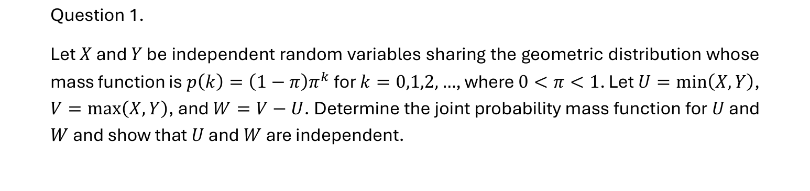

**题目任务（Task）：** 给定独立同分布的几何随机变量 $X,Y$，令 $U=\min(X,Y)$、$V=\max(X,Y)$、$W=V-U$。求 $(U,W)$ 的联合 PMF，并证明 $U$ 与 $W$ 独立。  
*English: Find the joint PMF of $(U,W)$ and show that $U$ and $W$ are independent.*

| 知识点（Chinese） | English | 用法 / 提示（Use / Hint） |
|---|---|---|
| 几何分布 PMF | Geometric PMF | $p(k)=(1-\pi)\pi^k,\ k=0,1,2,\ldots$；注意这里的支撑从 0 开始。 |
| 独立随机变量的联合 PMF | Joint PMF under independence | $p_{X,Y}(x,y)=p_X(x)p_Y(y)$。 |
| 离散变换 | Transformation of discrete RVs | 先写事件 $\{U=u,W=w\}$，再把它翻译成对 $(X,Y)$ 的条件。 |
| min / max 的次序 | Ordering of min and max | 若 $U=u,W=w$，则 $\{X,Y\}=\{u,u+w\}$，要分“谁是 min”两种情况。 |
| 联合 PMF 求和 | Summing over preimages | $p_{U,W}(u,w)=\sum_{(x,y):U=u,W=w}p_{X,Y}(x,y)$。 |
| 独立性判定 | Independence criterion | 验证 $p_{U,W}(u,w)=p_U(u)p_W(w)$ 是否对所有 $u,w$ 成立。 |
| 几何级数 | Geometric series | 处理 $w>0$ 时的尾部求和 $\sum_{k\ge0}\pi^k=1/(1-\pi)$。 |

> **易错（Common pitfall）：** $W=0$ 与 $W>0$ 的情况不同；$W=0$ 时 $X=Y$，只有一种配对，不要重复计数。  
> *English: The cases $W=0$ and $W>0$ are different; when $W=0$, $X=Y$, so do not double-count.*

---

## A2. Poisson mixture and conditional distribution

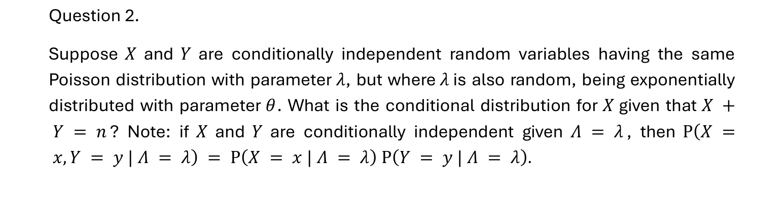

**题目任务（Task）：** $X,Y$ 在给定 $\Lambda=\lambda$ 时条件独立且同分布为 Poisson$(\lambda)$，而 $\Lambda\sim\mathrm{Exp}(\theta)$。求给定 $X+Y=n$ 时 $X$ 的条件分布。  
*English: Find the conditional distribution of $X$ given $X+Y=n$ in a Poisson–Exponential hierarchical model.*

| 知识点（Chinese） | English | 用法 / 提示（Use / Hint） |
|---|---|---|
| 分层模型 | Hierarchical model | 先有 $\Lambda$，再有 $X,Y\mid\Lambda$；不要一开始把 $\lambda$ 当常数。 |
| 条件独立 | Conditional independence | $p(x,y\mid\lambda)=p(x\mid\lambda)p(y\mid\lambda)$。 |
| Poisson 可加性 | Poisson additivity | 给定 $\lambda$ 时，$X+Y\sim\mathrm{Poisson}(2\lambda)$。 |
| 全概率 / 积分掉 $\lambda$ | Law of total probability / integrate out $\lambda$ | $p(x,y)=\int p(x,y\mid\lambda)p(\lambda)\,d\lambda$。 |
| Gamma–Poisson 共轭 | Gamma–Poisson conjugacy | $\mathrm{Exp}(\theta)=\mathrm{Gamma}(1,\theta)$；Poisson + Gamma ⇒ Gamma posterior。 |
| 后验预测 / 条件分布 | Posterior predictive / conditional distribution | 先求 $\Lambda\mid X+Y=n$，再求 $X\mid X+Y=n$。 |
| Beta / Gamma 函数 | Beta / Gamma functions | 计算归一化常数时可能会用到。 |

> **易错（Common pitfall）：** 题目问的是 $X\mid X+Y=n$，不是 $\Lambda\mid X+Y=n$；要先把 $\lambda$ 积分掉。  
> *English: The question asks for $X\mid X+Y=n$, not $\Lambda\mid X+Y=n$; integrate out $\lambda$.*

---

## A3. Mutual information of a bivariate normal

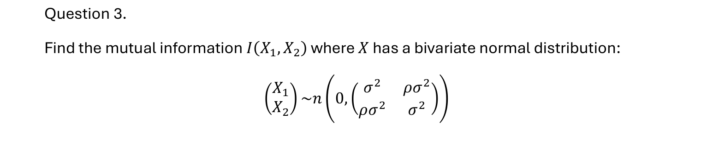

**题目任务（Task）：** 对二元正态 $(X_1,X_2)$，求互信息 $I(X_1,X_2)$。  
*English: Find the mutual information $I(X_1,X_2)$ for a bivariate normal distribution.*

| 知识点（Chinese） | English | 用法 / 提示（Use / Hint） |
|---|---|---|
| 二元正态 | Bivariate normal | 均值、方差、相关系数 $\rho$；协方差矩阵行列式。 |
| 边缘分布 | Marginal distributions | $X_1,X_2$ 各自是一元正态。 |
| 高斯熵 | Gaussian entropy | 一元/多元高斯的微分熵公式；注意 $\log$ 的底。 |
| 联合熵 | Joint entropy | 用协方差矩阵的行列式。 |
| 互信息分解 | Mutual information decomposition | $I(X_1,X_2)=H(X_1)+H(X_2)-H(X_1,X_2)$。 |
| 连续熵可负 | Differential entropy can be negative | 但互信息仍然非负；不要被负熵吓到。 |

> **易错（Common pitfall）：** 连续情形叫微分熵（differential entropy），单位和离散熵不同；用 $\log_2$ 还是 $\ln$ 要统一。  
> *English: In the continuous case this is differential entropy; keep the base of the logarithm consistent.*

---

## A4. Expected location of the leftmost point

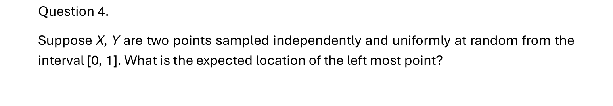

**题目任务（Task）：** $X,Y$ 独立均匀分布在 $[0,1]$，求最左点的期望位置。  
*English: Find the expected location of the leftmost of two i.i.d. uniform points on $[0,1]$.*

| 知识点（Chinese） | English | 用法 / 提示（Use / Hint） |
|---|---|---|
| 次序统计量 | Order statistics | 最左点就是 $M=\min(X,Y)=X_{(1)}$。 |
| min 的分布 | Distribution of the minimum | $P(M>t)=P(X>t)P(Y>t)$。 |
| 生存函数求期望 | Expectation via survival function | 非负随机变量：$E[M]=\int_0^1 P(M>t)\,dt$。 |
| 均匀分布 | Uniform distribution | $P(X>t)=1-t$，$0\le t\le1$。 |
| 对称性 | Symmetry | 两个点独立同分布，最左/最右的期望有对称关系。 |

> **易错（Common pitfall）：** 不要直接把“最左点的期望”当成 $E[X]/2$；要用 min 的分布。  
> *English: Do not assume the expected minimum is half the mean; use the distribution of the minimum.*

---

## A5. Empirical distribution and KL

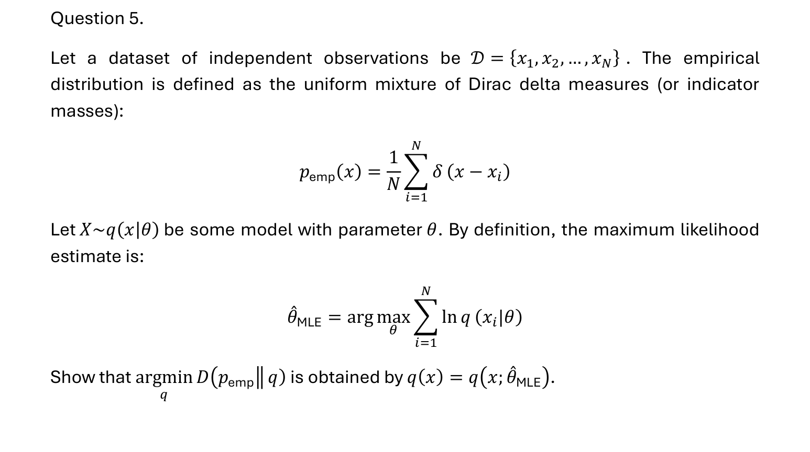

**题目任务（Task）：** 证明 $\arg\min_q D(p_{\mathrm{emp}}\vert\vert q)$ 由 $q(x)=q(x;\hat\theta_{\mathrm{MLE}})$ 取得。  
*English: Show that minimizing KL from the empirical distribution to the model is achieved by the MLE model.*

| 知识点（Chinese） | English | 用法 / 提示（Use / Hint） |
|---|---|---|
| 经验分布 | Empirical distribution | $p_{\mathrm{emp}}(x)=\frac1N\sum_{i=1}^N\delta(x-x_i)$。 |
| Dirac delta / 指示质量 | Dirac delta / indicator mass | 对 $p_{\mathrm{emp}}$ 求期望就是样本平均。 |
| KL 散度 | KL divergence | $D(p_{\mathrm{emp}}\vert\vert q)=\sum_x p_{\mathrm{emp}}(x)\log\frac{p_{\mathrm{emp}}(x)}{q(x)}$。 |
| 期望的样本形式 | Sample-average form | $\sum_x p_{\mathrm{emp}}(x)\log q(x)=\frac1N\sum_i\log q(x_i\mid\theta)$。 |
| MLE 目标 | MLE objective | $\hat\theta_{\mathrm{MLE}}=\arg\max_\theta\sum_i\ln q(x_i\mid\theta)$。 |
| 常数不影响 argmin | Constants do not affect argmin | $D(p_{\mathrm{emp}}\vert\vert q)= -H(p_{\mathrm{emp}})-\frac1N\sum_i\log q(x_i)$。 |

> **易错（Common pitfall）：** KL 的方向是 $D(p_{\mathrm{emp}}\vert\vert q)$，不要把 $p$ 和 $q$ 写反。  
> *English: The KL direction is $D(p_{\mathrm{emp}}\vert\vert q)$; do not swap $p$ and $q$.*

---

## A6. 2-parameter vs 4-parameter model

### A6(a–c)

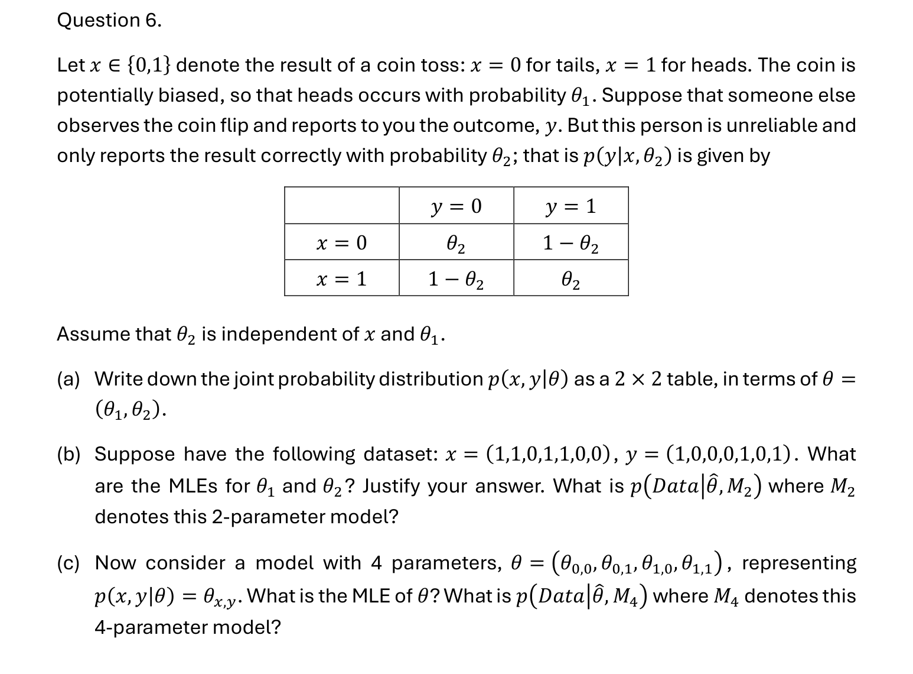

### A6(d–e)

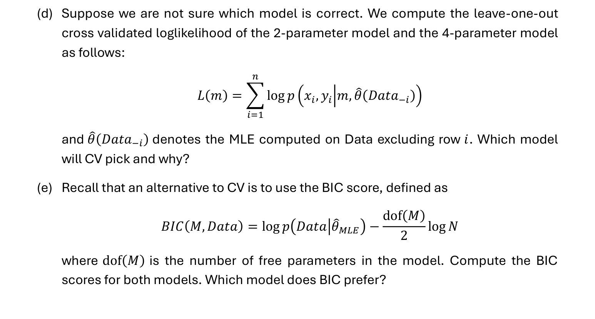

**题目任务（Task）：** 写出 $p(x,y\mid\theta)$ 的 $2\times2$ 表；在 2 参数模型和 4 参数模型下求 MLE；比较 LOO-CV 与 BIC 会选择哪个模型。  
*English: Write the joint table, find MLEs under the 2-parameter and 4-parameter models, and compare LOO-CV with BIC.*

| 知识点（Chinese） | English | 用法 / 提示（Use / Hint） |
|---|---|---|
| 条件概率表转联合表 | From conditional table to joint table | $p(x,y\mid\theta)=p(y\mid x,\theta_2)p(x\mid\theta_1)$。 |
| Bernoulli / coin bias MLE | Bernoulli MLE | $\hat\theta=\frac{\#\text{successes}}{\#\text{trials}}$。 |
| 2 参数模型 | 2-parameter model | 参数 $\theta_1$（硬币偏差）和 $\theta_2$（报告正确率）。 |
| 饱和 4 参数模型 | Saturated 4-parameter model | 每个 $(x,y)$ 格子一个参数，MLE 是经验频率。 |
| 对数似然 | Log-likelihood | 比较模型时看 $\log p(\text{Data}\mid\hat\theta,M)$。 |
| 自由度 | Degrees of freedom (dof) | 2 参数模型 dof $=2$；4 参数模型名义上有 4 个格子概率，但因为概率和为 1，自由度是 $4-1=3$（dof $=3$）。 |
| 留一交叉验证 | Leave-one-out CV | 每次去掉一行，重新拟合，再预测该行。 |
| BIC | BIC | $\mathrm{BIC}(M)=\log p(\text{Data}\mid\hat\theta_{\mathrm{MLE}})-\frac{\mathrm{dof}(M)}2\log N$。 |
| 过拟合 | Overfitting | 参数多的模型训练似然更大，但 CV/BIC 可能惩罚它。 |

> **易错（Common pitfall）：** 4 参数模型的 MLE 是“每个格子的经验频率”，但 2 参数模型不是；CV 必须“去掉一行后重新拟合”。另外 BIC 的 dof 用“自由参数个数”：4 格概率和为 1，所以 dof $=3$。  
> *English: The 4-parameter MLE uses cell frequencies; the 2-parameter model does not. CV must refit after removing each row. Also, BIC uses the number of free parameters: four cell probabilities sum to one, so dof $=3$.*

---

## A7. DAG and CPT MLE

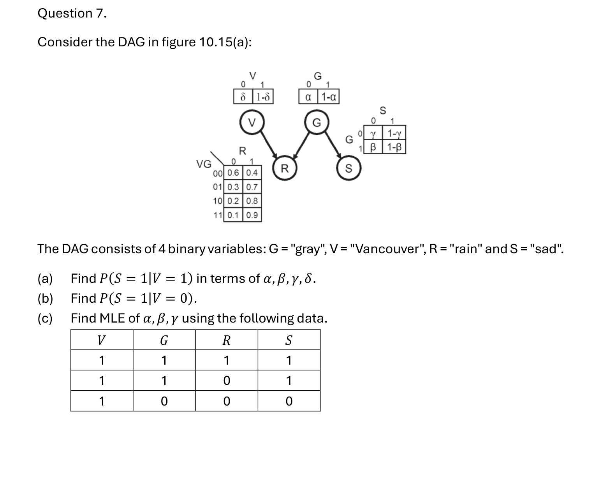

**题目任务（Task）：** 在给定 DAG 中求 $P(S=1\mid V=1)$、$P(S=1\mid V=0)$，并用数据求 $\alpha,\beta,\gamma$ 的 MLE。  
*English: Compute conditional probabilities from the DAG and find the MLEs of the CPT parameters.*

| 知识点（Chinese） | English | 用法 / 提示（Use / Hint） |
|---|---|---|
| DAG 因子分解 | DAG factorization | 先根据箭头写 $P(V,G,R,S)=P(V)P(G)P(R\mid V,G)P(S\mid G)$。 |
| 条件概率与边缘化 | Conditional probability and marginalization | 求 $P(S\mid V)$ 主要对 $G$ 边缘化；$S$ 只依赖 $G$，给定 $G$ 后 $R$ 不再影响 $S$。 |
| CPT 表的方向 | CPT orientation | 注意表中行/列分别代表哪个变量；$R$ 的表按 $VG$ 行给出。 |
| 条件概率链 | Chain of conditional probabilities | $P(S\mid V)=\sum_g P(S\mid G=g)P(G=g)$（若 $S$ 只依赖 $G$）。 |
| CPT 的 MLE | MLE for CPTs | 伯努利 CPT 的 MLE = 条件计数 / 行计数。 |
| 条件独立 | Conditional independence | 用 DAG 读出哪些变量在给定父节点后独立。 |

> **易错（Common pitfall）：** 先确认 $S$ 的父节点是谁，再决定要对哪些变量求和；不要把所有变量都加掉。  
> *English: Check the parents of $S$ first; do not marginalize over variables that are not in the factorization.*

---

## A8. Bayesian network classification

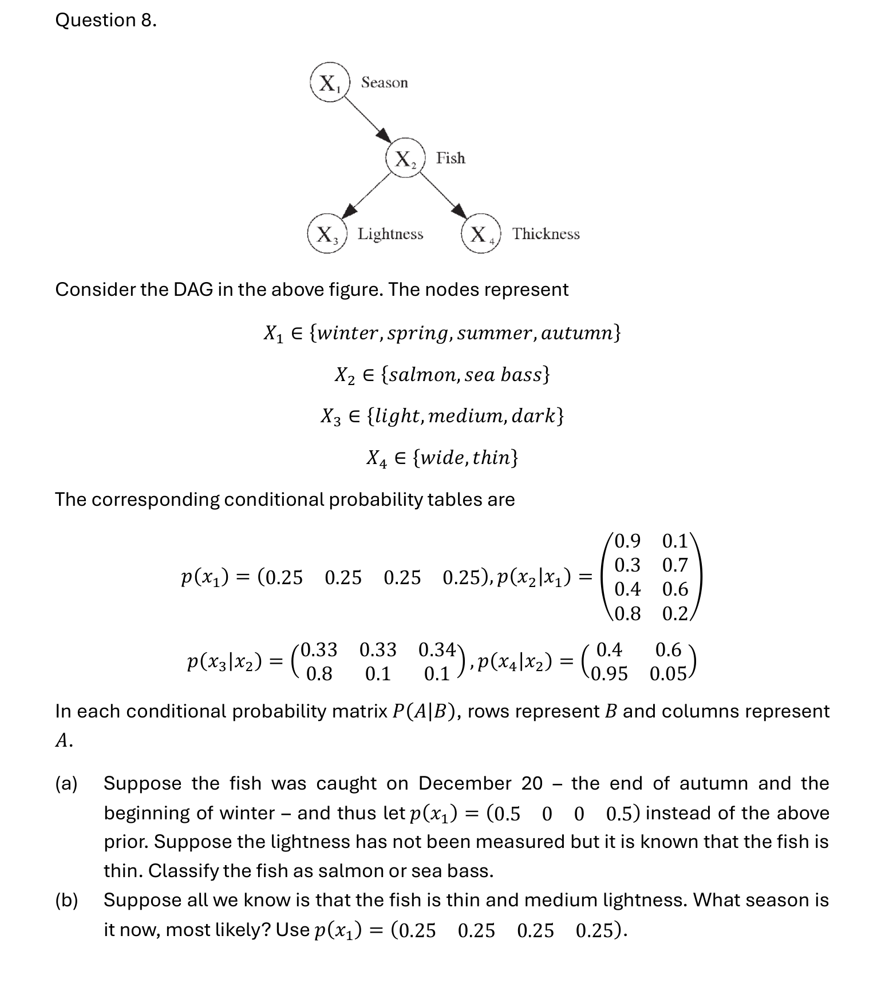

**题目任务（Task）：** 用给定 DAG 和 CPT，在“鱼是 thin”以及“thin + medium lightness”条件下分类鱼，或推断最可能的季节。  
*English: Classify the fish and infer the most likely season using the Bayesian network CPTs.*

| 知识点（Chinese） | English | 用法 / 提示（Use / Hint） |
|---|---|---|
| BN 因子分解 | BN factorization | $P(X_1,X_2,X_3,X_4)=P(X_1)P(X_2\mid X_1)P(X_3\mid X_2)P(X_4\mid X_2)$。 |
| CPT 矩阵方向 | CPT matrix orientation | 题目说 $P(A\mid B)$ 的行是 $B$、列是 $A$；不要读反。 |
| 贝叶斯分类 | Bayes classification | 比较 $P(X_2=\text{salmon}\mid\text{evidence})$ 与 $P(X_2=\text{sea bass}\mid\text{evidence})$。 |
| 边缘化隐变量 | Marginalize latent variables | 分类时通常要把 $X_1$（季节）或 $X_2$（鱼种）加掉。 |
| 季节后验 | Posterior over season | 已知 $X_4$ 和 $X_3$ 时，对 $X_2$ 求和得到 $P(X_1\mid X_3,X_4)$。 |
| 条件独立 | Conditional independence | $X_3\perp X_4\mid X_2$，所以给定鱼种后，lightness 与 thickness 独立。 |
| 先验变化 | Changing the prior | (a) 中 $p(x_1)$ 改成 $(0.5,0,0,0.5)$，要重新加权。 |

> **易错（Common pitfall）：** 矩阵“行是 $B$、列是 $A$”很容易看反；先写出 $P(A=a\mid B=b)$ 对应哪个元素。  
> *English: The row/column orientation is easy to reverse; write down which entry corresponds to $P(A=a\mid B=b)$ first.*

---

# 2. Week 5–8 精选练习（Selected exercises）

> 选择原则（Selection principle）：优先选 **hints 直接点名** 或 **你的薄弱点**（Week 7 / Week 8 / 多元条件 / 条件独立），不追求题量。  
> *English: Prioritize questions that match the hints or your weak areas; quality over quantity.*

| 周（Week） | 题目（Question） | 为什么选（Why selected） | 对应（Match） |
|---|---|---|---|
| Week 5 | Q5 | 全期望公式的标准应用 | ★ Law of Total Expectation p.50 |
| Week 5 | Q7 | 多元联合密度、条件密度、条件独立、support | 【重点】多元条件 |
| Week 6 | Q1 | 熵 / 交叉熵 / KL 的完整流程 | Week 6 核心 + Week 7 交叉熵 |
| Week 6 | Q7 | Fano 下界的直接应用 | ★ Fano Inequality p.38–43 |
| Week 7 | Q3 | 分层正态模型、MLE + Normal–Normal 后验 | 【重点】Week 7 + 共轭 |
| Week 7 | Q5 | MSE、偏差-方差、估计量优化 | 【重点】Week 7 MSE |
| Week 8 | Q1 | Gamma–Poisson 共轭、后验均值 | ★ Conjugate Priors p.5–17 |
| Week 8 | Q11 | d-separation 与条件独立判断 | 【重点】Week 8 d-separation |

---

## W5-Q5. Law of total expectation

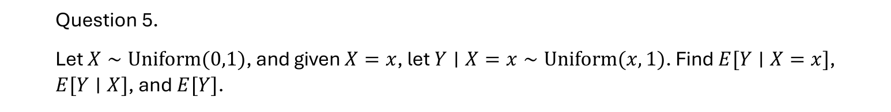

**为什么选（Why）：** 这是 hints 中 “Law of Total Expectation Week 5 p.50” 的直接练习。  
*English: Direct practice for the law of total expectation.*

| 知识点（Chinese） | English | 用法 / 提示 |
|---|---|---|
| 条件期望 | Conditional expectation | 先固定 $X=x$，求 $E[Y\mid X=x]$。 |
| 均匀分布均值 | Mean of uniform | $U(a,b)$ 的均值是区间中点 $(a+b)/2$。 |
| 条件期望是随机变量 | Conditional expectation is a random variable | $E[Y\mid X]$ 是 $X$ 的函数；$E[Y\mid X=x]$ 是数。 |
| 全期望公式 | Law of total expectation | $E[Y]=E[E[Y\mid X]]$。 |
| 期望的线性性 | Linearity of expectation | $E[(1+X)/2]=(1+E[X])/2$。 |

> **易错（Common pitfall）：** 不要把 $E[Y\mid X]$ 写成常数；最后还要对 $X$ 取期望。  
> *English: Do not treat $E[Y\mid X]$ as a constant; take the outer expectation over $X$ at the end.*

---

## W5-Q7. Multivariate conditional density and conditional independence

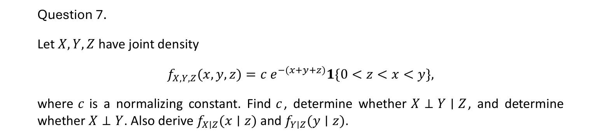

**为什么选（Why）：** 直接训练多元联合密度、support、条件密度和条件独立，正是你的薄弱点。  
*English: Trains multivariate joint density, support, conditional density, and conditional independence.*

| 知识点（Chinese） | English | 用法 / 提示 |
|---|---|---|
| 联合密度归一化 | Normalize a joint density | 用 $\iiint f=1$ 求常数 $c$。 |
| 支撑集 | Support | 本题支撑是 $0<z<x<y$；积分限由它决定。 |
| 边缘密度 | Marginal density | 对不需要的变量积分，例如 $f_Z(z)=\iint f(x,y,z)\,dx\,dy$。 |
| 条件密度 | Conditional density | $f_{X\mid Z}(x\mid z)=f_{X,Z}(x,z)/f_Z(z)$。 |
| 条件独立判定 | Conditional independence check | 检查 $f_{X,Y\mid Z}(x,y\mid z)=f_{X\mid Z}(x\mid z)f_{Y\mid Z}(y\mid z)$。 |
| 支撑集比较 | Compare supports | 即使函数形式像，support 不同也不能因子分解。 |
| 边缘独立 | Marginal independence | 检查 $f_{X,Y}(x,y)=f_X(x)f_Y(y)$。 |

> **易错（Common pitfall）：** 条件独立不仅看密度表达式，还要看 support；support 不一致就不能分解。  
> *English: Conditional independence requires both the density factorization and compatible supports.*

---

## W6-Q1. Entropy, cross-entropy, KL

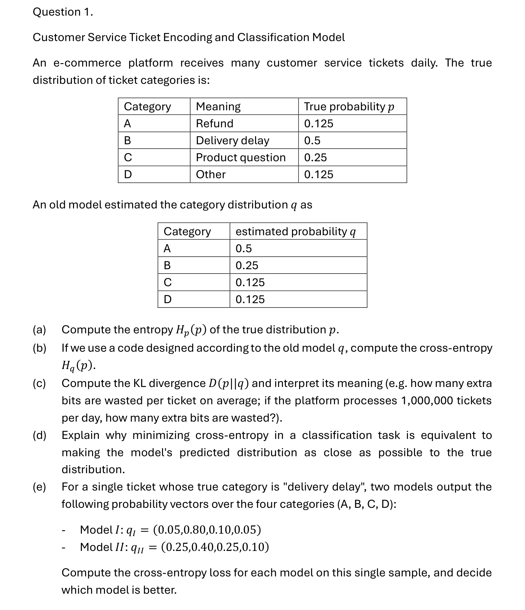

**为什么选（Why）：** 一题串起熵、交叉熵、KL、分类损失和模型比较。  
*English: One question connects entropy, cross-entropy, KL, classification loss, and model comparison.*

| 知识点（Chinese） | English | 用法 / 提示 |
|---|---|---|
| 熵 | Entropy | $H(p)=-\sum_x p(x)\log_2 p(x)$。 |
| 交叉熵 | Cross-entropy | $H(p,q)=-\sum_x p(x)\log_2 q(x)$。 |
| KL 散度 | KL divergence | $D(p\vert\vert q)=H(p,q)-H(p)$。 |
| 比特解释 | Bit interpretation | KL 是“用错模型多付出的平均编码位数”。 |
| 单样本交叉熵 | Single-sample cross-entropy | 真实标签 one-hot 时，$L=-\log q(\text{correct class})$。 |
| 为什么分类用交叉熵 | Why cross-entropy for classification | 最小化 CE ⇔ 最小化 KL（真实熵与模型无关）。 |
| 模型比较 | Model comparison | 正确类概率越高，CE 损失越小。 |

> **易错（Common pitfall）：** KL 不对称；$D(p\vert\vert q)\ne D(q\vert\vert p)$。  
> *English: KL is asymmetric; $D(p\vert\vert q)\ne D(q\vert\vert p)$.*

---

## W6-Q7. Fano inequality

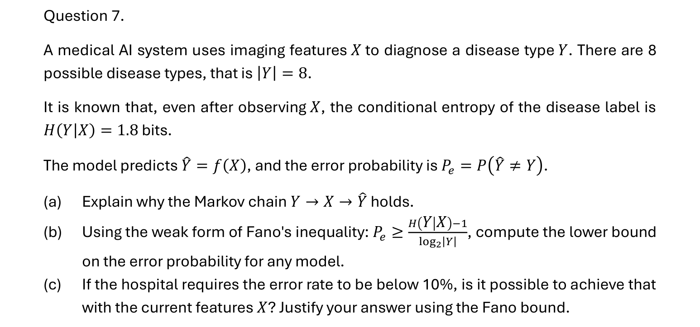

**为什么选（Why）：** hints 明确点名 Fano Inequality Week 6 p.38–43。  
*English: Directly matches the Fano inequality hint.*

| 知识点（Chinese） | English | 用法 / 提示 |
|---|---|---|
| 马尔可夫链 | Markov chain | 预测 $\hat Y=f(X)$，所以 $Y\to X\to\hat Y$。 |
| 条件熵 | Conditional entropy | 题目给 $H(Y\mid X)$。 |
| Fano 弱形式 | Weak Fano inequality | $P_e\ge \frac{H(Y\mid X)-1}{\log_2\vert\mathcal{Y}\vert}$。 |
| 错误率下界 | Error lower bound | 下界与特征信息量 $H(Y\mid X)$ 有关。 |
| 可行性判断 | Feasibility check | 若目标错误率低于下界，则当前特征不可能做到。 |
| 信息瓶颈 | Information bottleneck | 特征不足时，再复杂的模型也无法突破下界。 |

> **易错（Common pitfall）：** 分母是 $\log_2\vert\mathcal{Y}\vert$，不是 $\log_2 N$；$|\mathcal{Y}|$ 是类别数。  
> *English: The denominator is $\log_2\vert\mathcal{Y}\vert$, where $|\mathcal{Y}|$ is the number of classes.*

---

## W7-Q3. Hierarchical Normal model, MLE and posterior

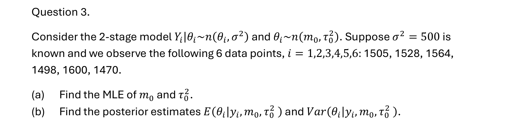

**为什么选（Why）：** 把 Week 7 的 MLE 和 Week 8 的 Normal–Normal 后验连在一起，正好补你的 Week 7 / Week 8 交界。  
*English: Bridges Week 7 MLE and Week 8 Normal–Normal posterior.*

| 知识点（Chinese） | English | 用法 / 提示 |
|---|---|---|
| 分层模型 | Hierarchical model | $Y_i\mid\theta_i\sim N(\theta_i,\sigma^2)$，$\theta_i\sim N(m_0,\tau_0^2)$。 |
| 全期望 / 全方差 | Total expectation / total variance | 求 $Y_i$ 的边际均值和边际方差。 |
| 边际似然 | Marginal likelihood | 把 $\theta_i$ 积分掉，得到 $Y_i$ 的边际分布。 |
| MLE | MLE | 对 $m_0,\tau_0^2$ 最大化边际对数似然。 |
| Normal–Normal 后验 | Normal–Normal posterior | 后验精度 = 先验精度 + 数据精度。 |
| 精度加权平均 | Precision-weighted average | 后验均值是先验均值和观测值的加权平均。 |
| 收缩 | Shrinkage | 后验估计会被拉向先验均值。 |

> **易错（Common pitfall）：** 求 $m_0,\tau_0^2$ 的 MLE 时，要用边际分布 $Y_i$，不是条件分布 $Y_i\mid\theta_i$；同时注意 $\tau_0^2>0$ 的参数约束。  
> *English: For the MLE of $m_0,\tau_0^2$, use the marginal distribution of $Y_i$, not the conditional one; also respect the constraint $\tau_0^2>0$.*

---

## W7-Q5. MSE of variance estimators

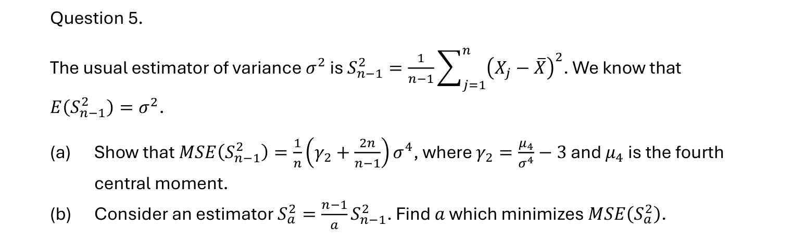

**为什么选（Why）：** 直接练 MSE、偏差-方差分解和估计量优化，是 Week 7 的核心计算。  
*English: Practices MSE, bias-variance decomposition, and estimator optimization.*

| 知识点（Chinese） | English | 用法 / 提示 |
|---|---|---|
| 无偏样本方差 | Unbiased sample variance | $S_{n-1}^2=\frac1{n-1}\sum(X_j-\bar X)^2$，且 $E[S_{n-1}^2]=\sigma^2$。 |
| MSE 分解 | MSE decomposition | $MSE(\hat\theta)=Var(\hat\theta)+[Bias(\hat\theta)]^2$。 |
| 四阶中心矩 | Fourth central moment | $\mu_4=E[(X-\mu)^4]$。 |
| 峰度 | Kurtosis | $\gamma_2=\mu_4/\sigma^4-3$。 |
| 二次型的期望 | Expectation of quadratic forms | 展开 $(\sum Y_i^2)^2$、$(\sum Y_i)^4$ 时用独立性和对称性。 |
| 优化线性缩放 | Optimize a linear scaling | 令 $S_a^2=\frac{n-1}{a}S_{n-1}^2$，对 $a$ 求导并令其为 0。 |
| 偏差-方差权衡 | Bias-variance trade-off | 最优 $a$ 通常不是 $n-1$；用一点偏差换更小方差。 |

> **易错（Common pitfall）：** $MSE$ 不是 $Var$；无偏估计的 MSE 就等于它的方差。  
> *English: MSE is not variance; for an unbiased estimator, MSE equals its variance.*

---

## W8-Q1. Gamma–Poisson conjugacy

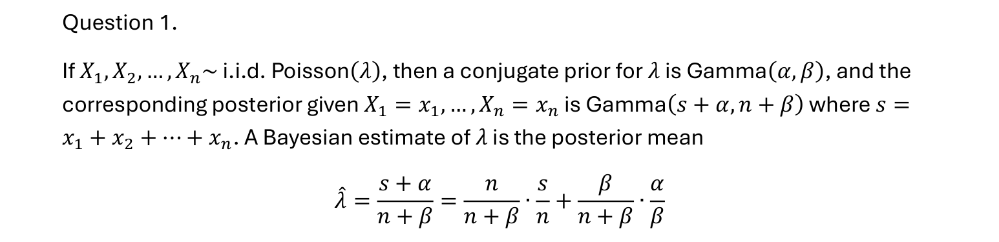

**为什么选（Why）：** hints 明确点名 Conjugate Priors Week 8 p.5–17；这是最标准的共轭练习。  
*English: Directly matches the conjugate-prior hint; a standard Gamma–Poisson exercise.*

| 知识点（Chinese） | English | 用法 / 提示 |
|---|---|---|
| Poisson 似然 | Poisson likelihood | $\prod_i e^{-\lambda}\lambda^{x_i}/x_i!$。 |
| Gamma 先验 | Gamma prior | $p(\lambda)\propto\lambda^{\alpha-1}e^{-\beta\lambda}$。 |
| 共轭更新 | Conjugate update | 后验仍是 Gamma，参数变成 $(\alpha+\sum x_i,\ \beta+n)$。 |
| 后验均值 | Posterior mean | Gamma$(\alpha',\beta')$ 的均值是 $\alpha'/\beta'$。 |
| 贝叶斯估计 | Bayesian estimate | 用后验均值作为 $\lambda$ 的估计。 |
| 收缩 / 加权平均 | Shrinkage / weighted average | 后验均值 = 数据均值与先验均值的加权平均。 |

> **易错（Common pitfall）：** 先验是 Gamma$(\alpha,\beta)$，不是 Gamma$(\alpha,\beta^{-1})$；注意速率/尺度参数化。  
> *English: Check the rate/scale parameterization of the Gamma prior.*

---

## W8-Q11. d-separation

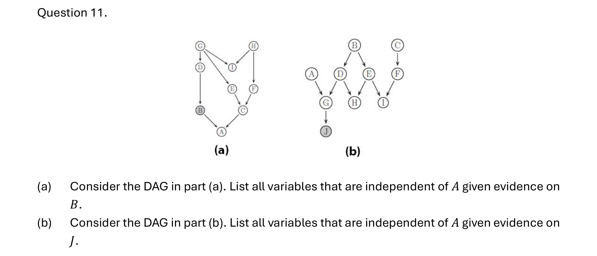

**为什么选（Why）：** 直接训练 d-separation，这是 Week 8 最需要图的薄弱点。  
*English: Direct practice for d-separation, the most graph-intensive Week 8 skill.*

| 知识点（Chinese） | English | 用法 / 提示 |
|---|---|---|
| d-separation | d-separation | 若所有路径都被阻断，则条件独立。 |
| 路径与三元组 | Paths and triples | 把无向路径拆成重叠的三元组 $A-B-C$。 |
| Chain / Fork | Chain / fork | 观测中间节点会阻断路径。 |
| Collider | Collider | 观测中间节点或其后代会打开路径。 |
| 证据节点 | Evidence nodes | 先把观测节点涂黑，再判断每条路径。 |
| 活跃 / 阻断 | Active / blocked | 一条路径 active ⇔ 每个 triple 都 active。 |
| 条件独立结论 | Conditional independence conclusion | 所有路径 blocked ⇒ d-separated ⇒ 条件独立。 |

> **易错（Common pitfall）：** 看到 collider 不要条件反射说“阻断”；观测 collider 反而打开路径。  
> *English: Do not automatically treat a collider as blocking; conditioning on a collider opens the path.*

---

# 3. Assignment 与课件知识点映射（Mapping）

| Assignment 题（Question） | 主要对应课件（Lecture） | 还需要补的（Remedial） |
|---|---|---|
| Q1 | Week 5：联合 / 边缘 / 条件、独立性 | 几何级数、离散变换 |
| Q2 | Week 5：条件分布、全概率；Week 8：共轭 | Poisson 可加性、Gamma–Poisson |
| Q3 | Week 6：互信息；Week 5：多元正态 | 高斯熵、行列式 |
| Q4 | Week 5：期望 | 次序统计量、生存函数 |
| Q5 | Week 6：KL；Week 7：MLE | 经验分布、Dirac delta |
| Q6 | Week 7：MLE、模型选择 | CV、BIC、饱和模型 |
| Q7 | Week 8：贝叶斯网络、CPT | 条件概率、MLE 计数 |
| Q8 | Week 8：贝叶斯网络分类 | 矩阵方向、边缘化 |

---

# 4. 做作业前的检查清单（Before-you-start checklist）

- [ ] 我能区分 **联合 / 边缘 / 条件**（joint / marginal / conditional）。
- [ ] 我会写 **全期望 / 全方差**（law of total expectation / variance）。
- [ ] 我会求 **连续联合密度的 support 和归一化常数**（support and normalizing constant）。
- [ ] 我会判断 **条件独立**（conditional independence），并知道 support 也要匹配。
- [ ] 我会算 **熵 / 交叉熵 / KL**（entropy / cross-entropy / KL）。
- [ ] 我会背 **Fano 弱形式**（weak Fano inequality）。
- [ ] 我会写 **似然 / 对数似然 / MLE**（likelihood / log-likelihood / MLE）。
- [ ] 我会做 **MSE = Var + Bias²**（bias-variance decomposition）。
- [ ] 我会 **共轭先验更新**（conjugate prior update）：Beta–Bernoulli、Gamma–Poisson、Normal–Normal。
- [ ] 我会写 **DAG 因子分解**（DAG factorization）和 **CPT 的 MLE**。
- [ ] 我会用 **d-separation** 判断条件独立（chain / fork / collider）。

> **最后提醒（Final reminder）：**  
> 这份文件只给“要用什么知识点”，不给答案。  
> *English: This guide lists the required knowledge points only; it does not provide solutions.*
